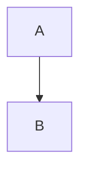
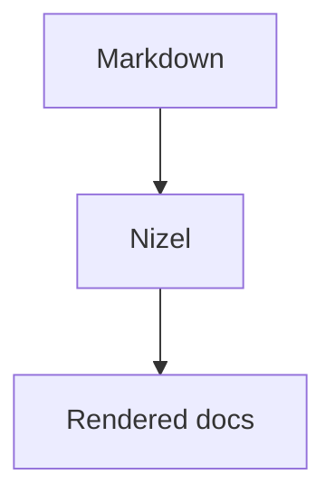

# API

## `useNizel(options?)`

Creates a Nizel processor.

```ts
import { useNizel } from 'nizel';

const nizel = useNizel({
  output: 'html',
  frontmatter: true,
  toc: true,
  anchors: true,
});
```

## `nizel(markdown, runtimeOptions?)`

Processes Markdown and returns a full `NizelResult` object.

```ts
const { result, html, meta, toc } = await nizel(markdown);
```

Runtime options are merged on top of the processor options for that call only.

```ts
await nizel(markdown, {
  data: {
    title: 'Runtime title',
  },
});
```

## Helper methods

Nizel should expose common output helpers for simpler usage.

```ts
await nizel.html(markdown);
await nizel.text(markdown);
await nizel.ast(markdown);
await nizel.meta(markdown);
```

These helpers should use the same configured processor, plugins, filters, blocks, elements, and safety rules.

## `htmlToMarkdown(html, options?)`

Converts semantic HTML into Markdown.

```ts
import { htmlToMarkdown } from 'nizel';

const markdown = htmlToMarkdown('<h1>Intro</h1><p>Hello <strong>world</strong>.</p>');
```

### Options

| Option | Type | Default | Description |
|---|---|---|---|
| `unsupported` | `'preserve' \| 'drop'` | `'preserve'` | Preserve HTML that Markdown cannot represent, or drop unsupported markup and keep readable text where possible. |

See [HTML to Markdown](./html-to-markdown.md) for conversion rules and unsupported HTML policy.

## Browser API

Browser-specific helpers are available from `nizel/browser`.

```ts
import {
  htmlToMarkdown,
  markdownToHtml,
  mountMarkdown,
  selectionToMarkdown,
  useBrowserNizel,
} from 'nizel/browser';

const html = await markdownToHtml('# Preview');
const markdown = htmlToMarkdown(document.querySelector('article')!);
const selected = selectionToMarkdown();

await mountMarkdown('#preview', '# Preview');

const nizel = useBrowserNizel();
await nizel.mount('#preview', '# Preview');
```

The browser entry also exports the core API (`useNizel`, `defineNizelPlugin`, `defineBlock`, and types), so it can be used as the single Nizel entry in browser bundles.

For embedded webviews such as `WKWebView`, the package build emits explicit browser artifacts:

```txt
dist/browser/nizel.js       ESM bundle
dist/browser/nizel.iife.js  IIFE bundle exposing globalThis.Nizel
```

Use `dist/browser/nizel.iife.js` when loading scripts directly into a webview, then call `Nizel.markdownToHtml()`, `Nizel.htmlToMarkdown()`, or `Nizel.useBrowserNizel()` from the preview bridge.

## Options

```ts
type NizelOptions<TMeta = Record<string, unknown>> = {
  output?: 'html' | 'text' | 'ast';

  frontmatter?: boolean | NizelFrontmatterOptions;
  template?: boolean | NizelTemplateOptions;
  toc?: boolean | NizelTocOptions;
  anchors?: boolean | NizelAnchorOptions;
  safe?: boolean | NizelSafetyOptions;
  unwrapStandaloneImages?: boolean;

  elements?: NizelElementRules;
  blocks?: NizelBlockMap;
  inline?: NizelInlineMap;
  transforms?: NizelTransform[];
  plugins?: NizelPlugin[];

  data?: Record<string, unknown>;
};
```

## Merge order

Configuration should be merged in this order:

```txt
defaults
→ preset options
→ plugin options, in order
→ useNizel options
→ runtime options
```

Later layers override earlier layers.

## Default behavior

The default processor should be useful without configuration.

```ts
const nizel = useNizel();
```

Default behavior should include:

- Markdown to HTML
- frontmatter extraction
- safe output
- variable interpolation enabled
- built-in filters from `@sil/format` and `@sil/case`
- heading collection
- TOC generation
- link and image extraction
- plain text extraction
- reading time
# Application Rendering Roadmap

Nizel's renderer roadmap keeps the core focused on application-ready content while adding framework-native and streaming presentation.

## Shipped Foundation

- `NizelDocument`: versioned, JSON-safe AST and metadata envelope
- `serializeNizelDocument()` and `deserializeNizelDocument()`
- `renderMarkdown()` and `nizel.markdown()` for AST/document serialization
- `completeStreamingMarkdown()` for incomplete frontmatter, code fences, custom blocks, links, code spans, strong text, and deleted text
- `visitNizel()` as the shared depth-first traversal primitive for renderers and analysis

The document schema is deliberately separate from `NizelResult`. Derived values such as HTML and reading time are recomputed rather than duplicated in network payloads.

## Phase 2: Renderer Contract

Define a small renderer package that maps every core node type to a host callback. Requirements:

- Render an AST or `NizelDocument` without the parser
- Map standard node types and named custom blocks
- Preserve typed node and parent context
- Support synchronous host renderers; isolate asynchronous plugin preparation before rendering
- Test one shared conformance fixture against HTML and framework renderers

## Phase 3: React and Vue

Create `@nizel/react` and `@nizel/vue` on the shared renderer contract.

- `Markdown`: parse and render source
- `NizelDocument`: render a pre-parsed document without bundling the parser
- Component maps for standard nodes and custom blocks
- Streaming and caret props
- Server rendering support
- Package-specific tree-shaking and bundle-size tests

React and Vue come first because they validate two different rendering models. Svelte, Angular, and other adapters should follow only after the contract is stable.

## Phase 4: Streaming

The shipped completion helper provides stable frames while reparsing accumulated source. Follow-up work:

- Add fixtures for chunk boundaries across every CommonMark delimiter
- Expose a provisional-document marker and caret insertion helper
- Benchmark accumulated-source parsing for realistic AI responses
- Investigate incremental block reuse only if profiles show reparsing is a practical bottleneck

## Phase 5: Playground

Build an interactive documentation route with:

- Markdown input and streamed-input simulation
- HTML preview
- Result, AST, metadata, links, images, and TOC inspectors
- Plugin toggles sourced from the official registry
- Safe-mode comparison
- Markdown and portable-document output
- Shareable examples encoded in the URL

## Compatibility Rules

- Never change a published document version in place.
- Additive AST fields do not require a new document version.
- Renamed or structurally changed nodes require a migration and a new version.
- Framework packages accept the document versions explicitly listed in their peer compatibility range.
- Core remains safe by default; framework component mappings do not implicitly enable raw HTML.
# AST Specification

Nizel uses a normalized AST as the central content model.

The AST is the contract between parsing, transforms, plugins, elements, blocks, renderers, and result extraction.

## Design goals

- predictable node shapes
- easy plugin authoring
- safe rendering
- framework-agnostic output
- no string-based post-processing
- clean transformation pipeline

## Base node

Every node should have a `type`.

```ts
type NizelNode =
  | NizelRootNode
  | NizelTextNode
  | NizelParagraphNode
  | NizelHeadingNode
  | NizelEmphasisNode
  | NizelStrongNode
  | NizelDeleteNode
  | NizelInlineCodeNode
  | NizelCodeNode
  | NizelLinkNode
  | NizelImageNode
  | NizelListNode
  | NizelListItemNode
  | NizelBlockquoteNode
  | NizelThematicBreakNode
  | NizelTableNode
  | NizelTableRowNode
  | NizelTableCellNode
  | NizelHtmlNode
  | NizelComponentNode
  | NizelCustomBlockNode;
```

## Root

```ts
type NizelRootNode = {
  type: 'root';
  children: NizelNode[];
};
```

## Text

```ts
type NizelTextNode = {
  type: 'text';
  value: string;
};
```

## Paragraph

```ts
type NizelParagraphNode = {
  type: 'paragraph';
  children: NizelInlineNode[];
};
```

## Heading

```ts
type NizelHeadingNode = {
  type: 'heading';
  depth: 1 | 2 | 3 | 4 | 5 | 6;
  id?: string;
  text: string;
  children: NizelInlineNode[];
};
```

Headings should generate stable `id` values when anchors are enabled.

## Emphasis

```ts
type NizelEmphasisNode = {
  type: 'emphasis';
  children: NizelInlineNode[];
};
```

## Strong

```ts
type NizelStrongNode = {
  type: 'strong';
  children: NizelInlineNode[];
};
```

## Delete

```ts
type NizelDeleteNode = {
  type: 'delete';
  children: NizelInlineNode[];
};
```

## Inline code

```ts
type NizelInlineCodeNode = {
  type: 'inlineCode';
  code: string;
};
```

Inline code should not be syntax-highlighted by default.

## Code block

```ts
type NizelCodeNode = {
  type: 'code';
  code: string;
  lang?: string;
  meta?: string;
  filename?: string;
  highlightLines?: number[];
};
```

Code copy buttons and syntax highlighting are plugin-owned.

## Link

```ts
type NizelLinkNode = {
  type: 'link';
  href: string;
  title?: string;
  external?: boolean;
  children: NizelInlineNode[];
};
```

Autolinks should create normal link nodes.

## Image

```ts
type NizelImageNode = {
  type: 'image';
  src: string;
  alt?: string;
  title?: string;
};
```

## List

```ts
type NizelListNode = {
  type: 'list';
  ordered: boolean;
  start?: number;
  spread?: boolean;
  children: NizelListItemNode[];
};
```

## List item

```ts
type NizelListItemNode = {
  type: 'listItem';
  checked?: boolean;
  spread?: boolean;
  children: NizelBlockNode[];
};
```

`checked` supports task lists.

## Blockquote

```ts
type NizelBlockquoteNode = {
  type: 'blockquote';
  children: NizelBlockNode[];
};
```

## Thematic break

```ts
type NizelThematicBreakNode = {
  type: 'thematicBreak';
};
```

## Table

```ts
type NizelTableNode = {
  type: 'table';
  align?: Array<'left' | 'center' | 'right' | null>;
  children: NizelTableRowNode[];
};
```

## Table row

```ts
type NizelTableRowNode = {
  type: 'tableRow';
  children: NizelTableCellNode[];
};
```

## Table cell

```ts
type NizelTableCellNode = {
  type: 'tableCell';
  children: NizelInlineNode[];
};
```

## Raw HTML

```ts
type NizelHtmlNode = {
  type: 'html';
  value: string;
};
```

Raw HTML should be disabled by default when `safe` mode is enabled.

## Component

```ts
type NizelComponentNode = {
  type: 'component';
  name: string;
  props?: Record<string, unknown>;
  children?: NizelNode[];
};
```

Component nodes are useful for framework renderers such as Vue, React, or Nuxt.

## Custom block

```ts
type NizelCustomBlockNode = {
  type: 'block';
  name: string;
  props?: Record<string, unknown>;
  children?: NizelNode[];
  value?: string;
};
```

Custom blocks are produced by block definitions.

## Inline nodes

```ts
type NizelInlineNode =
  | NizelTextNode
  | NizelEmphasisNode
  | NizelStrongNode
  | NizelDeleteNode
  | NizelInlineCodeNode
  | NizelLinkNode
  | NizelImageNode
  | NizelHtmlNode
  | NizelComponentNode;
```

## Block nodes

```ts
type NizelBlockNode =
  | NizelParagraphNode
  | NizelHeadingNode
  | NizelCodeNode
  | NizelListNode
  | NizelBlockquoteNode
  | NizelThematicBreakNode
  | NizelTableNode
  | NizelHtmlNode
  | NizelComponentNode
  | NizelCustomBlockNode;
```

## Normalization rules

Nizel should normalize parser output into this AST.

Rules:

- headings include extracted plain text
- heading IDs are generated when anchors are enabled
- autolinks become normal `link` nodes
- code fence language becomes `lang`
- code fence metadata becomes `meta`
- filenames and highlighted lines are parsed when possible
- frontmatter is not part of the AST; it belongs in `meta`
- raw HTML is represented as `html` nodes but can be stripped or escaped in safe mode

## Plugin rules

Plugins should modify AST nodes, not rendered strings, unless they are renderer-specific plugins.

Plugins may:

- add nodes
- replace nodes
- decorate nodes
- add props
- provide renderers for custom nodes

Plugins should not mutate shared global state.

## Renderer rules

Renderers consume the normalized AST.

Renderers should not parse Markdown, frontmatter, or template syntax.

Renderers may output:

- HTML
- text
- AST
- framework component trees
- email-safe HTML
# Automatic Links

Nizel should automatically convert URLs into links.

## Default behavior

This feature should be enabled by default.

```md
Visit https://example.com
```

Output:

```html
<p>Visit <a href="https://example.com">https://example.com</a></p>
```

## Rules

- Only valid URLs should be converted
- Do not affect code blocks
- Do not affect inline code
- Do not affect already existing links

## Email support

```md
Contact me@example.com
```

Should become:

```html
<a href="mailto:me@example.com">me@example.com</a>
```

## Customization

```ts
const nizel = useNizel({
  autolinks: {
    enabled: true,
    target: '_blank',
    rel: 'noopener noreferrer'
  }
});
```

## Plugin override

Autolink behavior can be replaced by a plugin if needed.

## Purpose

This removes the need for authors to manually write Markdown links for every URL.
# Blocks

Blocks define structured content.

## Syntax

```md
::alert warning
This is a warning
::
```

## Definition

```ts
defineBlock({
  name: 'alert',

  parse({ args, content }) {
    return {
      kind: args[0],
      content
    };
  },

  formats: {
    html(node, ctx) {
      return `<div class="alert alert--${node.kind}">
        ${ctx.render(node.content)}
      </div>`;
    }
  }
});
```

## Props

```md
::card
title: Hello
image: /img.jpg
::

Content

::
```

## Purpose

Blocks allow structured, reusable content instead of abusing raw HTML.
# CI and Publishing

Nizel should use GitHub Actions for validation and npm publishing.

The repository is planned as a monorepo, so CI and publishing must work for all packages.

## Goals

- Validate every pull request.
- Build and test all packages.
- Publish changed packages to npm.
- Support core and first-party plugins from the same repository.
- Avoid accidental publishing.
- Keep package release flow simple enough for Codex to maintain.
- Use npm Trusted Publishing instead of long-lived npm tokens.

## Recommended stack

- npm workspaces
- TypeScript
- GitHub Actions
- npm Trusted Publishing
- npm provenance

## npm authentication

Do not use `NPM_TOKEN`.

Nizel packages should use npm Trusted Publishing through GitHub Actions OIDC.

Each npm package must be configured on npmjs.com with this GitHub repository and the release workflow as its trusted publisher.

Do not configure `actions/setup-node` with `registry-url` for the publish job. That path writes npm token-oriented auth config for `NODE_AUTH_TOKEN`, which conflicts with Trusted Publishing and can produce `E401 token is invalid` even when provenance signing succeeds.

Required GitHub Actions permissions:

```yaml
permissions:
  contents: write
  id-token: write
```

`id-token: write` allows npm to verify that the package is being published from the trusted GitHub workflow.

## Workflows

### CI

Runs on pull requests and pushes to `main`.

Checks:

- install dependencies
- typecheck
- lint
- test
- build

### Publish

Runs on pushes to `main`.

The publish workflow only releases packages that actually changed. Each publish is recorded with a per-package git tag (`<package-name>@<version>`), which the next run uses as its change baseline.

1. `scripts/version-workspaces-for-publish.mjs` builds the publish plan:
   - For each package, it finds the most recent `<name>@<version>` git tag.
   - It diffs the package directory against that tag. `dist/`, `*.tsbuildinfo`, and `node_modules/` are gitignored, so the diff reflects real source changes only.
   - A package is scheduled to publish if its own files changed, or if a workspace dependency it declares in `dependencies`, `peerDependencies`, or `optionalDependencies` is publishing this run (transitive).
   - Packages that changed are bumped to the next unpublished patch (or keep an already-unpublished repo version). Packages with no changes are left untouched.
   - The plan is written to `.publish-plan`; packages not in the plan are skipped by the publish step.
2. Release notes are generated from the versioned tree.
3. CI builds and tests the versioned tree.
4. Each package is published with `scripts/publish-workspace-if-new.mjs`, which only publishes the versions listed in the plan and skips everything else.
5. After every publish step succeeds, the workflow commits the version files and release notes.
6. `scripts/create-publish-tags.mjs` creates and pushes the `<name>@<version>` tags at that commit. Tagging happens after the version commit so the tag points at a tree whose `package.json` already matches the tagged version.

The workflow does not rely on manual version edits before merging to `main`.
If any publish step fails, the generated version files and release notes are not committed. Publish runs triggered by the workflow's own version/release-note commit are skipped so the version commit does not start another release loop.

### Bootstrap tags

Packages first published manually (for example to enable Trusted Publishing) have no baseline tag. On the first CI run after that, `publish-workspace-if-new.mjs` detects the published version without a tag and records a baseline tag without republishing. From then on the package only republishes when it changes.

### Change detection

A package republishes when:

- files under its own package directory changed since its last publish tag, or
- a workspace dependency is publishing in the same run.

Because every plugin depends on `nizel`, a change to core cascades to all plugins and to `nizel-kit`. Editing a single plugin republishes only that plugin (plus `nizel-plugin-gfm` and `nizel-kit` if they consume it).

## Package release model

Every package should have its own `package.json`.

```txt
packages/
  nizel/
    package.json
  plugin-shiki/
    package.json
  plugin-code-copy/
    package.json
  plugin-autolink/
    package.json
```

Each package is versioned independently by `scripts/version-workspaces-for-publish.mjs`, but only when it (or a workspace dependency) has changed since its last publish tag.

## Package names

Planned packages:

```txt
nizel
nizel-plugin-shiki
nizel-plugin-code-copy
nizel-plugin-autolink
nizel-plugin-docs
nizel-plugin-blog
nizel-plugin-email
```

## Version command

```bash
node scripts/version-workspaces-for-publish.mjs
```

Use `--dry-run` to inspect the next versions without writing files:

```bash
node scripts/version-workspaces-for-publish.mjs --dry-run
```

## Publish command

```bash
node scripts/publish-workspace-if-new.mjs nizel
```

The publish command should rely on npm Trusted Publishing and should not require an npm token. Versioning and the publish plan happen before publish; the publish helper only publishes versions listed in `.publish-plan`, records the resulting `<name>@<version>` tag in `.tag-plan`, and skips everything else. When there is no plan (local bootstrap), it falls back to publishing any unpublished version.

## First publish for new packages

New npm package names must exist before Trusted Publishing can be configured for them on npmjs.com.

For that one-time bootstrap, publish locally with normal npm authentication and without provenance:

```bash
NPM_PROVENANCE=false node scripts/publish-workspace-if-new.mjs nizel-plugin-example
```

After the package exists, configure npm Trusted Publishing for the package with this repository and `.github/workflows/publish.yml`. CI publishes should then use OIDC and provenance.

## Safety

Publishing should only happen from `main`.

Pull requests should never publish.

Packages should include:

```json
{
  "publishConfig": {
    "access": "public",
    "provenance": true
  }
}
```

## Provenance

GitHub Actions should publish with npm provenance.

This improves trust in the published packages and aligns with Trusted Publishing.
# Code Blocks

Code blocks are a core node type in Nizel.

Syntax highlighting and copy buttons should be implemented through first-party plugins. The code-block data model belongs in core.

## AST shape

```ts
type NizelCodeNode = {
  type: 'code';
  code: string;
  lang?: string;
  meta?: string;
  filename?: string;
  highlightLines?: number[];
};
```

## Markdown input

````md
```ts filename="example.ts" {1,3-5}
const message = 'Hello';
console.log(message);
```
````

Should produce something like:

```ts
{
  type: 'code',
  lang: 'ts',
  filename: 'example.ts',
  highlightLines: [1, 3, 4, 5],
  code: "const message = 'Hello';\nconsole.log(message);"
}
```

## Copy support

Copy buttons are plugin-owned.

Core should not render copy-button HTML automatically and should never inject inline JavaScript.

A plugin can add copy markup, inline handlers, runtime helpers, framework components, or metadata.

```ts
import { codeCopyPlugin } from 'nizel-plugin-code-copy';

const nizel = useNizel({
  plugins: [codeCopyPlugin()]
});
```

The plugin may transform the code node or renderer output, but core remains clean and safe.

## Highlighting mode

Syntax highlighting is plugin-owned.

The Shiki plugin should highlight code blocks by default, while inline code should remain unhighlighted unless explicitly configured.

```ts
import { shikiPlugin } from 'nizel-plugin-shiki';

const nizel = useNizel({
  plugins: [
    shikiPlugin({
      theme: 'github-dark',
      highlighter(code, meta) {
        return highlight(code, meta);
      },
      mode: 'blocks' // 'blocks' | 'inline'
    })
  ]
});
```

## Inline code

Inline code should not be highlighted by default.

```md
Use `const value = true` here.
```

It should render as normal inline code unless a highlighting plugin is configured to handle inline code.

## Worker compatibility

The first-party highlighting plugin should prefer Shiki, but it must be usable in Worker-style runtimes.

The plugin should avoid Node-only APIs and should support async initialization.

Use `nizel-plugin-shiki/javascript` when the bundle must avoid Shiki's Oniguruma WASM engine:

```ts
import { shikiPlugin } from 'nizel-plugin-shiki';
import { createJavaScriptShikiHighlighter } from 'nizel-plugin-shiki/javascript';

const highlighter = await createJavaScriptShikiHighlighter({
  themes: ['github-dark'],
  langs: ['javascript', 'typescript'],
  defaultTheme: 'github-dark',
  defaultLang: 'text',
});

const nizel = useNizel({
  plugins: [shikiPlugin({ highlighter })],
});
```

## Fallback

If Shiki is not loaded, code blocks must still render safely.

```html
<pre><code class="language-ts">const value = true;</code></pre>
```

## Responsibility split

Core owns:

- code AST node shape
- language metadata
- filename metadata
- line-highlight metadata
- safe fallback rendering

Plugin owns:

- syntax highlighting
- theme loading
- language loading
- highlighted HTML/token output
- copy button markup
- copy runtime behavior
- framework-specific copy components
# Code Highlighting

Syntax highlighting should be implemented as a plugin.

## Why a plugin

- Highlighting libraries are large (e.g. Shiki)
- Not all users need it
- Allows multiple implementations
- Keeps core lightweight

## Default behavior (core)

Without a plugin, code blocks should render safely:

```html
<pre><code>const x = 1;</code></pre>
```

No highlighting, no extra markup.

## Plugin example

```ts
import { codeHighlightPlugin } from 'nizel-plugin-code-highlight';

const nizel = useNizel({
  plugins: [codeHighlightPlugin()]
});
```

## Plugin responsibilities

The plugin should:

- detect language from code fences
- highlight code
- return HTML or structured output

## Example implementation

```ts
defineNizelPlugin({
  name: 'code-highlight',

  blocks: {
    code: {
      formats: {
        html(node) {
          return highlight(node.code, node.lang);
        }
      }
    }
  }
});
```

## Optional features

Plugins may add:

- line highlighting
- copy button metadata
- filename support
- language labels

## Integration with result

Highlighted code should still be part of the AST.

Nizel should not lose structural information.
# Elements

Elements control how HTML is generated.

## Classes

```ts
elements: {
  h1: { class: 'heading-xl' },
  p: { class: 'text' }
}
```

## Attributes

```ts
a: {
  attrs: {
    target: '_blank',
    rel: 'noopener noreferrer'
  }
}
```

## Dynamic rules

```ts
a(node) {
  const external = node.href?.startsWith('http');

  return {
    class: external ? 'link-external' : 'link'
  };
}
```

## Replace elements

```ts
h1: {
  replace(node, ctx) {
    return `<MyHeading>${ctx.render(node.children)}</MyHeading>`;
  }
}
```

## Structured replace

```ts
h1: {
  replace(node) {
    return {
      type: 'component',
      name: 'Heading',
      props: { level: 1 },
      children: node.children
    };
  }
}
```

## Purpose

Elements provide a safe and predictable way to integrate Markdown output into a design system.

They avoid:

- string post-processing
- fragile regex hacks
- renderer overrides
# Filters

Filters transform template values before Markdown parsing.

```md
# {{ title | title }}
{{ slug | kebab }}
{{ amount | format('currency', 'EUR') }}
```

## Built-In Filters

Nizel includes these filters by default:

- `lower`
- `upper`
- `title`
- `kebab`
- `camel`
- `pascal`
- `snake`
- `constant`
- `format`

Casing filters use `@sil/case`.

## Custom Filters

```ts
const nizel = useNizel({
  template: {
    filters: {
      shout(value) {
        return String(value).toUpperCase();
      },
    },
  },
});
```

Filters can also be provided by plugins.

# Frontmatter

Nizel extracts a leading frontmatter block before template rendering and Markdown parsing.

```md
---
title: Hello
description: A page
draft: false
count: 3
---

# {{ meta.title }}
```

Frontmatter values are exposed through:

- `result.meta`
- `result.frontmatter`
- `{{ meta.* }}`
- `{{ frontmatter.* }}`

Supported values are flat scalar values:

- strings
- numbers
- booleans
- `null`

Disable frontmatter:

```ts
const nizel = useNizel({ frontmatter: false });
```

# Getting Started

## Install

```bash
npm install nizel
```

## Basic usage

```ts
import { useNizel } from 'nizel';

const nizel = useNizel();

const { html } = await nizel('# Hello');
```

## With options

```ts
const nizel = useNizel({
  output: 'html',
  frontmatter: true,
  toc: true,
  anchors: true
});
```

## With variables

```ts
await nizel('# {{ title }}', {
  data: { title: 'Hello Nizel' }
});
```}}# HTML to Markdown

Nizel exposes `htmlToMarkdown(html, options)` for importing semantic HTML into Markdown.

```ts
import { htmlToMarkdown } from 'nizel';

const markdown = htmlToMarkdown('<h1>Intro</h1><p>Hello <strong>world</strong>.</p>');
```

In browser code, import from `nizel/browser` when the source is already a DOM node, range, selection, or node list:

```ts
import { htmlToMarkdown, selectionToMarkdown } from 'nizel/browser';

const article = document.querySelector('article');
const markdown = article ? htmlToMarkdown(article) : '';
const selectedMarkdown = selectionToMarkdown();
```

The browser helper serializes DOM sources before handing them to the same conversion policy documented below.

## API

```ts
htmlToMarkdown(html: string, options?: NizelHtmlToMarkdownOptions): string
```

The `nizel/browser` overload also accepts browser sources:

```ts
htmlToMarkdown(source: string | Node | Range | Selection | ArrayLike<Node>, options?: NizelHtmlToMarkdownOptions): string
```

| Option | Type | Default | Description |
|---|---|---|---|
| `unsupported` | `'preserve' \| 'drop'` | `'preserve'` | Controls how HTML that Markdown cannot represent is handled. |

### `unsupported: 'preserve'`

This is the default. Nizel converts safe semantic equivalents and keeps unsupported or attribute-sensitive HTML as raw HTML.

Use this for migration tools, CMS imports, editor paste handling, and any workflow where losing attributes or custom structure would be worse than keeping raw HTML.

```ts
htmlToMarkdown('<p class="lead">Intro</p>');
// <p class="lead">Intro</p>
```

### `unsupported: 'drop'`

This mode emits more portable Markdown by removing unsupported tags and unsupported attributes. It keeps readable child text where possible.

Use this for plain Markdown targets where raw HTML is undesirable and lossy conversion is acceptable.

```ts
htmlToMarkdown('<p class="lead">Intro</p>', { unsupported: 'drop' });
// Intro
```

## Conversion Rules

Nizel converts these semantic HTML structures:

| HTML | Markdown output |
|---|---|
| `h1` through `h6` | ATX headings |
| `p` | paragraphs |
| `strong`, `b` | `**strong**` |
| `em`, `i` | `*emphasis*` |
| `del`, `s`, `strike` | `~~delete~~` |
| `code` | inline code |
| `pre`, `pre > code` | fenced code blocks |
| `a[href]` | links |
| `img[src]` | images |
| `blockquote` | blockquotes |
| `ul`, `ol`, `li` | lists |
| `hr` | thematic breaks |
| simple `table` markup | GFM tables |
| `div`, `main`, `section`, `article`, `header`, `footer`, `nav` without attributes | unwrapped block containers |
| `span` without attributes | unwrapped inline container |
| `br` | hard line breaks |

## Attribute Policy

Markdown cannot carry arbitrary HTML attributes. In default `preserve` mode, Nizel preserves an element as raw HTML when converting it would drop attributes.

Supported attributes that can be converted:

| Element | Supported attributes |
|---|---|
| `a` | `href`, `title` |
| `img` | `src`, `alt`, `title` |
| `ol` | `start` |
| `pre`, `code` | `class`, when it contains `language-*` |

Any other attribute marks the element as attribute-sensitive in `preserve` mode.

```ts
htmlToMarkdown('<a href="/docs" target="_blank">Docs</a>');
// <a href="/docs" target="_blank">Docs</a>
```

In `drop` mode, unsupported attributes are discarded and the element is converted when possible.

```ts
htmlToMarkdown('<a href="/docs" target="_blank">Docs</a>', { unsupported: 'drop' });
// [Docs](/docs)
```

## Tables

Only simple rectangular tables map cleanly to GFM table syntax. Nizel converts simple `table`, `thead`, `tbody`, `tfoot`, `tr`, `th`, and `td` structures.

Tables with cell attributes such as `colspan`, `rowspan`, or custom alignment are preserved as raw HTML in default mode because GFM tables cannot represent that structure.

```ts
htmlToMarkdown('<table><tr><th colspan="2">Name</th></tr></table>');
// <table><tr><th colspan="2">Name</th></tr></table>
```

In `drop` mode, Nizel emits the best simple table it can, even when table structure is lossy.

## Code

Inline code uses enough backticks to avoid conflicting with the code content. Fenced code blocks also grow their fence when the code contains triple backticks.

```ts
htmlToMarkdown('<pre><code>```nested```</code></pre>');
// ````
// ```nested```
// ````
```

For code blocks, `language-*` is read from `code.class` first and then from `pre.class`.

## Entities and Whitespace

Nizel decodes common named entities and numeric entities before emitting Markdown. HTML text whitespace is collapsed to the Markdown shape that most closely matches browser text rendering.

Block output is normalized to a stable form:

- no leading or trailing blank lines
- at most one blank line between blocks
- no trailing whitespace before newlines

## Parser Tolerance

The converter is intentionally dependency-free and tolerant rather than a full browser DOM implementation. It recognizes normal HTML tags, comments, declarations, processing instructions, and CDATA tokens.

Malformed or unmatched HTML is handled conservatively:

- unclosed unsupported elements are preserved as raw HTML in `preserve` mode
- unmatched closing tags are kept as text
- declarations, processing instructions, and CDATA are kept as source text

## Unsupported HTML

Markdown has no native representation for many HTML features:

- arbitrary attributes on otherwise semantic elements
- classes and ids on spans or divs
- custom elements
- forms and controls
- embedded media
- scripts and styles
- disclosure widgets and other interactive structures
- table cell spans and alignment beyond basic GFM tables

The default `preserve` mode keeps those constructs as raw HTML. The `drop` mode is intentionally lossy and best suited for plain-text publishing targets.
# Implementation Plan

This document defines the recommended build order for Nizel.

The goal is to make the first implementation small, working, typed, and extensible.

## Phase 0: Monorepo setup

Create the base workspace.

```txt
packages/
  nizel/
    src/
      index.ts
      use-nizel.ts
      types.ts
      defaults.ts
      pipeline.ts
      template/
      frontmatter/
      parse/
      normalize/
      render/
      collect/
      plugins/
    package.json

  plugin-shiki/
    src/index.ts
    package.json

  plugin-code-copy/
    src/index.ts
    package.json

  plugin-autolink/
    src/index.ts
    package.json
```

Root files:

```txt
package.json
package-lock.json
tsconfig.json
tsconfig.base.json
.changeset/config.json
.github/workflows/ci.yml
.github/workflows/release.yml
```

## Phase 1: Core package skeleton

Implement `packages/nizel`.

Required exports:

```ts
export { useNizel } from './use-nizel';
export { defineNizelPlugin } from './plugins/define-nizel-plugin';
export { defineBlock } from './blocks/define-block';
export type * from './types';
```

Initial API:

```ts
const nizel = useNizel();

const data = await nizel('# Hello');
```

Helper methods:

```ts
await nizel.html(markdown);
await nizel.text(markdown);
await nizel.ast(markdown);
await nizel.meta(markdown);
```

## Phase 2: Result model and types

Implement the documented `NizelResult` and AST node types.

The result object must include:

- `result`
- `html`
- `text`
- `ast`
- `meta`
- `frontmatter`
- `title`
- `description`
- `excerpt`
- `toc`
- `headings`
- `links`
- `images`
- `readingTime`

## Phase 3: Frontmatter

Implement frontmatter extraction before template rendering.

Supported format:

```md
---
title: Hello
---

# Hello
```

Rules:

- Frontmatter keys go to `meta` and `frontmatter`.
- Frontmatter is not part of the AST.
- `meta` and `frontmatter` can initially reference the same object.

## Phase 4: Template engine

Implement small variable interpolation.

Supported syntax:

```md
{{ value }}
{{ user.name }}
{{ meta.title }}
{{ value | kebab }}
{{ amount | format('currency', 'EUR') }}
```

Do not implement arbitrary JavaScript or EJS logic.

Rules:

- no `eval`
- escaped output by default
- raw output only through explicit triple braces later
- missing values configurable: `keep | empty | error`

Built-in filters must include functions from:

- `@sil/case`
- `@sil/format`

## Phase 5: Markdown parse and normalization

Use an existing Markdown parser for v0.1.

Recommended:

- `micromark` / `mdast-util-from-markdown`
- or unified/remark if faster to implement

Normalize parser output into the Nizel AST from `docs/ast.md`.

Do not expose third-party AST types as public API.

## Phase 6: HTML renderer

Implement a safe HTML renderer from the normalized AST.

Minimum node support:

- root
- text
- paragraph
- heading
- emphasis
- strong
- inlineCode
- code
- link
- image
- list
- listItem
- blockquote
- thematicBreak

Raw HTML should be disabled or escaped by default in safe mode.

## Phase 7: Collectors

Implement collectors from the AST:

- headings
- toc
- links
- images
- plain text
- excerpt
- reading time

Collectors should not parse Markdown strings. They should walk the AST.

## Phase 8: Autolinks

Automatic links should be enabled by default.

Rules:

- convert URLs to link nodes
- convert emails to `mailto:` links
- ignore code blocks
- ignore inline code
- ignore existing links

Autolink behavior can later be externalized or overridden by plugin.

## Phase 9: Elements system

Implement element decoration.

Supported features:

```ts
elements: {
  h1: { class: 'heading' },
  a: { attrs: { rel: 'noopener noreferrer' } },
  p(node, ctx) {
    return { class: 'text' };
  }
}
```

Element rules should affect rendering, not parsing.

## Phase 10: Plugins

Implement plugin registration and option merging.

Plugins may provide:

- elements
- blocks
- inline extensions
- transforms
- template filters
- hooks

Merge order:

```txt
defaults
→ presets
→ plugins
→ useNizel options
→ runtime options
```

## Phase 11: Blocks

Implement basic custom block parsing.

Syntax:

```md
::alert warning
Content
::
```

Props syntax:

```md
::card
title: Hello
image: /image.jpg
::

Content

::
```

Blocks should become structured AST nodes, not raw HTML strings.

## Phase 12: First-party plugins

Create initial plugin packages:

### `nizel-plugin-shiki`

- Shiki-based code highlighting
- async setup
- Worker-compatible
- block highlighting by default
- inline highlighting opt-in

### `nizel-plugin-code-copy`

- copy-button markup/runtime behavior
- no inline JavaScript by default
- CSP-friendly
- framework-friendly

### `nizel-plugin-autolink`

Optional override/plugin form of the default autolink behavior.

## Phase 13: Presets

Implement:

```ts
useNizel.preset('minimal')
useNizel.preset('blog')
useNizel.preset('docs')
useNizel.preset('email')
```

Presets should just be option/plugin bundles.

## Phase 14: Tests

Minimum tests:

- Markdown to HTML
- frontmatter extraction
- template replacement
- built-in filters
- TOC generation
- autolinks
- code block metadata
- plugin merge order
- element class rendering
- safe output escaping

## Phase 15: Release readiness

Before publishing:

- root monorepo setup works
- CI passes
- packages build
- package names checked on npm
- npm Trusted Publishing configured per package
- changeset created

## v0.1 Scope

v0.1 should ship:

- monorepo setup
- `nizel` core package
- Markdown to HTML
- result object
- frontmatter
- template variables
- built-in filters
- AST normalization
- TOC/headings/links/images/text collectors
- safe rendering
- autolinks
- basic plugin system

Blocks and first-party plugins can be included if ready, but should not block v0.1.
# Inline Markdown

Nizel supports these inline features:

- emphasis: `*text*` and `_text_`
- strong: `**text**` and `__text__`
- delete: `~~text~~`
- inline code: `` `code` ``
- links: `[label](https://example.com)`
- images: ``
- autolink URLs
- autolink emails

Autolinks are enabled by default:

```md
Visit https://example.com
Contact me@example.com
```

Disable autolinks:

```ts
const nizel = useNizel({ autolinks: false });
```

Autolinks are not applied inside existing links, inline code, or code blocks.

Standalone images are rendered inside a paragraph by default because images are inline Markdown content:

```html
<p></p>
```

Set `unwrapStandaloneImages: true` to render image-only paragraphs as bare image elements:

```ts
const nizel = useNizel({ unwrapStandaloneImages: true });
```
# Monorepo Architecture

Nizel should be developed as a monorepo.

The core package should stay small, while larger or optional features can live in first-party plugin packages.

## Goals

- Keep `nizel` usable out of the box.
- Allow optional features to be externalized.
- Ship first-party plugins from the same repository.
- Make it easy for Codex or contributors to add features without bloating core.
- Keep package boundaries clear.

## Proposed structure

```txt
packages/
  nizel/
    src/
    package.json

  plugin-code-highlight/
    src/
    package.json

  plugin-autolink/
    src/
    package.json

  plugin-sil/
    src/
    package.json

  plugin-docs/
    src/
    package.json

  plugin-blog/
    src/
    package.json

  plugin-email/
    src/
    package.json
```

## Root files

```txt
package.json
package-lock.json
tsconfig.json
tsconfig.base.json
README.md
docs/
```

## Package naming

The main package should be published as:

```txt
nizel
```

First-party plugin packages can be published as unscoped names if available, or as scoped packages later if needed.

Recommended internal workspace names:

```txt
@nizel/core-internal only if needed internally
nizel
nizel-plugin-code-highlight
nizel-plugin-autolink
nizel-plugin-sil
nizel-plugin-docs
nizel-plugin-blog
nizel-plugin-email
```

If npm package names become a problem, the repository structure can stay the same and publication names can be adjusted later.

## What belongs in core

Core should include features that are part of the default Nizel contract:

- Markdown parsing
- HTML output
- plain text output
- frontmatter extraction
- template variables
- filters from `@sil/format` and `@sil/case`
- safe output defaults
- result object generation
- TOC generation
- heading extraction
- link extraction
- image extraction
- automatic links enabled by default
- plugin system
- block system
- element customization
- transform system

## What should be externalized

Large or optional features should be plugins:

- syntax highlighting
- code block enhancements
- copy-code metadata
- docs-specific blocks
- blog-specific helpers
- email rendering constraints
- framework renderers
- Vue output
- React output
- localization/translation helpers

## First-party plugins

First-party plugins should be developed inside the monorepo and exported as normal packages.

Example:

```ts
import { useNizel } from 'nizel';
import { codeHighlightPlugin } from 'nizel-plugin-code-highlight';

const nizel = useNizel({
  plugins: [codeHighlightPlugin()]
});
```

## Bundled defaults

Some plugins can also be bundled into core presets.

Example:

```ts
const nizel = useNizel.preset('docs');
```

The docs preset can internally enable:

- code highlighting
- autolinks
- heading anchors
- callout blocks
- tabs

## Dependency strategy

Core should avoid heavy dependencies when possible.

Syntax highlighting is a good example: Shiki is powerful but heavy, so it should live in a plugin.

Core can define the code-highlight API and fallback rendering. The plugin provides the heavy implementation.
# Native Apps

Nizel can be embedded in native apps through a JavaScript runtime such as `WKWebView` or `JSContext`.

Use `nizel-kit` when the app should let users choose supported plugins from settings. The native app only stores plugin IDs; Markdown parsing and extension handling remain inside Nizel.

Use `nizel-format` when the app needs to normalize Markdown source before saving.

## Bundle

Build the kit:

```bash
npm run build --workspace nizel-kit
```

Load this file in the native JavaScript environment:

```text
packages/nizel-kit/dist/nizel-kit.iife.js
```

It exposes a global:

```js
NizelKit
```

## Plugin Settings

Use `NizelKit.supportedPlugins` to build a settings screen:

```js
NizelKit.supportedPlugins
```

Each item contains:

- `id`
- `label`
- `description`
- `defaultEnabled`
- `category`
- `exclusiveGroup`

Store selected plugin IDs in Swift:

```swift
let enabledPlugins = ["sanitize", "autolink", "alert", "deflist", "footnotes", "math", "typography", "diagrams"]
```

Pass the IDs into the renderer:

```js
const html = await NizelKit.markdownToHtml(markdown, {
  enabledPlugins: ["sanitize", "autolink", "alert", "deflist", "footnotes", "math", "typography", "diagrams"]
});
```

## Supported Plugin IDs

`NizelKit.supportedPlugins` currently includes:

- `sanitize`
- `autolink`
- `gfm`
- `emoji`
- `abbr`
- `citations`
- `alert`
- `details`
- `deflist`
- `frontmatter-ui`
- `heading-anchors`
- `media`
- `toc`
- `footnotes`
- `math`
- `typography`
- `diagrams`
- `shiki`
- `code-copy`

## Code Renderers

The first-party code-related plugins are composable:

- `diagrams` only converts explicit ```` ```mermaid ```` fences.
- `shiki` renders ordinary code fences when configured with a highlighter.
- `code-copy` wraps rendered code or diagram output with copy controls.

They can be enabled together.

## Source Formatting

Build the formatter:

```bash
npm run build --workspace nizel-format
```

Load:

```text
packages/nizel-format/dist/nizel-format.iife.js
```

Format Markdown before saving:

```js
const formatted = NizelFormat.formatMarkdown(markdown);
```

## Kitchen Sink

The Markdown kitchen-sink fixture should be rendered with the plugins it is intended to test. It is not a plugin itself.

For the current fixture, enable:

```js
[
  "sanitize",
  "autolink",
  "alert",
  "deflist",
  "footnotes",
  "math",
  "typography",
  "diagrams",
  "shiki",
  "code-copy"
]
```

## Plugin Overhead Benchmarks

Run the per-plugin overhead benchmark to measure the cost of each checkbox independently:

```bash
npm run benchmark:plugins -- --time=100 --warmup=25
```

The benchmark compares `core` versus `core + plugin` on a focused fixture for each plugin and writes:

```text
apps/benchmarks/results/plugin-overhead-latest.json
```
# Nizel Format

`nizel-format` formats Markdown source text. Use it before saving or syncing Markdown in apps such as Lezin.

## CLI

```bash
npx nizel-format notes.md
npx nizel-format docs/
npx nizel-format --check README.md docs/
cat notes.md | npx nizel-format --stdin
```

File paths are formatted in place by default. `--check` reports files that would change and exits with code `1` when any differ.

## JavaScript

```ts
import { formatMarkdown } from 'nizel-format';

const formatted = formatMarkdown(markdown);
```

## Native Apps

Build the bundle:

```bash
npm run build --workspace nizel-format
```

Load:

```txt
packages/nizel-format/dist/nizel-format.iife.js
```

Call:

```js
NizelFormat.formatMarkdown(markdown)
```

## Scope

The formatter handles common Markdown cleanup: tables, heading spacing, blank lines, list markers, ordered-list numbers, code fences, horizontal rules, blockquote spacing, inline HTML emphasis cleanup, image shortcodes, and common BBCode.

It preserves frontmatter and fenced code content.
# Pipeline

Nizel processes content in a predictable order.

```txt
resolve options
extract frontmatter
render frontmatter templates
render body templates
run beforeParse hooks
parse Markdown to AST
run afterParse hooks
run transforms
collect result metadata
render HTML
select result output
```

Options are merged in this order:

```txt
defaults
plugins
useNizel options
runtime options
```

The parser is an implementation detail. The public contract is the normalized Nizel result object and AST.

# Plugins

For native Swift apps and WebViews, use `nizel-kit` when you need a single bundled renderer with a user-facing plugin registry. See [Native Apps](./native-apps.md).

Plugins bundle optional functionality. The core `nizel` package stays focused on Markdown parsing, rendering, templates, blocks, and the plugin pipeline. Syntax that is GFM-specific, app-specific, or extension-specific lives in plugins.

## Example

```ts
defineNizelPlugin({
  name: 'docs',

  elements: {
    h2: { class: 'docs-h2' }
  },

  template: {
    filters: {
      uppercase: (v) => String(v).toUpperCase()
    }
  }
});
```

## Usage

```ts
const nizel = useNizel({
  plugins: [docsPlugin()]
});
```

## Capabilities

Plugins can define:

- elements
- blocks
- inline extensions
- transforms
- template filters
- hooks

## Official Plugins

Nizel publishes these first-party plugins from this workspace:

| Package | Purpose |
| --- | --- |
| `nizel-plugin-abbr` | Adds `*[HTML]: ...` abbreviation definitions |
| `nizel-plugin-alert` | GitHub-style `> [!NOTE]` callouts and `::note` alert blocks |
| `nizel-plugin-autolink` | Configures bare URL and email autolinking |
| `nizel-plugin-citations` | Adds `[@id]` citations and a bibliography |
| `nizel-plugin-code-copy` | Adds CSP-friendly copy markup to code blocks |
| `nizel-plugin-deflist` | Adds definition list syntax |
| `nizel-plugin-details` | Adds disclosure/details blocks |
| `nizel-plugin-diagrams` | Renders Mermaid code blocks as diagram containers |
| `nizel-plugin-emoji` | Replaces `:name:` emoji shortcuts outside code |
| `nizel-plugin-footnotes` | Adds `[^id]` footnote references and definitions |
| `nizel-plugin-frontmatter-ui` | Renders frontmatter-like metadata blocks |
| `nizel-plugin-gfm` | Convenience preset for GFM companion plugins |
| `nizel-plugin-heading-anchors` | Adds visible anchor links to headings |
| `nizel-plugin-math` | Adds `$inline$` and `$$` display math wrappers |
| `nizel-plugin-media` | Enhances standalone images with figure markup |
| `nizel-plugin-sanitize` | Adds an output sanitizing pass for WebView/native use |
| `nizel-plugin-shiki` | Integrates Worker-compatible syntax highlighting |
| `nizel-plugin-toc` | Renders `[[toc]]` into a linked table of contents |
| `nizel-plugin-typography` | Adds `==mark==`, `H~2~O`, and `x^2^` typography |
| `nizel-kit` | Browser/WebView kit with all official plugins in a serializable registry |

Each plugin is authored in TypeScript, builds to `dist`, publishes declaration files, and has unit and integration tests.

Website docs for every plugin live in `documentation/plugins`. Native/WebView integration docs live in `docs/native-apps.md`.

## Priority

```txt
defaults
→ presets
→ plugins
→ options
→ runtime options
```
# Presets

Nizel exposes built-in option bundles.

```ts
const minimal = useNizel.preset('minimal');
const blog = useNizel.preset('blog');
const docs = useNizel.preset('docs');
const email = useNizel.preset('email');
```

## `minimal`

Disables:

- frontmatter
- templates
- TOC
- anchors
- autolinks

## `blog`

Keeps default content behavior with TOC and anchors enabled.

## `docs`

Adds documentation-oriented element classes.

## `email`

Keeps link output conservative for email contexts.

# Nizel Reference

This is the end-user reference for the current Nizel package.

Nizel turns Markdown into structured content:

- HTML
- plain text
- normalized AST
- frontmatter metadata
- table of contents
- headings
- links
- images
- excerpt
- reading-time data

## Install

```bash
npm install nizel
```

## Basic Usage

```ts
import { useNizel } from 'nizel';

const nizel = useNizel();

const result = await nizel(`
---
title: Hello World
---

# {{ meta.title }}

Welcome to **Nizel**.
`);

console.log(result.html);
console.log(result.meta.title);
console.log(result.toc);
```

## Main API

### `useNizel(options?)`

Creates a configured processor.

```ts
const nizel = useNizel({
  output: 'html',
  toc: true,
  anchors: true,
});
```

### `nizel(markdown, runtimeOptions?)`

Processes Markdown and returns a full result object.

```ts
const result = await nizel(markdown, {
  data: {
    product: { name: 'Nizel' },
  },
});
```

Runtime options are merged on top of processor options for that call only.

### Helper Methods

```ts
await nizel.html(markdown);
await nizel.text(markdown);
await nizel.ast(markdown);
await nizel.meta(markdown);
```

Helpers use the same configured processor, plugins, filters, elements, blocks, and safety rules.

## Result Object

```ts
type NizelResult = {
  result: unknown;

  html: string;
  text: string;
  ast: NizelRootNode;

  meta: Record<string, unknown>;
  frontmatter: Record<string, unknown>;

  title?: string;
  description?: string;
  excerpt?: string;

  toc: NizelTocItem[];
  headings: NizelHeading[];
  links: NizelLink[];
  images: NizelImage[];

  readingTime: {
    words: number;
    minutes: number;
  };
};
```

`result` is selected by `options.output`:

- `html`: `result === html`
- `text`: `result === text`
- `ast`: `result === ast`

## Options

```ts
type NizelOptions = {
  output?: 'html' | 'text' | 'ast';

  frontmatter?: boolean;
  template?: boolean | NizelTemplateOptions;
  toc?: boolean;
  anchors?: boolean;
  autolinks?: boolean | NizelAutolinkOptions;
  safe?: boolean;
  unwrapStandaloneImages?: boolean;

  elements?: NizelElementRules;
  blocks?: NizelBlockMap;
  transforms?: NizelTransform[];
  plugins?: NizelPlugin[];

  data?: Record<string, unknown>;
  meta?: Record<string, unknown>;
};
```

### `output`

Controls the main `result` value.

Default: `html`

```ts
const nizel = useNizel({ output: 'text' });
const result = await nizel('# Hello');

result.result === result.text;
```

### `frontmatter`

Enables or disables leading frontmatter extraction.

Default: `true`

```md
---
title: Hello
draft: false
count: 3
---

# Hello
```

Supported values are flat scalar values:

- strings
- numbers
- booleans
- `null`

Frontmatter is exposed as both `meta` and `frontmatter`.

### `template`

Enables or disables template replacement.

Default:

```ts
{
  missing: 'keep',
  raw: false,
  filters: defaultFilters
}
```

```ts
type NizelTemplateOptions = {
  missing?: 'keep' | 'empty' | 'error';
  raw?: boolean;
  filters?: Record<string, NizelTemplateFilter>;
};
```

### `toc`

Enables or disables `toc` output.

Default: `true`

### `anchors`

Adds stable IDs to headings.

Default: `true`

Duplicate headings get suffixes:

```md
# Intro
# Intro
```

produces `intro` and `intro-2`.

### `autolinks`

Converts URLs and email addresses into links.

Default:

```ts
{ enabled: true }
```

```ts
const nizel = useNizel({
  autolinks: {
    enabled: true,
    target: '_blank',
    rel: 'noopener noreferrer',
  },
});
```

Autolinks are not applied inside code blocks, inline code, or existing Markdown links.

### `safe`

Controls raw HTML parsing.

Default: `true`

In safe mode, raw HTML is treated as text and escaped during rendering.

### `unwrapStandaloneImages`

Renders image-only paragraphs as a bare `` element.

Default: `false`

By default, Nizel follows CommonMark and renders a standalone image as inline content inside a paragraph:

```html
<p></p>
```

Enable unwrapping when the surrounding paragraph is not wanted:

```ts
const nizel = useNizel({ unwrapStandaloneImages: true });
```

Only paragraphs containing a single image are unwrapped. Mixed text and image content remains a paragraph.

### `elements`

Controls rendered element attributes and classes.

```ts
const nizel = useNizel({
  elements: {
    h1: { class: 'heading-xl' },
    a: {
      attrs: {
        rel: 'noopener noreferrer',
      },
    },
    p(node) {
      return { class: 'copy' };
    },
  },
});
```

Element rules affect rendering, not parsing.

### `blocks`

Defines custom block syntax.

```ts
import { defineBlock, useNizel } from 'nizel';

const alertBlock = defineBlock({
  name: 'alert',
  parse({ args, props, content }) {
    return {
      kind: args[0],
      title: props.title,
      contentLength: content.length,
    };
  },
  formats: {
    html(node, ctx) {
      return `<aside class="alert alert--${ctx.escape(node.value.kind)}">
        ${ctx.render(node.children)}
      </aside>`;
    },
  },
});

const nizel = useNizel({
  blocks: {
    alert: alertBlock,
  },
});
```

Markdown:

```md
::alert warning
title: Careful
::
Pay **attention**.
::
```

### `transforms`

Transforms run after parsing and plugin `afterParse` hooks.

```ts
const nizel = useNizel({
  transforms: [
    (ast) => {
      ast.children.push({
        type: 'paragraph',
        children: [{ type: 'text', value: 'Appended' }],
      });
    },
  ],
});
```

### `plugins`

Plugins bundle blocks, elements, filters, transforms, options, and hooks.

```ts
import { defineNizelPlugin } from 'nizel';

const docsPlugin = defineNizelPlugin({
  name: 'docs',
  elements: {
    h2: { class: 'docs-h2' },
  },
  template: {
    filters: {
      uppercase: (value) => String(value).toUpperCase(),
    },
  },
});
```

### `data`

Runtime data available to templates.

```ts
await nizel('# {{ product.name }}', {
  data: {
    product: { name: 'Nizel' },
  },
});
```

### `meta`

Processor-level metadata merged on top of extracted frontmatter.

## Merge Order

Options are merged in this order:

```txt
defaults
plugins
useNizel options
runtime options
```

Later layers override earlier layers.

## Presets

```ts
useNizel.preset('minimal');
useNizel.preset('blog');
useNizel.preset('docs');
useNizel.preset('email');
```

### `minimal`

Disables frontmatter, templates, TOC, anchors, and autolinks.

### `blog`

Default content-oriented behavior with TOC and anchors enabled.

### `docs`

Adds docs-oriented element classes for headings and inline code.

### `email`

Keeps output conservative for email contexts and avoids opening links in new tabs.

## Supported Markdown

Nizel currently supports the documented core Markdown subset:

- paragraphs
- headings `#` through `######`
- emphasis `*text*` and `_text_`
- strong `**text**` and `__text__`
- delete `~~text~~`
- inline code
- fenced code blocks
- links
- images
- unordered lists
- ordered lists
- task list markers
- blockquotes
- thematic breaks
- pipe tables
- autolinked URLs
- autolinked email addresses
- custom `::block` syntax

Nizel normalizes Markdown into its own AST instead of exposing third-party parser node types.

## Code Blocks

Code fences preserve language and metadata.

````md
```ts filename="example.ts" {1,3-5}
const message = 'Hello';
console.log(message);
```
````

AST:

```ts
{
  type: 'code',
  lang: 'ts',
  filename: 'example.ts',
  highlightLines: [1, 3, 4, 5],
  code: "const message = 'Hello';\nconsole.log(message);"
}
```

Core renders a safe fallback:

```html
<pre><code class="language-ts">...</code></pre>
```

Syntax highlighting and copy controls are plugin-owned.

## Templates And Filters

Templates run before Markdown parsing.

```md
# {{ meta.title }}

{{ product.name | kebab }}
{{ price | format('currency', 'EUR') }}
```

Built-in filters include:

- `lower`
- `upper`
- `title`
- `kebab`
- `camel`
- `pascal`
- `snake`
- `constant`
- `format`

Casing filters use `@sil/case`.

Missing values:

```ts
template: {
  missing: 'keep' // keep | empty | error
}
```

Raw output:

```md
{{{ html }}}
```

Raw output is disabled unless `template.raw` is `true`.

## Safety

Nizel escapes:

- text
- attributes
- code
- raw HTML in safe mode
- element-provided attributes

Raw HTML should not be used as a customization mechanism. Use blocks, elements, transforms, or plugins instead.

## First-Party Plugins

### `nizel-plugin-autolink`

Configures built-in autolink behavior.

```ts
import { autolinkPlugin } from 'nizel-plugin-autolink';

const nizel = useNizel({
  plugins: [
    autolinkPlugin({
      target: '_blank',
      rel: 'noopener noreferrer',
    }),
  ],
});
```

### `nizel-plugin-code-copy`

Adds copy controls to code blocks.

```ts
import { codeCopyPlugin } from 'nizel-plugin-code-copy';

const nizel = useNizel({
  plugins: [codeCopyPlugin()],
});
```

By default the plugin injects an inline `onclick` handler. Use `codeCopyPlugin({ mode: 'button' })` for button-only markup under strict Content Security Policy.

### `nizel-plugin-task-list`

Renders parsed task-list metadata as view-only or editable checkboxes.

```ts
import { taskListPlugin } from 'nizel-plugin-task-list';

const nizel = useNizel({
  plugins: [taskListPlugin({ mode: 'view' })],
});
```

### `nizel-plugin-shiki`

Provides a Worker-compatible highlighting integration point.

```ts
import { shikiPlugin } from 'nizel-plugin-shiki';

const nizel = useNizel({
  plugins: [
    shikiPlugin({
      theme: 'github-dark',
      highlighter(code, meta) {
        return highlight(code, meta);
      },
    }),
  ],
});
```

If no highlighter is provided, it falls back to safe core code block HTML.

For Worker bundles that should avoid Shiki's WASM engine, use the JavaScript regex helper:

```ts
import { shikiPlugin } from 'nizel-plugin-shiki';
import { createJavaScriptShikiHighlighter } from 'nizel-plugin-shiki/javascript';

const highlighter = await createJavaScriptShikiHighlighter({
  themes: ['github-dark'],
  langs: ['javascript', 'typescript'],
  defaultTheme: 'github-dark',
  defaultLang: 'text',
});

const nizel = useNizel({
  plugins: [shikiPlugin({ highlighter })],
});
```
# Result Object

Nizel returns a structured result object.

```ts
const result = await nizel(markdown);
```

## Shape

```ts
type NizelResult<TOutput = string, TMeta = Record<string, unknown>> = {
  result: TOutput;

  html: string;
  text: string;
  ast: NizelNode[];

  meta: TMeta;
  frontmatter: TMeta;

  title?: string;
  description?: string;
  excerpt?: string;

  toc: NizelTocItem[];
  headings: NizelHeading[];
  links: NizelLink[];
  images: NizelImage[];

  readingTime: {
    words: number;
    minutes: number;
  };
};
```

## `result`

The main output based on `options.output`.

```ts
const nizel = useNizel({ output: 'text' });

const { result, text, html } = await nizel(md);

result === text;
```

## `meta` / `frontmatter`

Parsed frontmatter.

```ts
meta.title;
```

## `toc`

Generated from headings.

```ts
[
  { id: 'hello', text: 'Hello', depth: 1 }
]
```

## `headings`

All headings with depth and slug.

## `links` / `images`

Extracted resources from the document.

## `readingTime`

Estimated reading time.

## `ast`

Structured representation of the document.
# Safety

Safe output is enabled by default.

```ts
const nizel = useNizel({ safe: true });
```

Nizel escapes:

- text
- HTML attributes
- code block content
- inline code
- raw HTML in safe mode
- element-provided attributes

Raw HTML is treated as text in safe mode.

```md
<script>alert(1)</script>
```

renders as escaped text.

When `safe: false`, raw HTML-like lines are represented as `html` AST nodes and rendered as raw HTML.

Prefer these extension points instead of raw HTML:

- `elements`
- `blocks`
- `transforms`
- `plugins`
# Template & Variables

Nizel supports variable injection before Markdown parsing.

## Syntax

```md
# {{ title }}

Hello {{ user.name }}
```

## Usage

```ts
await nizel(md, {
  data: {
    title: 'Hello',
    user: { name: 'Sil' }
  }
});
```

## Filters (built-in)

Nizel includes filters from:

- @sil/case
- @sil/format

### Examples

```md
{{ title | title }}
{{ title | kebab }}
{{ amount | format('currency', 'EUR') }}
```

## Raw output

```md
{{{ html }}}
```

Disabled by default.

## Missing values

```ts
template: {
  missing: 'keep' // keep | empty | error
}
```}}# Testing

Nizel's test suite is intended to protect the Markdown behavior documented for the package.

Run all checks:

```bash
npm ci
npm run typecheck
npm run build
npm test
```

Run CommonMark fixture checks:

```bash
npm run test:commonmark:smoke:report
npm run test:commonmark:report
npm run test:commonmark:browser
npm run test:commonmark:smoke
npm run test:commonmark
```

`test:commonmark` runs the official CommonMark 0.31.2 examples from the `commonmark-spec` package against Nizel's own parser. It is a strict conformance target and fails when any fixture fails.

`test:commonmark:browser` runs the same full CommonMark fixture suite against `packages/nizel/dist/browser/nizel.js`, the bundled ESM browser artifact intended for browser and `WKWebView` use.

The `:report` variants print pass/fail counts and section summaries without failing the process. Use those while closing sections incrementally.

## Test Categories

### Unit Tests

Unit tests cover:

- HTML escaping
- slug generation
- dotted path lookup
- unique slug generation
- default filters
- option resolution
- inline parsing
- Markdown parsing
- HTML to Markdown conversion
- HTML rendering
- AST collection
- frontmatter extraction
- template rendering

### Integration Tests

Integration tests cover:

- Markdown to structured result objects
- HTML import conversion policy
- helper methods
- frontmatter and template interaction
- table of contents
- heading collection
- link and image collection
- autolinks
- code block metadata
- custom blocks
- plugin merge order
- hooks
- transforms
- presets
- safety escaping

### Plugin Tests

Each first-party plugin has its own tests:

- `nizel-plugin-alert`
- `nizel-plugin-autolink`
- `nizel-plugin-code-copy`
- `nizel-plugin-deflist`
- `nizel-plugin-emoji`
- `nizel-plugin-shiki`

`nizel-plugin-shiki` also includes a Worker e2e test. It bundles a Worker module with `esbuild`, runs it in Miniflare/workerd, renders Markdown through `useNizel()`, and asserts that code highlighting uses `nizel-plugin-shiki/javascript` without bundling Shiki's Oniguruma WASM path.

### E2E Consumption Test

The core package includes a package-consumption test that imports `nizel` by package name from the npm workspace and processes Markdown through the public API. Plugin e2e tests import plugin packages the same way so workspace package exports are exercised before publish.

## Documentation Regression

The test suite includes a source documentation test that fails when source function declarations or exported function constants are added without JSDoc.

## Scope

Nizel targets full CommonMark conformance through the official 0.31.2 fixture suite. GFM and plugin-specific behavior is covered by focused unit and integration tests.
# Table Of Contents

Nizel collects headings into `result.toc`.

```ts
const result = await nizel(`# Intro

## Install`);

console.log(result.toc);
```

Output:

```ts
[
  { id: 'intro', text: 'Intro', depth: 1 },
  { id: 'install', text: 'Install', depth: 2 }
]
```

Disable TOC output:

```ts
const nizel = useNizel({ toc: false });
```

Disable heading anchors:

```ts
const nizel = useNizel({ anchors: false });
```

# Transforms

Transforms receive the normalized AST after parsing.

```ts
const nizel = useNizel({
  transforms: [
    (ast) => {
      ast.children.push({
        type: 'paragraph',
        children: [{ type: 'text', value: 'Appended' }],
      });
    },
  ],
});
```

Transforms can mutate the AST or return a replacement AST.

Transform order:

```txt
parse
plugin afterParse hooks
transforms
collect
render
```

---
projectTitle: Niżel
projectDescription: A Markdown content processor for modern applications.
projectSearch: true
hide: true
---

# Niżel

A Markdown content processor for modern applications.

Turn Markdown into structured content your app can use — HTML, frontmatter, TOC, headings, links, images, plain text, excerpts, reading time, and a full AST.

One call. One result object. Everything you need.

## Install

```bash
npm install nizel
```

## Quick Start

```ts
import { useNizel } from 'nizel';

const nizel = useNizel();

const { html, meta, toc, title, readingTime } = await nizel(`
---
title: Hello World
description: My first Nizel page
---

# {{ meta.title }}

Welcome to **Nizel**.
`);
```

## Why Niżel

Most Markdown parsers answer one question: how do I turn Markdown into HTML?

Niżel answers a more useful question: how do I turn Markdown into structured content my app can use?

In real products, Markdown usually needs more than rendered HTML. It needs metadata, frontmatter, slugs, anchors, TOC generation, custom blocks, design-system classes, safe links, variables, filters, and plugin-based extension points.

Niżel is not a parser with a nicer name. It is a content engine with Markdown as its input format. The parser is an implementation detail. The public value is the stable content model and the simple API.

## CommonMark Compliant

Niżel passes the full CommonMark 0.31 specification test suite — all 652 tests.

CommonMark is the only standardized, cross-implementation Markdown specification. It defines exactly how Markdown should parse and render, removing the ambiguity that plagues most parsers.

Compliance means your content renders consistently. No surprises. No edge cases. What you write is what you get.

## What You Get

- Markdown to HTML
- Frontmatter extraction with typed metadata
- Template variables with built-in filters from `@sil/format` and `@sil/case`
- Table of contents generation
- Heading anchors and slugs
- Plain-text extraction and excerpts
- Reading-time calculation
- HTML to Markdown conversion
- Link and image extraction
- Element customization
- AST transforms
- Plugin system with beforeParse, transform, and afterRender hooks
- Safe output defaults
- Presets for blog, docs, email, and minimal usage

## Explore the Docs

- [Getting Started](/guides/getting-started/index.html) — install, configure, and run your first parse
- [API Reference](/guides/api/index.html) — every option and return value
- [Pipeline](/guides/pipeline/index.html) — the processing order from input to result
- [Result Object](/guides/result/index.html) — what you get back from a parse call
- [Template Variables](/guides/template/index.html) — inject data into your Markdown
- [Filters](/guides/filters/index.html) — built-in formatting and case transforms
- [Frontmatter](/guides/frontmatter/index.html) — extract and use metadata
- [Table of Contents](/guides/toc/index.html) — automatic heading collection
- [Elements](/guides/elements/index.html) — customize HTML output
- [Plugins](/guides/plugins/index.html) — extend Nizel with your own logic
- [Plugin Packages](/plugins/index.html) — first-party plugin reference pages
- [Presets](/guides/presets/index.html) — blog, docs, email, and minimal bundles
- [Safety](/guides/safety/index.html) — safe output defaults
- [HTML to Markdown](/guides/html-to-markdown/index.html) — import HTML while preserving unsupported constructs
- [Testing](/guides/testing/index.html) — test suite and conformance
---
title: Guides
icon: ui/book
archive: articles
menuChildren: true
order: 1
---

# Guides

Everything you need to use Nizel effectively.

Start with [Getting Started](/guides/getting-started/index.html) if you are new. Use the sidebar to navigate to specific topics.
---
title: API Reference
icon: ui/file-code
order: 2
---

# API Reference

## `useNizel(options?)`

Creates a Nizel processor instance.

```ts
import { useNizel } from 'nizel';

const nizel = useNizel(options);
```

### Options

| Option | Type | Default | Description |
|---|---|---|---|
| output | `'html' / 'ast' / 'text'` | `'html'` | Main output format |
| frontmatter | `boolean` | `true` | Extract YAML frontmatter |
| toc | `boolean` | `true` | Generate table of contents |
| anchors | `boolean` | `true` | Add id attributes to headings |
| slugStyle | `'github' / 'classic'` | `'github'` | Slug generation style |
| elements | `object` | `{}` | Customize HTML element output |
| plugins | `array` | `[]` | Plugin instances |
| preset | `string` | `undefined` | Built-in preset name |
| safe | `boolean` | `true` | Sanitize output |
| variables | `object` | `{}` | Template variables |
| autolinks | `boolean / object` | `{ enabled: true }` | Auto-link URLs |

### Usage

```ts
const nizel = useNizel({
  output: 'html',
  frontmatter: true,
  toc: true,
  anchors: true,
});
```

## `nizel(markdown, runtimeOptions?)`

Parse Markdown and return a structured result.

```ts
const data = await nizel(markdown, runtimeOptions);
```

### Parameters

- **markdown** `string` — The Markdown source text.
- **runtimeOptions** `object` — Optional per-call overrides.

### Runtime Options

| Option | Type | Description |
|---|---|---|
| `variables` | `object` | Template variables for this call |

### Return Value

Returns a `NizelResult` object. See [Result Object](/guides/result/index.html).

## `useNizel().parse(markdown)`

Returns the raw AST without rendering. This is an async method.

```ts
const ast = await nizel.parse('# Hello');
```

## `useNizel().render(ast)`

Renders an AST to HTML.

```ts
const html = nizel.render(ast);
```

## `htmlToMarkdown(html, options?)`

Converts semantic HTML into Markdown.

```ts
import { htmlToMarkdown } from 'nizel';

const markdown = htmlToMarkdown('<h1>Intro</h1><p>Hello <strong>world</strong>.</p>');
```

### Options

| Option | Type | Default | Description |
|---|---|---|---|
| `unsupported` | `'preserve' / 'drop'` | `'preserve'` | Preserve HTML that Markdown cannot represent, or drop unsupported markup and keep readable text where possible. |

See [HTML to Markdown](/guides/html-to-markdown/index.html) for conversion rules and unsupported HTML policy.

## Browser API

Browser-specific helpers are available from `nizel/browser`.

```ts
import {
  htmlToMarkdown,
  markdownToHtml,
  mountMarkdown,
  selectionToMarkdown,
  useBrowserNizel,
} from 'nizel/browser';

const html = await markdownToHtml('# Preview');
const markdown = htmlToMarkdown(document.querySelector('article')!);
const selected = selectionToMarkdown();

await mountMarkdown('#preview', '# Preview');

const nizel = useBrowserNizel();
await nizel.mount('#preview', '# Preview');
```

The browser entry also exports the core API (`useNizel`, `defineNizelPlugin`, `defineBlock`, and types), so it can be used as the single Nizel entry in browser bundles.

For embedded webviews such as `WKWebView`, the package build emits explicit browser artifacts:

```txt
dist/browser/nizel.js       ESM bundle
dist/browser/nizel.iife.js  IIFE bundle exposing globalThis.Nizel
```

Use `dist/browser/nizel.iife.js` when loading scripts directly into a webview, then call `Nizel.markdownToHtml()`, `Nizel.htmlToMarkdown()`, or `Nizel.useBrowserNizel()` from the preview bridge.

If the native app should expose plugin settings, use `nizel-kit` instead of the core browser bundle. See [NizelKit for Native Apps](/guides/nizel-kit/index.html).
---
title: Benchmarks
icon: ui/chart
order: 15
---

# Benchmarks

Per-plugin overhead can be measured with:

```bash
npm run benchmark:plugins -- --time=100 --warmup=25
```

This compares core rendering with `core + one plugin` for every official plugin and writes `apps/benchmarks/results/plugin-overhead-latest.json`.

Nizel keeps two benchmark reports: an engine comparison against other Markdown parsers and an internal function benchmark for finding parser, renderer, and pipeline bottlenecks.

The numbers below are from the local benchmark suite using the current Nizel worktree. Higher Hz and higher scores are better. Lower mean milliseconds are better.

<style>
.benchmark-bar {
  display: inline-block;
  width: min(180px, 100%);
  height: 0.7rem;
  overflow: hidden;
  vertical-align: middle;
  background: color-mix(in srgb, currentColor 12%, transparent);
  border-radius: 999px;
}

.benchmark-bar span {
  display: block;
  height: 100%;
  background: currentColor;
}
</style>

## Summary

| Metric | Value |
| --- | --- |
| Benchmark run | 5 May 2026, 12:31 (2026-05-05T10:31:06.691Z) |
| Function run | 5 May 2026, 12:34 (2026-05-05T10:34:02.886Z) |
| Run label | after-render-fast-path |
| Node | v22.12.0 |
| Platform | darwin-arm64 |
| Nizel source | ../nizel |
| Nizel dist | packages/nizel/dist/ |
| Time / warmup | 700ms / 300ms |
| Function time / warmup | 500ms / 200ms |
| markdown-it | 14.1.1 |
| marked | 18.0.3 |
| remark | 11.0.0 |
| tinybench | 4.1.0 |

## Fixtures

- code-heavy: 700 bytes, 46 lines
- gfm: 559 bytes, 23 lines
- large: 2093 bytes, 83 lines
- readme: 997 bytes, 44 lines
- small: 191 bytes, 14 lines

## Engine Rankings

Score is the geometric mean of relative speed across fixtures for the mode. A score of 100 means that engine was fastest for every fixture in that mode.

| Mode | Rank | Engine | Result | Score | Graph | Average Relative | Wins | Fixtures |
| --- | --- | --- | --- | --- | --- | --- | --- | --- |
| parse | 1 | nizel-local | best | 91.8 | <div class="benchmark-bar" aria-label="91.8"><span style="width: 91.8%"></span></div> | 92.6% | 3 | 5 |
| parse | 2 | markdown-it |  | 87.1 | <div class="benchmark-bar" aria-label="87.1"><span style="width: 87.1%"></span></div> | 87.8% | 2 | 5 |
| parse | 3 | marked |  | 56.1 | <div class="benchmark-bar" aria-label="56.1"><span style="width: 56.1%"></span></div> | 58.0% | 0 | 5 |
| parse | 4 | remark |  | 4.0 | <div class="benchmark-bar" aria-label="4.0"><span style="width: 4.0%"></span></div> | 4.0% | 0 | 5 |
| render | 1 | markdown-it | best | 93.2 | <div class="benchmark-bar" aria-label="93.2"><span style="width: 93.2%"></span></div> | 93.6% | 2 | 5 |
| render | 2 | nizel-local |  | 89.9 | <div class="benchmark-bar" aria-label="89.9"><span style="width: 89.9%"></span></div> | 90.7% | 2 | 5 |
| render | 3 | marked |  | 65.7 | <div class="benchmark-bar" aria-label="65.7"><span style="width: 65.7%"></span></div> | 67.6% | 1 | 5 |
| render | 4 | remark |  | 4.5 | <div class="benchmark-bar" aria-label="4.5"><span style="width: 4.5%"></span></div> | 4.6% | 0 | 5 |

## Fixture Winners

- nizel-local: 5 wins
- markdown-it: 4 wins
- marked: 1 wins

## Benchmark Tests

Each benchmark test is shown first, followed by the result for every implementation in that exact test.

### code-heavy / parse

Test: Markdown string to parser output.
Fixture: code-heavy (700 bytes, 46 lines).

| Rank | Implementation | Result | Hz | Mean ms | Relative | Slower | Samples |
| --- | --- | --- | --- | --- | --- | --- | --- |
| 1 | nizel-local | best | 139,733.69 | 0.0073 | 100.0% of fastest |  | 95,299 |
| 2 | markdown-it |  | 124,013.45 | 0.0083 | 88.7% of fastest | 11.3% | 84,777 |
| 3 | marked |  | 123,466.58 | 0.0082 | 88.4% of fastest | 11.6% | 85,128 |
| 4 | remark |  | 5,204.81 | 0.1960 | 3.7% of fastest | 96.3% | 3,572 |

### code-heavy / render

Test: Markdown string to HTML string.
Fixture: code-heavy (700 bytes, 46 lines).

| Rank | Implementation | Result | Hz | Mean ms | Relative | Slower | Samples |
| --- | --- | --- | --- | --- | --- | --- | --- |
| 1 | marked | best | 92,707.84 | 0.0109 | 100.0% of fastest |  | 63,993 |
| 2 | markdown-it |  | 91,168.95 | 0.0112 | 98.3% of fastest | 1.7% | 62,358 |
| 3 | nizel-local |  | 89,634.40 | 0.0121 | 96.7% of fastest | 3.3% | 57,752 |
| 4 | remark |  | 4,774.63 | 0.2139 | 5.2% of fastest | 94.8% | 3,273 |

### gfm / parse

Test: Markdown string to parser output.
Fixture: gfm (559 bytes, 23 lines).

| Rank | Implementation | Result | Hz | Mean ms | Relative | Slower | Samples |
| --- | --- | --- | --- | --- | --- | --- | --- |
| 1 | nizel-local | best | 52,830.94 | 0.0197 | 100.0% of fastest |  | 35,603 |
| 2 | markdown-it |  | 38,062.06 | 0.0270 | 72.0% of fastest | 28.0% | 25,902 |
| 3 | marked |  | 31,147.46 | 0.0328 | 59.0% of fastest | 41.0% | 21,358 |
| 4 | remark |  | 2,288.02 | 0.4567 | 4.3% of fastest | 95.7% | 1,533 |

### gfm / render

Test: Markdown string to HTML string.
Fixture: gfm (559 bytes, 23 lines).

| Rank | Implementation | Result | Hz | Mean ms | Relative | Slower | Samples |
| --- | --- | --- | --- | --- | --- | --- | --- |
| 1 | nizel-local | best | 41,937.80 | 0.0247 | 100.0% of fastest |  | 28,386 |
| 2 | markdown-it |  | 32,623.46 | 0.0318 | 77.8% of fastest | 22.2% | 22,018 |
| 3 | marked |  | 29,018.39 | 0.0351 | 69.2% of fastest | 30.8% | 19,938 |
| 4 | remark |  | 1,979.71 | 0.5244 | 4.7% of fastest | 95.3% | 1,335 |

### large / parse

Test: Markdown string to parser output.
Fixture: large (2093 bytes, 83 lines).

| Rank | Implementation | Result | Hz | Mean ms | Relative | Slower | Samples |
| --- | --- | --- | --- | --- | --- | --- | --- |
| 1 | markdown-it | best | 17,882.65 | 0.0575 | 100.0% of fastest |  | 12,172 |
| 2 | nizel-local |  | 12,419.42 | 0.0825 | 69.4% of fastest | 30.6% | 8,488 |
| 3 | marked |  | 8,010.82 | 0.1268 | 44.8% of fastest | 55.2% | 5,522 |
| 4 | remark |  | 747.15 | 1.3625 | 4.2% of fastest | 95.8% | 514 |

### large / render

Test: Markdown string to HTML string.
Fixture: large (2093 bytes, 83 lines).

| Rank | Implementation | Result | Hz | Mean ms | Relative | Slower | Samples |
| --- | --- | --- | --- | --- | --- | --- | --- |
| 1 | markdown-it | best | 14,881.50 | 0.0694 | 100.0% of fastest |  | 10,084 |
| 2 | nizel-local |  | 10,220.57 | 0.1010 | 68.7% of fastest | 31.3% | 6,931 |
| 3 | marked |  | 7,543.96 | 0.1349 | 50.7% of fastest | 49.3% | 5,191 |
| 4 | remark |  | 636.17 | 1.6700 | 4.3% of fastest | 95.7% | 420 |

### readme / parse

Test: Markdown string to parser output.
Fixture: readme (997 bytes, 44 lines).

| Rank | Implementation | Result | Hz | Mean ms | Relative | Slower | Samples |
| --- | --- | --- | --- | --- | --- | --- | --- |
| 1 | nizel-local | best | 57,310.52 | 0.0181 | 100.0% of fastest |  | 38,639 |
| 2 | markdown-it |  | 44,880.98 | 0.0240 | 78.3% of fastest | 21.7% | 29,216 |
| 3 | marked |  | 25,211.05 | 0.0413 | 44.0% of fastest | 56.0% | 16,954 |
| 4 | remark |  | 1,873.66 | 0.5426 | 3.3% of fastest | 96.7% | 1,291 |

### readme / render

Test: Markdown string to HTML string.
Fixture: readme (997 bytes, 44 lines).

| Rank | Implementation | Result | Hz | Mean ms | Relative | Slower | Samples |
| --- | --- | --- | --- | --- | --- | --- | --- |
| 1 | nizel-local | best | 41,532.94 | 0.0263 | 100.0% of fastest |  | 26,648 |
| 2 | markdown-it |  | 38,241.54 | 0.0269 | 92.1% of fastest | 7.9% | 26,030 |
| 3 | marked |  | 23,486.82 | 0.0435 | 56.5% of fastest | 43.5% | 16,076 |
| 4 | remark |  | 1,628.18 | 0.6258 | 3.9% of fastest | 96.1% | 1,120 |

### small / parse

Test: Markdown string to parser output.
Fixture: small (191 bytes, 14 lines).

| Rank | Implementation | Result | Hz | Mean ms | Relative | Slower | Samples |
| --- | --- | --- | --- | --- | --- | --- | --- |
| 1 | markdown-it | best | 136,790.82 | 0.0076 | 100.0% of fastest |  | 91,918 |
| 2 | nizel-local |  | 128,187.77 | 0.0081 | 93.7% of fastest | 6.3% | 86,076 |
| 3 | marked |  | 73,956.43 | 0.0147 | 54.1% of fastest | 45.9% | 47,638 |
| 4 | remark |  | 6,062.50 | 0.1711 | 4.4% of fastest | 95.6% | 4,093 |

### small / render

Test: Markdown string to HTML string.
Fixture: small (191 bytes, 14 lines).

| Rank | Implementation | Result | Hz | Mean ms | Relative | Slower | Samples |
| --- | --- | --- | --- | --- | --- | --- | --- |
| 1 | markdown-it | best | 113,782.04 | 0.0093 | 100.0% of fastest |  | 75,126 |
| 2 | nizel-local |  | 100,556.02 | 0.0103 | 88.4% of fastest | 11.6% | 67,963 |
| 3 | marked |  | 70,298.99 | 0.0147 | 61.8% of fastest | 38.2% | 47,754 |
| 4 | remark |  | 5,379.13 | 0.1947 | 4.7% of fastest | 95.3% | 3,596 |

## Nizel Internal Costs

The internal benchmark separates public pipeline calls from parser/rendering phases and inline parsing. These rows are useful for deciding where optimization work should start.

| Category | Functions | Total mean ms | Graph | Average mean ms | Slowest function | Fixture | Slowest ms |
| --- | --- | --- | --- | --- | --- | --- | --- |
| pipeline | 30 | 0.7704 | <div class="benchmark-bar" aria-label="0.8"><span style="width: 100.0%"></span></div> | 0.0257 | useNizel().html | large | 0.0984 |
| phase | 25 | 0.2014 | <div class="benchmark-bar" aria-label="0.2"><span style="width: 26.1%"></span></div> | 0.0081 | parseMarkdown | large | 0.0877 |
| inline | 10 | 0.1429 | <div class="benchmark-bar" aria-label="0.1"><span style="width: 18.5%"></span></div> | 0.0143 | stripInlineMarkdown | large | 0.0436 |

## Function Results

| Rank | Category | Fixture | Function | Mean ms | Cost | Hz | Samples | RME |
| --- | --- | --- | --- | --- | --- | --- | --- | --- |
| 1 | pipeline | large | useNizel().html | 0.0984 | <div class="benchmark-bar" aria-label="0.1"><span style="width: 100.0%"></span></div> | 10,335.08 | 5,080 | 0.54 |
| 2 | pipeline | large | useNizel().text | 0.0965 | <div class="benchmark-bar" aria-label="0.1"><span style="width: 98.0%"></span></div> | 10,548.08 | 5,184 | 0.53 |
| 3 | pipeline | large | useNizel.preset("minimal").html | 0.0909 | <div class="benchmark-bar" aria-label="0.1"><span style="width: 92.3%"></span></div> | 11,211.83 | 5,503 | 0.56 |
| 4 | phase | large | parseMarkdown | 0.0877 | <div class="benchmark-bar" aria-label="0.1"><span style="width: 89.1%"></span></div> | 11,894.60 | 5,704 | 0.93 |
| 5 | pipeline | large | useNizel().ast | 0.0861 | <div class="benchmark-bar" aria-label="0.1"><span style="width: 87.5%"></span></div> | 11,975.50 | 5,807 | 0.73 |
| 6 | pipeline | large | useNizel().parse | 0.0829 | <div class="benchmark-bar" aria-label="0.1"><span style="width: 84.3%"></span></div> | 12,280.02 | 6,029 | 0.53 |
| 7 | inline | large | stripInlineMarkdown | 0.0436 | <div class="benchmark-bar" aria-label="0.0"><span style="width: 44.3%"></span></div> | 23,495.09 | 11,479 | 0.60 |
| 8 | inline | large | parseInline | 0.0425 | <div class="benchmark-bar" aria-label="0.0"><span style="width: 43.2%"></span></div> | 24,160.19 | 11,763 | 0.62 |
| 9 | pipeline | gfm | useNizel().html | 0.0248 | <div class="benchmark-bar" aria-label="0.0"><span style="width: 25.1%"></span></div> | 41,560.38 | 20,202 | 0.56 |
| 10 | pipeline | readme | useNizel().html | 0.0240 | <div class="benchmark-bar" aria-label="0.0"><span style="width: 24.4%"></span></div> | 43,035.83 | 20,802 | 0.65 |
| 11 | pipeline | readme | useNizel().text | 0.0236 | <div class="benchmark-bar" aria-label="0.0"><span style="width: 24.0%"></span></div> | 44,359.71 | 21,166 | 0.80 |
| 12 | pipeline | gfm | useNizel().text | 0.0232 | <div class="benchmark-bar" aria-label="0.0"><span style="width: 23.6%"></span></div> | 44,366.54 | 21,568 | 0.57 |
| 13 | pipeline | gfm | useNizel().ast | 0.0198 | <div class="benchmark-bar" aria-label="0.0"><span style="width: 20.1%"></span></div> | 51,897.89 | 25,286 | 0.52 |
| 14 | pipeline | gfm | useNizel().parse | 0.0195 | <div class="benchmark-bar" aria-label="0.0"><span style="width: 19.8%"></span></div> | 52,602.45 | 25,641 | 0.51 |
| 15 | pipeline | gfm | useNizel.preset("minimal").html | 0.0194 | <div class="benchmark-bar" aria-label="0.0"><span style="width: 19.7%"></span></div> | 53,092.93 | 25,742 | 0.59 |
| 16 | phase | gfm | parseMarkdown | 0.0193 | <div class="benchmark-bar" aria-label="0.0"><span style="width: 19.6%"></span></div> | 53,079.84 | 25,862 | 0.53 |
| 17 | pipeline | readme | useNizel().ast | 0.0191 | <div class="benchmark-bar" aria-label="0.0"><span style="width: 19.4%"></span></div> | 55,174.65 | 26,164 | 0.85 |
| 18 | phase | readme | parseMarkdown | 0.0179 | <div class="benchmark-bar" aria-label="0.0"><span style="width: 18.2%"></span></div> | 57,800.99 | 27,875 | 0.68 |
| 19 | pipeline | readme | useNizel().parse | 0.0178 | <div class="benchmark-bar" aria-label="0.0"><span style="width: 18.1%"></span></div> | 57,920.73 | 28,096 | 0.59 |
| 20 | pipeline | readme | useNizel.preset("minimal").html | 0.0168 | <div class="benchmark-bar" aria-label="0.0"><span style="width: 17.1%"></span></div> | 63,111.43 | 29,779 | 0.91 |
| 21 | inline | gfm | stripInlineMarkdown | 0.0124 | <div class="benchmark-bar" aria-label="0.0"><span style="width: 12.6%"></span></div> | 82,142.01 | 40,181 | 0.46 |
| 22 | phase | large | renderHtml | 0.0124 | <div class="benchmark-bar" aria-label="0.0"><span style="width: 12.6%"></span></div> | 83,082.93 | 40,255 | 0.53 |
| 23 | inline | gfm | parseInline | 0.0122 | <div class="benchmark-bar" aria-label="0.0"><span style="width: 12.4%"></span></div> | 83,797.94 | 41,121 | 0.40 |
| 24 | phase | large | collect | 0.0119 | <div class="benchmark-bar" aria-label="0.0"><span style="width: 12.1%"></span></div> | 86,553.27 | 41,902 | 0.55 |
| 25 | pipeline | code-heavy | useNizel().html | 0.0116 | <div class="benchmark-bar" aria-label="0.0"><span style="width: 11.7%"></span></div> | 89,780.02 | 43,279 | 0.40 |
| 26 | inline | code-heavy | stripInlineMarkdown | 0.0114 | <div class="benchmark-bar" aria-label="0.0"><span style="width: 11.6%"></span></div> | 89,508.01 | 43,710 | 0.47 |
| 27 | inline | code-heavy | parseInline | 0.0111 | <div class="benchmark-bar" aria-label="0.0"><span style="width: 11.3%"></span></div> | 91,864.42 | 44,996 | 0.43 |
| 28 | pipeline | code-heavy | useNizel().text | 0.0104 | <div class="benchmark-bar" aria-label="0.0"><span style="width: 10.5%"></span></div> | 98,975.10 | 48,176 | 0.45 |
| 29 | pipeline | small | useNizel().html | 0.0102 | <div class="benchmark-bar" aria-label="0.0"><span style="width: 10.4%"></span></div> | 100,565.21 | 48,992 | 0.47 |
| 30 | pipeline | code-heavy | useNizel.preset("minimal").html | 0.0101 | <div class="benchmark-bar" aria-label="0.0"><span style="width: 10.3%"></span></div> | 101,675.95 | 49,455 | 0.50 |
| 31 | pipeline | small | useNizel().text | 0.0098 | <div class="benchmark-bar" aria-label="0.0"><span style="width: 10.0%"></span></div> | 104,797.24 | 50,800 | 0.51 |
| 32 | pipeline | small | useNizel.preset("minimal").html | 0.0087 | <div class="benchmark-bar" aria-label="0.0"><span style="width: 8.9%"></span></div> | 117,934.15 | 57,248 | 0.48 |
| 33 | pipeline | small | useNizel().ast | 0.0083 | <div class="benchmark-bar" aria-label="0.0"><span style="width: 8.4%"></span></div> | 123,581.80 | 60,243 | 0.46 |
| 34 | pipeline | small | useNizel().parse | 0.0081 | <div class="benchmark-bar" aria-label="0.0"><span style="width: 8.2%"></span></div> | 126,851.92 | 61,594 | 0.49 |
| 35 | phase | code-heavy | parseMarkdown | 0.0080 | <div class="benchmark-bar" aria-label="0.0"><span style="width: 8.2%"></span></div> | 135,723.78 | 62,136 | 1.28 |
| 36 | pipeline | code-heavy | useNizel().ast | 0.0080 | <div class="benchmark-bar" aria-label="0.0"><span style="width: 8.1%"></span></div> | 130,661.84 | 62,702 | 0.55 |
| 37 | phase | small | parseMarkdown | 0.0079 | <div class="benchmark-bar" aria-label="0.0"><span style="width: 8.1%"></span></div> | 128,977.38 | 62,921 | 0.44 |
| 38 | pipeline | code-heavy | useNizel().parse | 0.0073 | <div class="benchmark-bar" aria-label="0.0"><span style="width: 7.5%"></span></div> | 139,781.10 | 68,158 | 0.35 |
| 39 | phase | readme | renderHtml | 0.0049 | <div class="benchmark-bar" aria-label="0.0"><span style="width: 5.0%"></span></div> | 212,206.10 | 101,458 | 0.72 |
| 40 | phase | readme | collect | 0.0043 | <div class="benchmark-bar" aria-label="0.0"><span style="width: 4.4%"></span></div> | 246,244.37 | 116,305 | 1.62 |
| 41 | inline | small | stripInlineMarkdown | 0.0039 | <div class="benchmark-bar" aria-label="0.0"><span style="width: 4.0%"></span></div> | 261,309.00 | 126,595 | 0.51 |
| 42 | phase | gfm | renderHtml | 0.0039 | <div class="benchmark-bar" aria-label="0.0"><span style="width: 4.0%"></span></div> | 264,336.24 | 127,212 | 0.60 |
| 43 | inline | small | parseInline | 0.0037 | <div class="benchmark-bar" aria-label="0.0"><span style="width: 3.7%"></span></div> | 281,343.97 | 136,013 | 0.59 |
| 44 | pipeline | large | useNizel().meta | 0.0032 | <div class="benchmark-bar" aria-label="0.0"><span style="width: 3.3%"></span></div> | 320,164.90 | 155,679 | 0.46 |
| 45 | pipeline | readme | useNizel().meta | 0.0032 | <div class="benchmark-bar" aria-label="0.0"><span style="width: 3.2%"></span></div> | 337,595.49 | 157,805 | 0.85 |
| 46 | phase | code-heavy | renderHtml | 0.0031 | <div class="benchmark-bar" aria-label="0.0"><span style="width: 3.2%"></span></div> | 330,197.20 | 160,486 | 0.44 |
| 47 | pipeline | code-heavy | useNizel().meta | 0.0031 | <div class="benchmark-bar" aria-label="0.0"><span style="width: 3.1%"></span></div> | 339,574.45 | 162,108 | 0.57 |
| 48 | phase | gfm | collect | 0.0029 | <div class="benchmark-bar" aria-label="0.0"><span style="width: 2.9%"></span></div> | 363,833.93 | 173,834 | 0.68 |
| 49 | pipeline | gfm | useNizel().meta | 0.0028 | <div class="benchmark-bar" aria-label="0.0"><span style="width: 2.9%"></span></div> | 363,632.43 | 176,985 | 0.48 |
| 50 | pipeline | small | useNizel().meta | 0.0028 | <div class="benchmark-bar" aria-label="0.0"><span style="width: 2.8%"></span></div> | 375,014.08 | 181,248 | 0.87 |
| 51 | phase | code-heavy | collect | 0.0025 | <div class="benchmark-bar" aria-label="0.0"><span style="width: 2.6%"></span></div> | 407,025.84 | 198,944 | 0.37 |
| 52 | phase | large | renderTemplate | 0.0021 | <div class="benchmark-bar" aria-label="0.0"><span style="width: 2.2%"></span></div> | 488,440.70 | 236,199 | 0.51 |
| 53 | phase | readme | renderTemplate | 0.0019 | <div class="benchmark-bar" aria-label="0.0"><span style="width: 1.9%"></span></div> | 550,886.64 | 266,716 | 0.51 |
| 54 | phase | code-heavy | renderTemplate | 0.0018 | <div class="benchmark-bar" aria-label="0.0"><span style="width: 1.8%"></span></div> | 571,356.54 | 277,886 | 0.43 |
| 55 | phase | gfm | renderTemplate | 0.0017 | <div class="benchmark-bar" aria-label="0.0"><span style="width: 1.8%"></span></div> | 588,629.43 | 287,198 | 0.40 |
| 56 | phase | small | renderTemplate | 0.0017 | <div class="benchmark-bar" aria-label="0.0"><span style="width: 1.7%"></span></div> | 625,606.80 | 302,870 | 0.48 |
| 57 | phase | small | renderHtml | 0.0015 | <div class="benchmark-bar" aria-label="0.0"><span style="width: 1.5%"></span></div> | 699,827.50 | 337,249 | 0.68 |
| 58 | phase | small | collect | 0.0012 | <div class="benchmark-bar" aria-label="0.0"><span style="width: 1.2%"></span></div> | 854,835.44 | 414,514 | 0.43 |
| 59 | inline | readme | stripInlineMarkdown | 0.0010 | <div class="benchmark-bar" aria-label="0.0"><span style="width: 1.1%"></span></div> | 974,628.99 | 479,980 | 0.33 |
| 60 | inline | readme | parseInline | 0.0010 | <div class="benchmark-bar" aria-label="0.0"><span style="width: 1.0%"></span></div> | 1,008,069.28 | 499,185 | 0.20 |
| 61 | phase | readme | extractFrontmatter | 0.0005 | <div class="benchmark-bar" aria-label="0.0"><span style="width: 0.5%"></span></div> | 2,008,963.46 | 976,006 | 0.63 |
| 62 | phase | code-heavy | extractFrontmatter | 0.0005 | <div class="benchmark-bar" aria-label="0.0"><span style="width: 0.5%"></span></div> | 2,015,057.52 | 982,338 | 0.56 |
| 63 | phase | small | extractFrontmatter | 0.0005 | <div class="benchmark-bar" aria-label="0.0"><span style="width: 0.5%"></span></div> | 2,008,434.97 | 982,549 | 0.32 |
| 64 | phase | large | extractFrontmatter | 0.0005 | <div class="benchmark-bar" aria-label="0.0"><span style="width: 0.5%"></span></div> | 2,024,933.29 | 982,855 | 1.13 |
| 65 | phase | gfm | extractFrontmatter | 0.0005 | <div class="benchmark-bar" aria-label="0.0"><span style="width: 0.5%"></span></div> | 2,017,985.09 | 984,306 | 0.44 |

## Running Benchmarks

The benchmark suite lives in `apps/benchmarks` and writes generated reports to `apps/benchmarks/results`. The result folder is ignored so local benchmark history does not pollute commits.

~~~bash
npm run benchmark -- --fixture=small,readme,large,gfm,code-heavy --mode=parse,render --label=local
npm run benchmark:nizel -- --fixture=small,readme,large,gfm,code-heavy --mode=pipeline,phase,inline --label=local
~~~

The root benchmark scripts rebuild Nizel before running. If you run the benchmark workspace directly, rebuild Nizel first when parser or renderer code changed:

~~~bash
npm run build --workspace nizel
~~~

The [WebAssembly guide](/guides/webassembly/index.html) covers opt-in imports, supported inputs, and fallback behavior.
---
title: Elements
icon: ui/paint-brush
order: 9
---

# Elements

Elements control how HTML is generated from the AST. You can customize tag names, attributes, and classes for any element type.

## Customization

Use the `elements` option to override HTML output:

```ts
const nizel = useNizel({
  elements: {
    h1: { class: 'title is-1' },
    h2: { class: 'title is-2' },
    p: { class: 'content' },
    a: { target: '_blank', rel: 'noopener' },
    code: { class: 'language-code' },
  },
});
```

## Per-Element Options

Each element accepts:

| Property | Type | Description |
|---|---|---|
| `tag` | `string` | Replace the HTML tag |
| `class` | `string` | Add CSS class(es) |
| `attr` | `object` | Add HTML attributes |
| `attrs` | `object` | Alias for `attr` |

## Replace a Tag

```ts
const nizel = useNizel({
  elements: {
    strong: { tag: 'b' },
    em: { tag: 'i' },
  },
});
```

## Add Attributes

```ts
const nizel = useNizel({
  elements: {
    a: { attr: { target: '_blank', rel: 'noopener noreferrer' } },
    img: { attr: { loading: 'lazy' } },
  },
});
```

## Supported Elements

All standard Markdown elements can be customized:

- Headings: `h1` through `h6`
- Block: `p`, `blockquote`, `pre`, `ul`, `ol`, `li`
- Inline: `a`, `strong`, `em`, `code`, `del`
- Media: `img`
- Other: `hr`, `br`, `table`, `thead`, `tbody`, `tr`, `th`, `td`
---
title: Filters
icon: ui/funnel
order: 6
---

# Filters

Filters transform template values before Markdown parsing. Nizel includes built-in filters from `@sil/format` and `@sil/case`.

## Case Filters

From `@sil/case`:

| Filter | Input | Output |
|---|---|---|
| `camel` | `hello world` | `helloWorld` |
| `capital` | `hello world` | `Hello world` |
| `constant` | `hello world` | `HELLO_WORLD` |
| `dot` | `hello world` | `hello.world` |
| `header` | `hello world` | `Hello-World` |
| `kebab` | `hello world` | `hello-world` |
| `lower` | `Hello World` | `hello world` |
| `pascal` | `hello world` | `HelloWorld` |
| `path` | `hello world` | `hello/world` |
| `sentence` | `hello world` | `Hello world` |
| `snake` | `hello world` | `hello_world` |
| `title` | `hello world` | `Hello World` |
| `upper` | `hello world` | `HELLO WORLD` |

## Format Filters

From `@sil/format`:

| Filter | Usage | Description |
|---|---|---|
| `format` | `format('currency', 'EUR')` | Format a number as currency |
| `format` | `format('date', 'dd MMM yyyy')` | Format a date string |
| `format` | `format('number', '0.00')` | Format a number with pattern |

## Usage

```md
---
title: "{{ product.name | title }}"
slug: "{{ product.name | kebab }}"
---

# {{ meta.title }}

Price: {{ price | format('currency', 'EUR') }}
Date: {{ publishedAt | format('date', 'dd MMM yyyy') }}
Status: {{ status | upper }}
```

## Chaining

Filters can be chained:

```md
{{ name | trim | kebab }}
```
---
title: Frontmatter
icon: ui/file-lines
order: 7
---

# Frontmatter

Nizel extracts a leading frontmatter block before template rendering and Markdown parsing.

## Syntax

Use `---` delimiters at the very start of the Markdown:

```md
---
title: My Page
description: A description of this page
author: silvandiepen
tags:
  - markdown
  - parser
---

# My Page

Content starts here.
```

## Extraction

When `frontmatter: true` (the default), Nizel:

1. Detects the leading `---` block
2. Parses the content between delimiters as YAML
3. Removes the frontmatter from the Markdown body
4. Stores the result in `meta` and `frontmatter`

## Accessing Metadata

```ts
const { meta } = await nizel(`
---
title: Hello
count: 42
---
Content.
`);

// meta.title === 'Hello'
// meta.count === 42
```

## Template Variables in Frontmatter

Frontmatter values support template expressions:

```md
---
title: "{{ product.name | title }}"
slug: "{{ product.name | kebab }}"
---
```

Template expressions in frontmatter values are resolved after the YAML is parsed, using the provided variables and data.

Frontmatter values are also available as top-level template variables in the Markdown body. This is useful for legal or policy documents where the same entity names repeat throughout the text:

```md
---
entityName: Henk
documentName: "{{ entityName }} service agreement"
---

# {{ documentName | title }}

This agreement is between {{ entityName }} and the customer.
```

The same values remain available through `{{ frontmatter.entityName }}` and `{{ meta.entityName }}`. Explicit `data` or `variables` passed to Nizel override same-name frontmatter variables in body templates.

## Derived Fields

Nizel can derive fields from the content when they are not in frontmatter:

- **title** — first heading text
- **description** — first paragraph text
- **excerpt** — truncated content summary

## Options

| Option | Default | Description |
|---|---|---|
| `frontmatter` | `true` | Enable frontmatter extraction |
---
title: Getting Started
icon: ui/folder-star
order: 1
---

# Getting Started

## Install

```bash
npm install nizel
```

## Basic Usage

```ts
import { useNizel } from 'nizel';

const nizel = useNizel();

const { html } = await nizel('# Hello');
```

## With Options

```ts
const nizel = useNizel({
  output: 'html',
  frontmatter: true,
  toc: true,
  anchors: true,
});
```

## Parse a document

```ts
const document = `
---
title: Getting started
---

# Getting started

Nizel returns HTML, metadata, a table of contents, and a stable AST.
`;

const result = await nizel(document);

console.log(result.html);
console.log(result.meta.title);
console.log(result.toc);
```

Template variables are an optional, separate feature. See [Templates](/guides/template) when you need runtime interpolation.

## Result

The main call returns a structured object:

```ts
const {
  result,       // the selected main output (HTML by default)
  html,         // rendered HTML string
  text,         // plain text extraction
  meta,         // parsed frontmatter
  frontmatter,  // raw frontmatter object
  toc,          // table of contents entries
  title,        // first heading text
  description,  // first paragraph text
  excerpt,      // truncated summary
  headings,     // all heading nodes
  links,        // all link references
  images,       // all image references
  readingTime,  // estimated reading time
  ast,          // full AST tree
} = await nizel(markdown);
```

## Next Steps

- [API Reference](/guides/api/index.html) — every option and return value
- [Pipeline](/guides/pipeline/index.html) — how processing works internally
- [Template Variables](/guides/template/index.html) — inject data into Markdown

The [WebAssembly guide](/guides/webassembly/index.html) covers opt-in imports, supported inputs, and fallback behavior.
---
title: HTML to Markdown
icon: ui/file-code
order: 15
---

# HTML to Markdown

Nizel exposes `htmlToMarkdown(html, options)` for importing semantic HTML into Markdown.

```ts
import { htmlToMarkdown } from 'nizel';

const markdown = htmlToMarkdown('<h1>Intro</h1><p>Hello <strong>world</strong>.</p>');
```

In browser code, import from `nizel/browser` when the source is already a DOM node, range, selection, or node list:

```ts
import { htmlToMarkdown, selectionToMarkdown } from 'nizel/browser';

const article = document.querySelector('article');
const markdown = article ? htmlToMarkdown(article) : '';
const selectedMarkdown = selectionToMarkdown();
```

The browser helper serializes DOM sources before handing them to the same conversion policy documented below.

## API

```ts
htmlToMarkdown(html: string, options?: NizelHtmlToMarkdownOptions): string
```

The `nizel/browser` overload also accepts browser sources:

```ts
htmlToMarkdown(source: string | Node | Range | Selection | ArrayLike<Node>, options?: NizelHtmlToMarkdownOptions): string
```

| Option | Type | Default | Description |
|---|---|---|---|
| `unsupported` | `'preserve' / 'drop'` | `'preserve'` | Controls how HTML that Markdown cannot represent is handled. |

### `unsupported: 'preserve'`

This is the default. Nizel converts safe semantic equivalents and keeps unsupported or attribute-sensitive HTML as raw HTML.

Use this for migration tools, CMS imports, editor paste handling, and any workflow where losing attributes or custom structure would be worse than keeping raw HTML.

```ts
htmlToMarkdown('<p class="lead">Intro</p>');
// <p class="lead">Intro</p>
```

### `unsupported: 'drop'`

This mode emits more portable Markdown by removing unsupported tags and unsupported attributes. It keeps readable child text where possible.

Use this for plain Markdown targets where raw HTML is undesirable and lossy conversion is acceptable.

```ts
htmlToMarkdown('<p class="lead">Intro</p>', { unsupported: 'drop' });
// Intro
```

## Conversion Rules

Nizel converts these semantic HTML structures:

| HTML | Markdown output |
|---|---|
| `h1` through `h6` | ATX headings |
| `p` | paragraphs |
| `strong`, `b` | `**strong**` |
| `em`, `i` | `*emphasis*` |
| `del`, `s`, `strike` | `~~delete~~` |
| `code` | inline code |
| `pre`, `pre > code` | fenced code blocks |
| `a[href]` | links |
| `img[src]` | images |
| `blockquote` | blockquotes |
| `ul`, `ol`, `li` | lists |
| `hr` | thematic breaks |
| simple `table` markup | GFM tables |
| `div`, `main`, `section`, `article`, `header`, `footer`, `nav` without attributes | unwrapped block containers |
| `span` without attributes | unwrapped inline container |
| `br` | hard line breaks |

## Attribute Policy

Markdown cannot carry arbitrary HTML attributes. In default `preserve` mode, Nizel preserves an element as raw HTML when converting it would drop attributes.

Supported attributes that can be converted:

| Element | Supported attributes |
|---|---|
| `a` | `href`, `title` |
| `img` | `src`, `alt`, `title` |
| `ol` | `start` |
| `pre`, `code` | `class`, when it contains `language-*` |

Any other attribute marks the element as attribute-sensitive in `preserve` mode.

```ts
htmlToMarkdown('<a href="/docs" target="_blank">Docs</a>');
// <a href="/docs" target="_blank">Docs</a>
```

In `drop` mode, unsupported attributes are discarded and the element is converted when possible.

```ts
htmlToMarkdown('<a href="/docs" target="_blank">Docs</a>', { unsupported: 'drop' });
// [Docs](/docs)
```

## Tables

Only simple rectangular tables map cleanly to GFM table syntax. Nizel converts simple `table`, `thead`, `tbody`, `tfoot`, `tr`, `th`, and `td` structures.

Tables with cell attributes such as `colspan`, `rowspan`, or custom alignment are preserved as raw HTML in default mode because GFM tables cannot represent that structure.

```ts
htmlToMarkdown('<table><tr><th colspan="2">Name</th></tr></table>');
// <table><tr><th colspan="2">Name</th></tr></table>
```

In `drop` mode, Nizel emits the best simple table it can, even when table structure is lossy.

## Code

Inline code uses enough backticks to avoid conflicting with the code content. Fenced code blocks also grow their fence when the code contains triple backticks.

```ts
htmlToMarkdown('<pre><code>```nested```</code></pre>');
// ````
// ```nested```
// ````
```

For code blocks, `language-*` is read from `code.class` first and then from `pre.class`.

## Entities and Whitespace

Nizel decodes common named entities and numeric entities before emitting Markdown. HTML text whitespace is collapsed to the Markdown shape that most closely matches browser text rendering.

Block output is normalized to a stable form:

- no leading or trailing blank lines
- at most one blank line between blocks
- no trailing whitespace before newlines

## Parser Tolerance

The converter is intentionally dependency-free and tolerant rather than a full browser DOM implementation. It recognizes normal HTML tags, comments, declarations, processing instructions, and CDATA tokens.

Malformed or unmatched HTML is handled conservatively:

- unclosed unsupported elements are preserved as raw HTML in `preserve` mode
- unmatched closing tags are kept as text
- declarations, processing instructions, and CDATA are kept as source text

## Unsupported HTML

Markdown has no native representation for many HTML features:

- arbitrary attributes on otherwise semantic elements
- classes and ids on spans or divs
- custom elements
- forms and controls
- embedded media
- scripts and styles
- disclosure widgets and other interactive structures
- table cell spans and alignment beyond basic GFM tables

The default `preserve` mode keeps those constructs as raw HTML. The `drop` mode is intentionally lossy and best suited for plain-text publishing targets.

The [WebAssembly guide](/guides/webassembly/index.html) covers opt-in imports, supported inputs, and fallback behavior.
---
title: Nizel Format
icon: ui/edit
order: 12
---

# Nizel Format

`nizel-format` formats Markdown source text. Use it when an app needs consistent Markdown before saving, syncing, or rendering.

It is separate from `nizel`, which renders Markdown to HTML. For Lezin, the formatter can run before a note is saved while Nizel or NizelKit can still render the preview.

## Command Line

Format a file in place:

```bash
npx nizel-format notes.md
```

Format all Markdown files in a directory:

```bash
npx nizel-format docs/
```

Check formatting in CI:

```bash
npx nizel-format --check README.md docs/
```

Read from stdin:

```bash
cat notes.md | npx nizel-format --stdin
```

## JavaScript

```ts
import { formatMarkdown } from 'nizel-format';

const formatted = formatMarkdown(markdown, {
  tables: true,
  unorderedListMarker: '-',
  nestedListIndent: 2,
});
```

## Native Apps

Build the package:

```bash
npm run build --workspace nizel-format
```

Load the IIFE bundle in a `WKWebView`, `JSContext`, or similar embedded JavaScript runtime:

```txt
packages/nizel-format/dist/nizel-format.iife.js
```

It exposes:

```js
NizelFormat.formatMarkdown(markdown)
```

The native app can pass Markdown in, receive formatted Markdown back, and save the returned string.

## Options

| Option | Type | Default | Description |
| --- | --- | --- | --- |
| `tables` | `boolean` | `true` | Align pipe tables. |
| `headingSpacing` | `boolean` | `true` | Normalize heading marker spacing. |
| `blankLines` | `boolean` | `true` | Normalize blank lines around block starts. |
| `unorderedListMarker` | `'-' / '*' / '+'` | `'-'` | Preferred unordered-list marker. |
| `nestedListIndent` | `2 / 4` | `2` | Spaces per nested-list level. |
| `renumberOrderedLists` | `boolean` | `true` | Renumber ordered lists per nesting level. |
| `codeFenceMarker` | ``'```' / '~~~'`` | ``'```'`` | Preferred code-fence marker. |
| `horizontalRule` | `'---' / '***' / '___'` | `'---'` | Preferred thematic-break marker. |
| `blockquoteSpacing` | `boolean` | `true` | Normalize blockquote marker spacing. |
| `htmlInlineTags` | `boolean` | `true` | Convert simple inline HTML emphasis tags to Markdown. |
| `imageShortcodes` | `boolean` | `true` | Convert `[img=url]` shortcodes to Markdown images. |
| `bbcode` | `boolean` | `true` | Convert common BBCode to Markdown. |

## Scope

`nizel-format` is intentionally deterministic and lightweight. It formats common Markdown authoring patterns, preserves frontmatter, and does not rewrite fenced code content.

It is not a full Markdown AST pretty-printer. Unsupported syntax is left alone rather than guessed.
---
title: NizelKit for Native Apps
icon: ui/smartphone
order: 11
---

# NizelKit for Native Apps

`nizel-kit` is the browser/WebView bundle for native apps that want Nizel rendering with user-selectable plugins.

Use it when a Swift iOS or macOS app should expose settings such as "Support footnotes", "Support math", or "Support diagrams" without reimplementing Markdown extension parsing in Swift. The native app stores plugin IDs. NizelKit owns Markdown parsing, plugin composition, rendering, and plugin conflict handling.

Use `nizel-format` separately when the native app needs to normalize Markdown source before saving. See [Nizel Format](/guides/nizel-format/index.html).

## Build the Bundle

Install and build from the Nizel workspace:

```bash
npm install
npm run build --workspace nizel-kit
```

The native app should load:

```txt
packages/nizel-kit/dist/nizel-kit.iife.js
```

The IIFE exposes:

```js
NizelKit
```

## Render Markdown

```js
const html = await NizelKit.markdownToHtml(markdown, {
  enabledPlugins: ['sanitize', 'autolink', 'alert', 'footnotes', 'math']
});
```

`enabledPlugins` is an array of plugin IDs. Unknown IDs are ignored.

## Settings UI

Use `NizelKit.supportedPlugins` to build a native settings screen:

```js
NizelKit.supportedPlugins
```

Each entry is serializable:

```ts
type NizelKitPluginMeta = {
  id: string;
  label: string;
  description: string;
  defaultEnabled: boolean;
  category: string;
  exclusiveGroup?: string;
};
```

The Swift-side model can mirror that shape:

```swift
struct NizelPluginSetting: Codable, Identifiable {
    let id: String
    let label: String
    let description: String
    let defaultEnabled: Bool
    let category: String
    let exclusiveGroup: String?
}
```

Store only the selected plugin IDs:

```swift
let enabledPlugins = [
    "sanitize",
    "autolink",
    "alert",
    "footnotes",
    "math",
    "typography"
]
```

Then pass those IDs into JavaScript when rendering.

## Supported Plugin IDs

`NizelKit.supportedPlugins` currently includes:

| ID | Package |
| --- | --- |
| `sanitize` | `nizel-plugin-sanitize` |
| `autolink` | `nizel-plugin-autolink` |
| `gfm` | `nizel-plugin-gfm` |
| `emoji` | `nizel-plugin-emoji` |
| `abbr` | `nizel-plugin-abbr` |
| `citations` | `nizel-plugin-citations` |
| `alert` | `nizel-plugin-alert` |
| `details` | `nizel-plugin-details` |
| `deflist` | `nizel-plugin-deflist` |
| `frontmatter-ui` | `nizel-plugin-frontmatter-ui` |
| `heading-anchors` | `nizel-plugin-heading-anchors` |
| `hidden-comments` | `nizel-plugin-hidden-comments` |
| `media` | `nizel-plugin-media` |
| `toc` | `nizel-plugin-toc` |
| `footnotes` | `nizel-plugin-footnotes` |
| `math` | `nizel-plugin-math` |
| `typography` | `nizel-plugin-typography` |
| `diagrams` | `nizel-plugin-diagrams` |
| `shiki` | `nizel-plugin-shiki` |
| `code-copy` | `nizel-plugin-code-copy` |

## Default Plugins

Use `defaultEnabledPlugins()` when the app needs an initial settings value:

```js
const enabledPlugins = NizelKit.defaultEnabledPlugins();
```

The native app should persist the user's selected IDs after that first load.

## Plugin Normalization

NizelKit ignores unknown IDs and removes duplicate selections:

```js
const normalized = NizelKit.normalizeEnabledPlugins([
  'code-copy',
  'shiki',
  'diagrams'
]);
```

Code-related first-party plugins are composable: `diagrams` handles explicit Mermaid fences, `shiki` handles ordinary code fences, and `code-copy` wraps rendered code or diagram output.

## Plugin Options

Pass plugin-specific options with `pluginOptions`:

```js
const html = await NizelKit.markdownToHtml(markdown, {
  enabledPlugins: ['sanitize', 'math', 'diagrams'],
  pluginOptions: {
    sanitize: { allowRawHtml: false },
    math: {
      inlineClassName: 'math math-inline',
      blockClassName: 'math math-display'
    },
    diagrams: { className: 'mermaid' }
  }
});
```

## WKWebView Shape

One common Swift integration is:

1. Load `nizel-kit.iife.js` into a hidden or preview `WKWebView`.
2. Read `NizelKit.supportedPlugins` once and map it to native settings rows.
3. Persist selected plugin IDs in app settings.
4. Call `NizelKit.markdownToHtml(markdown, { enabledPlugins })`.
5. Inject or display the returned HTML in the preview.

Keep Markdown source unchanged in Swift. The point of NizelKit is that Lezin can toggle Nizel plugins without converting extension syntax before rendering.

## Kitchen Sink Testing

The kitchen-sink fixture is a test document, not a plugin. Render it with the plugins it is meant to exercise:

```js
await NizelKit.markdownToHtml(kitchenSinkMarkdown, {
  enabledPlugins: [
    'sanitize',
    'autolink',
    'alert',
    'deflist',
    'footnotes',
    'math',
    'typography',
    'diagrams',
    'shiki',
    'code-copy'
  ]
});
```

## Benchmarks

Measure per-plugin overhead with:

```bash
npm run benchmark:plugins -- --time=100 --warmup=25
```

The benchmark reports `core`, each individual plugin, `kit-default`, and `kit-all` so you can see the cost of each setting and the full native-app bundle profile.

The [WebAssembly guide](/guides/webassembly/index.html) covers opt-in imports, supported inputs, and fallback behavior.
---
title: Pipeline
icon: ui/flow
order: 4
---

# Pipeline

Nizel processes content in a predictable order.

## Steps

```txt
resolve options
extract frontmatter
render frontmatter templates
render body templates
run beforeParse hooks
parse Markdown to AST
run afterParse hooks
run AST transforms
collect metadata
render AST to output format
run afterRender hooks
build result object
```

## Detail

### 1. Resolve Options

Merge constructor options with runtime options. Runtime options win on conflict.

### 2. Extract Frontmatter

If `frontmatter: true`, Nizel looks for a leading `---` block and parses it as YAML. The frontmatter is removed from the Markdown body before parsing continues.

### 3. Render Frontmatter Templates

Template expressions like `{{ value }}` inside frontmatter values are resolved using the provided variables.

### 4. Render Body Templates

Template expressions inside the Markdown body are resolved.

### 5. Before Parse Hooks

Plugins with `beforeParse` hooks run. These can modify the raw Markdown string.

### 6. Parse Markdown

The Markdown body is parsed into an AST. This is the core parsing step that handles block structure, inline content, and nested elements.

### 7. After Parse Hooks

Plugins with `afterParse` hooks run. These receive the AST and can modify it before transforms.

### 8. AST Transforms

Registered transforms receive the AST and can modify it before rendering.

### 9. Collect Metadata

Headings, links, images, reading time, excerpt, and table of contents are collected from the AST.

### 10. Render

The AST is rendered to the output format (HTML by default).

### 11. After Render Hooks

Plugins with `afterRender` hooks run. These can modify the rendered output.

### 12. Build Result

All collected data is assembled into the final result object.
---
title: Plugins
icon: ui/puzzle
order: 10
---

# Plugins

Plugins bundle functionality into reusable extensions that hook into the Nizel pipeline.

## Using a Plugin

```ts
import { useNizel } from 'nizel';
import { syntaxHighlightPlugin } from 'nizel-highlight';

const nizel = useNizel({
  plugins: [syntaxHighlightPlugin()],
});
```

Plugins are ordinary JavaScript objects. You can compose them directly:

```ts
import { alertPlugin } from 'nizel-plugin-alert';
import { mathPlugin } from 'nizel-plugin-math';

const nizel = useNizel({
  plugins: [
    alertPlugin(),
    mathPlugin(),
  ],
});
```

Native apps can use `nizel-kit` instead of importing individual packages. `nizel-kit` exposes a serializable `supportedPlugins` registry and accepts plugin IDs:

```js
const html = await NizelKit.markdownToHtml(markdown, {
  enabledPlugins: ['sanitize', 'autolink', 'alert', 'math']
});
```

For Swift, iOS, macOS, and WebView integration details, read [NizelKit for Native Apps](/guides/nizel-kit/index.html).

## Plugin Hooks

A plugin can implement one or more hooks:

```ts
interface NizelPlugin {
  name?: string;
  hooks?: {
    beforeParse?(markdown: string, options: NizelOptions): string;
    afterParse?(ast: NizelRootNode, options: NizelOptions): NizelRootNode | void;
    afterRender?(html: string, options: NizelOptions): string;
  };
}
```

## Writing a Plugin

Use `defineNizelPlugin()` when authoring TypeScript plugins. It preserves typing while leaving the object unchanged.

```ts
import { defineNizelPlugin, type NizelPlugin } from 'nizel';

export const uppercasePlugin = (): NizelPlugin => defineNizelPlugin({
  name: 'uppercase',
  hooks: {
    afterRender(html) {
      return html.replace(/\bIMPORTANT\b/g, '<strong>IMPORTANT</strong>');
    },
  },
});
```

Use the lightest hook that matches the job:

- `beforeParse`: syntax preprocessing, custom shorthand, or block rewrites.
- `afterParse`: AST changes where structure matters.
- `afterRender`: output-only decoration, sanitizing, wrappers, or post-processing.

For block-like syntax, prefer custom blocks over raw string replacement:

```ts
const notePlugin = (): NizelPlugin => ({
  name: 'note',
  blocks: {
    note: {
      name: 'note',
      parse({ content }) {
        return { content };
      },
      formats: {
        html(node, ctx) {
          return node.type === 'customBlock'
            ? `<aside>${ctx.render(node.children ?? [])}</aside>`
            : '';
        },
      },
    },
  },
});
```

### `beforeParse`

Receives the raw Markdown string before parsing. Return the modified string.

```ts
const plugin = {
  name: 'add-footer',
  hooks: {
    beforeParse(markdown) {
      return markdown + '\n\n---\n*Generated by Nizel*';
    },
  },
};
```

### `afterParse`

Receives the AST after parsing. Return the modified AST.

```ts
const plugin = {
  name: 'external-links',
  hooks: {
    afterParse(ast) {
      // modify link nodes to open externally
      return ast;
    },
  },
};
```

### `afterRender`

Receives the rendered HTML string. Return the modified HTML.

```ts
const plugin = {
  name: 'wrap-tables',
  hooks: {
    afterRender(html) {
      return html.replace(/<table>/g, '<div class="table-wrapper"><table>');
    },
  },
};
```

## Plugin Order

Plugins run in the order they appear in the `plugins` array. `beforeParse` hooks run left to right. `afterParse` hooks run left to right. `afterRender` hooks run left to right.

## Official Plugins

Nizel publishes first-party plugins from the npm workspace:

| Package | Purpose |
| --- | --- |
| [`nizel-plugin-abbr`](/plugins/abbr/index.html) | Abbreviation definitions |
| [`nizel-plugin-alert`](/plugins/alert/index.html) | GitHub-style alert custom blocks |
| [`nizel-plugin-autolink`](/plugins/autolink/index.html) | Bare URL and email autolink configuration |
| [`nizel-plugin-citations`](/plugins/citations/index.html) | Simple citation references and bibliography |
| [`nizel-plugin-code-copy`](/plugins/code-copy/index.html) | CSP-friendly copy markup for code blocks |
| [`nizel-plugin-deflist`](/plugins/deflist/index.html) | Definition list syntax |
| [`nizel-plugin-details`](/plugins/details/index.html) | Disclosure blocks |
| [`nizel-plugin-diagrams`](/plugins/diagrams/index.html) | Mermaid diagram containers |
| [`nizel-plugin-emoji`](/plugins/emoji/index.html) | `:name:` emoji shortcuts outside code |
| [`nizel-plugin-footnotes`](/plugins/footnotes/index.html) | Footnotes |
| [`nizel-plugin-frontmatter-ui`](/plugins/frontmatter-ui/index.html) | Metadata UI helpers |
| [`nizel-plugin-gfm`](/plugins/gfm/index.html) | GFM-oriented preset |
| [`nizel-plugin-heading-anchors`](/plugins/heading-anchors/index.html) | Heading anchor links |
| [`nizel-plugin-hidden-comments`](/plugins/hidden-comments/index.html) | Controlled Markdown HTML comment rendering |
| [`nizel-plugin-math`](/plugins/math/index.html) | Inline and display math wrappers |
| [`nizel-plugin-media`](/plugins/media/index.html) | Image and figure enhancements |
| [`nizel-plugin-sanitize`](/plugins/sanitize/index.html) | Output sanitizing |
| [`nizel-plugin-shiki`](/plugins/shiki/index.html) | Worker-compatible syntax highlighting integration |
| [`nizel-plugin-task-list`](/plugins/task-list/index.html) | Task-list checkbox rendering |
| [`nizel-plugin-toc`](/plugins/toc/index.html) | Rendered table of contents |
| [`nizel-plugin-typography`](/plugins/typography/index.html) | Mark, subscript, and superscript extensions |

All official plugins are TypeScript packages that publish `dist` JavaScript and `.d.ts` files. Plugin tests include unit coverage for package helpers and integration coverage through `useNizel`.

Use `nizel-style` when rendered plugin markup should use the standard Nizel content styles. It publishes a full stylesheet plus per-plugin CSS entrypoints, so apps can load only the styles for the plugins they enable.
---
title: Presets
icon: ui/cube
order: 11
---

# Presets

Nizel exposes built-in option bundles for common use cases.

## Available Presets

### `blog`

Optimized for blog content:

```ts
const nizel = useNizel({ preset: 'blog' });
// frontmatter: true
// toc: true
// anchors: true
// elements: { time: { class: 'nizel-date' } }
```

### `docs`

Optimized for documentation:

```ts
const nizel = useNizel({ preset: 'docs' });
// toc: true
// anchors: true
// elements: { h2: { class: 'nizel-docs-heading' }, code: { class: 'nizel-code' } }
```

### `email`

Optimized for email HTML:

```ts
const nizel = useNizel({ preset: 'email' });
// safe: true
// anchors: false
// autolinks: { enabled: true }
// elements: {
//   a: { attr: { target: undefined, rel: undefined } },
//   table: { attr: { role: 'presentation', cellpadding: '0', cellspacing: '0', border: '0' } },
// }
```

### `minimal`

Minimal processing, no extras:

```ts
const nizel = useNizel({ preset: 'minimal' });
// frontmatter: false
// template: false
// toc: false
// anchors: false
// autolinks: false
```

## Override Preset Options

Presets set defaults. You can override individual options:

```ts
const nizel = useNizel({
  preset: 'blog',
  toc: false, // disable TOC from the blog preset
});
```
---
title: Result Object
icon: ui/box
order: 3
---

# Result Object

Nizel returns a structured result object from every parse call.

```ts
const data = await nizel(markdown);
```

## Properties

### `result`

The selected main output. By default this is the HTML string.

```ts
const { result } = await nizel('# Hello');
// result === '<h1>Hello</h1>\n'
```

### `html`

The rendered HTML string, regardless of the `output` setting.

```ts
const { html } = await nizel('# Hello');
// '<h1>Hello</h1>\n'
```

### `text`

Plain text extraction. Strips all Markdown and HTML markup.

```ts
const { text } = await nizel('Hello **world**');
// 'Hello world'
```

### `meta`

Parsed frontmatter as a typed object.

```ts
const { meta } = await nizel(`
---
title: My Page
description: A description
---
Content here.
`);
// { title: 'My Page', description: 'A description' }
```

### `frontmatter`

Raw frontmatter object, same as `meta` but without type enforcement.

### `toc`

Table of contents entries. Only populated when `toc: true`.

```ts
const { toc } = await nizel(`\
# Title
## Section 1
## Section 2
`, { toc: true });
// [
//   { depth: 1, level: 1, text: 'Title', id: 'title', slug: 'title' },
//   { depth: 2, level: 2, text: 'Section 1', id: 'section-1', slug: 'section-1' },
//   { depth: 2, level: 2, text: 'Section 2', id: 'section-2', slug: 'section-2' },
// ]
```

### `title`

Text content of the first heading.

### `description`

Description from frontmatter metadata, if set.

### `excerpt`

A truncated summary of the content. Default 160 characters.

### `headings`

Array of all heading nodes with level, text, and slug.

### `links`

Array of all link references found in the content.

### `images`

Array of all image references found in the content.

### `readingTime`

Estimated reading time in minutes, based on word count.

### `ast`

The full AST tree representing the parsed content.
---
title: Safety
icon: ui/shield
order: 12
---

# Safety

Safe output is enabled by default in Nizel.

## What Safe Mode Does

When `safe: true` (the default), Nizel sanitizes output to prevent injection:

- HTML in Markdown is escaped unless explicitly allowed
- Script tags are stripped
- Event handler attributes (`onclick`, `onerror`) are removed
- JavaScript URLs (`javascript:...`) are stripped from links

## Disable Safe Mode

Only disable safe mode when you trust the input source completely:

```ts
const nizel = useNizel({ safe: false });
```

This is useful for internal tools where the Markdown author is trusted and needs full HTML pass-through.

## Raw HTML Blocks

CommonMark supports raw HTML blocks. In safe mode, these are escaped:

```md
<div class="custom">
  This raw HTML is escaped in safe mode.
</div>
```

With `safe: false`, the HTML passes through unchanged.

## Inline HTML

Same behavior applies to inline HTML:

```md
This is <strong>inline HTML</strong> in a paragraph.
```

In safe mode, the `<strong>` tags are escaped. With `safe: false`, they render as HTML.
---
title: Styling
description: Use nizel-style to style rendered Nizel content.
icon: ui/palette
order: 11
---

# Styling

`nizel-style` ships scoped CSS for rendered Markdown content and official Nizel plugin output.

Use it when you want Nizel HTML to be styled directly without writing application-specific selectors for every Markdown and plugin element.

The base stylesheet is renderer-agnostic. It targets ordinary HTML elements such as headings, paragraphs, lists, blockquotes, code, images, and tables inside a supported scope, so it can also style Markdown rendered by another library. The plugin styles are the Nizel-specific layer.

## Install

```bash
npm install nizel-style
```

## Full Stylesheet

Import the complete stylesheet when you want core content styles and all first-party plugin styles.

```ts
import 'nizel-style';
```

Or link the compiled CSS:

```html
<link rel="stylesheet" href="/node_modules/nizel-style/dist/nizel-style.css">
```

For Sass pipelines, use the public Sass entrypoint:

```scss
@use "nizel-style/style";
```

Wrap rendered output with a supported scope:

```html
<article class="nizel-content">
  <!-- rendered Nizel HTML -->
</article>
```

The same styles also target `[data-nizel-content]` and `.nizel-prose`.

## Partial Styles

Load only the CSS for the plugins you use.

```ts
import 'nizel-style/tokens.css';
import 'nizel-style/base.css';
import 'nizel-style/plugins/alert.css';
import 'nizel-style/plugins/code-copy.css';
import 'nizel-style/plugins/shiki.css';
import 'nizel-style/plugins/task-list.css';
```

Available plugin entrypoints:

| Plugin | CSS |
| --- | --- |
| Abbreviations | `nizel-style/plugins/abbr.css` |
| Alerts | `nizel-style/plugins/alert.css` |
| Citations | `nizel-style/plugins/citations.css` |
| Code Copy | `nizel-style/plugins/code-copy.css` |
| Definition Lists | `nizel-style/plugins/deflist.css` |
| Details | `nizel-style/plugins/details.css` |
| Diagrams | `nizel-style/plugins/diagrams.css` |
| Footnotes | `nizel-style/plugins/footnotes.css` |
| Frontmatter UI | `nizel-style/plugins/frontmatter-ui.css` |
| Heading Anchors | `nizel-style/plugins/heading-anchors.css` |
| Hidden Comments | `nizel-style/plugins/hidden-comments.css` |
| Math | `nizel-style/plugins/math.css` |
| Media | `nizel-style/plugins/media.css` |
| Shiki | `nizel-style/plugins/shiki.css` |
| Task Lists | `nizel-style/plugins/task-list.css` |
| Table of Contents | `nizel-style/plugins/toc.css` |
| Typography | `nizel-style/plugins/typography.css` |

## Theme Tokens

Set tokens on `:root`, a theme container, or directly on the content scope.

```css
.nizel-content {
  --nizel-foreground: #1f2328;
  --nizel-background: #ffffff;
  --nizel-surface: #f6f8fa;
  --nizel-border: #d0d7de;
  --nizel-primary: #2563eb;
  --nizel-secondary: #7c3aed;
  --nizel-error: #b42318;
  --nizel-info: #0969da;
  --nizel-success: #1a7f37;
  --nizel-warning: #9a6700;
  --nizel-font-body: Inter, system-ui, sans-serif;
  --nizel-font-heading: Inter, system-ui, sans-serif;
  --nizel-font-code: "SF Mono", Menlo, Monaco, monospace;
}
```

The token layer falls back to common app tokens such as `--foreground`, `--background`, `--primary`, `--secondary`, `--error`, and `--info`.

## Spacing

Spacing is based on named `em` tokens so rendered content scales with its font size.

```css
.nizel-content {
  --nizel-space-xxs: 0.2em;
  --nizel-space-xs: 0.35em;
  --nizel-space-s: 0.65em;
  --nizel-space: 1em;
  --nizel-space-l: 1.35em;
  --nizel-space-xl: 1.8em;
  --nizel-space-xxl: 2.6em;
}
```

Plugin styles use those variables instead of hard-coded spacing values.

## Rhythm

For common prose tuning, use the three high-level rhythm variables:

```css
.nizel-content {
  --nizel-size: 1em;
  --nizel-leading: 1.66;
  --nizel-flow: 1.35em;
}
```

- `--nizel-size` controls the base content font size.
- `--nizel-leading` controls the base line height.
- `--nizel-flow` controls block spacing.

Preset classes are available for common contexts:

```html
<div class="nizel-content nizel-compact">Chat output</div>
<article class="nizel-content nizel-docs">Documentation</article>
<article class="nizel-content nizel-reading">Long-form article</article>
<article class="nizel-content nizel-large">Large text mode</article>
```

The same presets can be selected with `data-nizel-preset="compact"`, `docs`, `reading`, or `large`.

## Element Defaults

Code blocks use a flat surface with no border by default. Use `--nizel-code-block-background` and `--nizel-code-block-radius` to tune that treatment.

Tables use horizontal row separators instead of boxed cells, which keeps Markdown documentation tables readable without making every cell feel like a form grid.

## Preview

The package includes a Markdown-backed preview fixture in `packages/nizel-style/preview.md`.

```bash
npm run preview:build --workspace nizel-style
```

Open `packages/nizel-style/preview.html` to inspect the rendered output.
---
title: Template Variables
icon: ui/curly-braces
order: 5
---

# Template Variables

Nizel supports variable injection before Markdown parsing. Use `{{ expression }}` syntax in both frontmatter and body content.

## Basic Usage

```ts
const { html } = await nizel(
  '# Hello {{ name }}',
  { variables: { name: 'World' } },
);
// <h1>Hello World</h1>
```

## In Frontmatter

```ts
const { meta } = await nizel(`
---
title: {{ product.name | title }}
slug: {{ product.name | kebab }}
---
Content here.
`, { variables: { product: { name: 'nizel handbook' } } });
// meta.title === 'Nizel Handbook'
// meta.slug === 'nizel-handbook'
```

## In Body

```ts
const { html } = await nizel(
  `Price: {{ price | format('currency', 'EUR') }}`,
  { variables: { price: 29.99 } },
);
```

## From Frontmatter

Values declared in frontmatter are available as body template variables:

```md
---
entityName: Henk
documentName: "{{ entityName }} service agreement"
---

# {{ documentName | title }}

This agreement is between {{ entityName }} and the customer.
```

Use `{{ frontmatter.entityName }}` or `{{ meta.entityName }}` when you want to be explicit about where the value came from. Runtime `variables` and `data` override same-name frontmatter values.

## Nested Access

Dot notation works for nested objects:

```md
{{ user.name }}
{{ config.theme.primary }}
{{ items.length }}
```

## Filters

Variables can be piped through filters:

```md
{{ name | capitalize }}
{{ name | kebab }}
{{ price | format('currency', 'USD') }}
{{ date | format('date', 'dd MMM yyyy') }}
```

See [Filters](/guides/filters/index.html) for the full list.
---
title: Testing
icon: ui/check
order: 13
---

# Testing

Nizel's test suite protects the Markdown behavior documented for the package.

## CommonMark Conformance

Nizel runs the full CommonMark 0.31 spec test suite:

```bash
npm run test:commonmark
```

This runs all 652 spec tests against the Nizel parser and reports pass/fail for each.

The browser bundle runs the same suite:

```bash
npm run test:commonmark:browser
```

This targets `packages/nizel/dist/browser/nizel.js`, the bundled ESM artifact intended for browser and `WKWebView` use.

## Detailed Report

For a section-by-section breakdown:

```bash
npm run test:commonmark:report
```

## Unit Tests

Unit tests cover Nizel-specific features beyond the spec:

- frontmatter extraction
- template variable resolution
- filter application
- element customization
- HTML to Markdown conversion
- plugin hooks
- preset behavior
- metadata collection

```bash
npm run test
```

## Worker E2E

`nizel-plugin-shiki` includes a Worker e2e test for code highlighting. The test bundles a Worker module with `esbuild`, runs it in Miniflare/workerd, renders Markdown with `useNizel()`, and verifies that highlighted code is produced without bundling Shiki's Oniguruma WASM path.

## Writing Tests

Tests use Vitest. Example:

```ts
import assert from 'node:assert/strict';
import { describe, it } from 'vitest';
import { useNizel } from 'nizel';

describe('frontmatter', () => {
  it('extracts YAML frontmatter', async () => {
    const nizel = useNizel();
    const { meta } = await nizel(`
---
title: Test
---
Content.
`);
    assert.equal(meta.title, 'Test');
  });
});
```

## Conformance Runner

The CommonMark conformance runner lives at:

```txt
packages/nizel/conformance/commonmark-spec-runner.mjs
```

It loads tests from `commonmark-spec`, runs them through `useNizel().parse()` and `render()`, and compares the HTML output.
---
title: Table of Contents
icon: ui/list
order: 8
---

# Table of Contents

Nizel collects headings into `result.toc` when `toc: true` is set.

## Enable TOC

```ts
const nizel = useNizel({ toc: true });

const { toc } = await nizel(`
# Title
## Section 1
### Subsection
## Section 2
`);
```

## Output Format

The `toc` array contains objects with:

```ts
interface TocEntry {
  depth: number;   // heading depth (1-6)
  level: number;   // alias for depth
  text: string;    // heading text content
  id: string;      // generated anchor id
  slug: string;    // alias for id
}
```

## Example

```ts
// Given:
// # Getting Started
// ## Install
// ## Configuration
// ### Theme
// ### Language

const { toc } = await nizel(markdown, { toc: true });

// toc === [
//   { depth: 1, level: 1, text: 'Getting Started', id: 'getting-started', slug: 'getting-started' },
//   { depth: 2, level: 2, text: 'Install', id: 'install', slug: 'install' },
//   { depth: 2, level: 2, text: 'Configuration', id: 'configuration', slug: 'configuration' },
//   { depth: 3, level: 3, text: 'Theme', id: 'theme', slug: 'theme' },
//   { depth: 3, level: 3, text: 'Language', id: 'language', slug: 'language' },
// ]
```

## Heading Anchors

When `anchors: true`, Nizel adds `id` attributes to headings matching their slug:

```html
<h1 id="getting-started">Getting Started</h1>
<h2 id="install">Install</h2>
```

## Slug Generation

Slugs follow GitHub-style slugification by default:

- lowercase
- spaces become hyphens
- special characters removed
- consecutive hyphens collapsed

Use `slugStyle: 'classic'` for a simpler algorithm.
---
title: Transforms
icon: ui/arrows-spin
order: 14
---

# Transforms

Transforms receive the normalized AST after parsing and before rendering. They let you modify the content tree programmatically.

## Using Transforms

Transforms can be provided via plugins using the `afterParse` hook, or as a top-level `transforms` array:

```ts
// Using a plugin with the afterParse hook
const plugin = {
  name: 'capitalize-headings',
  hooks: {
    afterParse(ast, options) {
      // walk the tree, modify heading nodes
      return ast;
    },
  },
};

const nizel = useNizel({ plugins: [plugin] });
```

```ts
// Using the top-level transforms option
const nizel = useNizel({
  transforms: [
    (ast) => {
      // modify ast
      return ast;
    },
  ],
});
```

## AST Structure

The AST uses a normalized node format:

```ts
interface NizelNode {
  type: string;        // 'root', 'heading', 'paragraph', 'text', etc.
  children?: NizelNode[];
  value?: string;      // for text and html nodes
  depth?: number;      // for headings (1-6)
  lang?: string;       // for fenced code blocks
  meta?: string;       // for fenced code block info string
  href?: string;       // for links
  src?: string;        // for images
  title?: string;      // for links and images
  alt?: string;        // for images
  ordered?: boolean;   // for lists
  start?: number;      // for ordered lists
  checked?: boolean;   // for task list items
}
```

## Common Transform Patterns

### Modify All Headings

```ts
// Use the elements option to customize heading rendering
const nizel = useNizel({
  elements: {
    heading(node, attrs, children) {
      const tag = `h${node.depth}`;
      return `<${tag} class="heading-${node.depth}">${children}</${tag}>`;
    },
  },
});
```

Or use a transform to modify node properties:

```ts
const nizel = useNizel({
  transforms: [
    (ast) => {
      for (const node of ast.children) {
        if (node.type === 'heading') {
          // modify node properties that the renderer uses
        }
      }
      return ast;
    },
  ],
});
```

### Remove Nodes

```ts
const nizel = useNizel({
  transforms: [
    (ast) => {
      // remove all images
      function walk(node) {
        if (node.children) {
          node.children = node.children.filter(
            (child) => child.type !== 'image'
          );
          node.children.forEach(walk);
        }
      }
      walk(ast);
      return ast;
    },
  ],
});
```

### Rewrite URLs

```ts
const nizel = useNizel({
  transforms: [
    (ast) => {
      function walk(node) {
        if (node.type === 'link' && node.href?.startsWith('http')) {
          node.href = `/proxy?url=${encodeURIComponent(node.href)}`;
        }
        if (node.children) {
          node.children.forEach(walk);
        }
      }
      walk(ast);
      return ast;
    },
  ],
});
```
---
title: WebAssembly
icon: ui/lightning
order: 12
---

# WebAssembly

Nizel has an optional first-party WebAssembly backend for Markdown to HTML and HTML to Markdown. The Wasm entry points share Nizel’s JavaScript API and use its existing renderer whenever a document needs features outside the accelerated subset.

## Use the optional build

The first Wasm release is Nizel 0.1.16. If the npm registry cannot resolve the version, install the [release archive](https://github.com/silvandiepen/nizel/releases/tag/nizel%400.1.16):

~~~sh
npm install https://github.com/silvandiepen/nizel/releases/download/nizel%400.1.16/nizel-0.1.16.tgz
~~~

For Node.js, import from the Wasm entry point:

~~~js
import { useNizel, htmlToMarkdown } from 'nizel/wasm';

const nizel = useNizel();
const html = await nizel.html('A **bold** word.');
const markdown = htmlToMarkdown(html);
~~~

In a browser bundle, use the equivalent helpers from `nizel/browser/wasm`. This entry supports HTML strings, DOM nodes, ranges, and selections. For an offline WebView with official plugins, use `nizel-kit/wasm` or the package’s `dist/nizel-kit.wasm.iife.js` file. The IIFE exposes the same `NizelKit` global as the standard bundle.

The Wasm bytes travel with the optional build. The first eligible call initializes the module locally. Browsers that block compilation, including under a restrictive Content Security Policy, use the JavaScript fallback. Standard imports continue to use JavaScript.

## What it accelerates

The forward path covers ASCII paragraphs, soft and hard line breaks, simple ATX headings and heading IDs, inline code, and simple emphasis. The reverse path covers corresponding semantic HTML and common named entities. Complex syntax, custom rendering rules, AST-dependent plugins, reverse plugin handlers, and inputs over 1,048,576 UTF-16 code units use JavaScript. Before-parse and after-render hooks run on either path. APIs that return ASTs, document objects, metadata, or collected text continue through the existing pipeline.

Coverage depends on the document and plugin settings. Benchmark both conversions on representative inputs and check the fallback path before enabling it in an application.
---
title: Plugins
icon: ui/puzzle
archive: articles
menuChildren: true
order: 2
---

# Plugins

First-party Nizel plugins add focused behavior without changing the core content pipeline.

Install the packages you need, register them in `useNizel({ plugins })`, and keep plugin behavior explicit at the call site.

## Available Plugins

- [Abbreviations](/plugins/abbr/index.html) - Abbreviation definitions.
- [Alerts](/plugins/alert/index.html) - GitHub-style callout blocks.
- [Autolinks](/plugins/autolink/index.html) - Bare URL and email link behavior.
- [Badge](/plugins/badge/index.html) - Inline badges and status labels.
- [Citations](/plugins/citations/index.html) - Simple citation references and bibliography.
- [Code Copy](/plugins/code-copy/index.html) - Copy controls for code blocks.
- [Definition Lists](/plugins/deflist/index.html) - Definition-list Markdown syntax.
- [Details](/plugins/details/index.html) - Disclosure blocks.
- [Diagrams](/plugins/diagrams/index.html) - Mermaid diagram containers.
- [Emoji](/plugins/emoji/index.html) - `:name:` emoji shortcuts outside code.
- [Footnotes](/plugins/footnotes/index.html) - Footnote references and definitions.
- [Frontmatter UI](/plugins/frontmatter-ui/index.html) - Metadata rendering helpers.
- [GFM Preset](/plugins/gfm/index.html) - GFM-oriented companion plugin preset.
- [Heading Anchors](/plugins/heading-anchors/index.html) - Visible heading anchor links.
- [Hidden Comments](/plugins/hidden-comments/index.html) - Controlled Markdown HTML comment rendering.
- [Keyboard Shortcuts](/plugins/kbd/index.html) - Semantic keyboard shortcut markup.
- [Math](/plugins/math/index.html) - Inline and display math wrappers.
- [Media](/plugins/media/index.html) - Figure and image enhancements.
- [Open Icon](/plugins/open-icon/index.html) - Inline SVG icons from the local Open Icon catalog.
- [Print](/plugins/print/index.html) - Print and PDF layout controls.
- [Sanitize](/plugins/sanitize/index.html) - Output sanitizing.
- [Shiki](/plugins/shiki/index.html) - Worker-compatible syntax highlighting integration.
- [Task Lists](/plugins/task-list/index.html) - View-only or editable task-list checkboxes.
- [Table of Contents](/plugins/toc/index.html) - Rendered `[[toc]]`.
- [Typography](/plugins/typography/index.html) - Mark, subscript, and superscript extensions.

For plugin authoring concepts and pipeline hook details, read the [plugin guide](/guides/plugins/index.html).
---
title: Abbreviations
icon: ui/file-lines
---

# Abbreviations

`nizel-plugin-abbr` renders abbreviation definitions such as:

```md
*[HTML]: HyperText Markup Language

HTML is text.
```

## Preview

*[HTML]: HyperText Markup Language

HTML is text.

## Usage

```ts
import { useNizel } from 'nizel';
import { abbrPlugin } from 'nizel-plugin-abbr';

const nizel = useNizel({ plugins: [abbrPlugin()] });
```

## Options

| Option | Type | Default | Description |
| --- | --- | --- | --- |
| `definitions` | `Record<string, string>` | `{}` | Additional abbreviation definitions merged with definitions from the Markdown file. |

Definitions are removed from the rendered document. Matching terms are rendered as `<abbr title="...">...</abbr>`.

Browser IIFE: `NizelAbbr` from `dist/abbr.iife.js`.
---
title: Alerts
description: GitHub-style alert callout blocks for Nizel.
icon: ui/message
order: 1
---

# Alerts

`nizel-plugin-alert` adds GitHub-style callout blocks for notes, tips, important notices, warnings, and cautions.

## Install

```bash
npm install nizel-plugin-alert
```

## Usage

```ts
import { useNizel } from 'nizel';
import { alertPlugin } from 'nizel-plugin-alert';

const nizel = useNizel({
  plugins: [alertPlugin()],
});

const html = await nizel.html(`::warning Careful
Pay **attention**.
::`);
```

## Preview

::warning Careful
Pay **attention**.
::

## Syntax

Use one of the supported block names:

- `note`
- `tip`
- `important`
- `warning`
- `caution`

The first argument becomes the alert title.

```md
::tip Helpful
Use Markdown inside the alert body.
::
```

You can also pass the title as a block prop.

```md
::tip
title: Helpful
::
Use Markdown inside the alert body.
::
```

## Options

| Option | Type | Default | Description |
| --- | --- | --- | --- |
| `className` | `string` | `'alert'` | Root CSS class used for the generated alert markup. |

## Output

```html
<div class="alert alert--warning" data-alert="warning">
  <p class="alert__title">Careful</p>
  <div class="alert__content">...</div>
</div>
```

The plugin escapes title text and attributes before rendering.
---
title: Autolinks
description: Configure bare URL and email autolink behavior for Nizel.
icon: ui/link
order: 2
---

# Autolinks

`nizel-plugin-autolink` configures Nizel's built-in conversion of bare URLs and email addresses into links.

## Install

```bash
npm install nizel-plugin-autolink
```

## Usage

```ts
import { useNizel } from 'nizel';
import { autolinkPlugin } from 'nizel-plugin-autolink';

const nizel = useNizel({
  plugins: [
    autolinkPlugin({
      target: '_blank',
      rel: 'noopener noreferrer',
    }),
  ],
});

const html = await nizel.html('Visit https://example.com');
```

## Preview

Visit https://example.com or mail docs@example.com.

## Options

| Option | Type | Default | Description |
| --- | --- | --- | --- |
| `enabled` | `boolean` | `true` | Enables or disables autolinking. |
| `target` | `string` | - | `target` attribute for generated links. |
| `rel` | `string` | - | `rel` attribute for generated links. |

## Output

```html
<p>Visit <a href="https://example.com" target="_blank" rel="noopener noreferrer">https://example.com</a></p>
```

Use this plugin when you want autolink behavior to be packaged and shared with the rest of your plugin setup.
---
title: Badge
description: Inline badges and status labels for Nizel.
icon: ui/tag
---

# Badge

`nizel-plugin-badge` renders compact inline labels with safe tones, aliases, titles, and metadata.

## Install

```bash
npm install nizel-plugin-badge
```

## Usage

```ts
import { useNizel } from 'nizel';
import { badgePlugin } from 'nizel-plugin-badge';
import 'nizel-plugin-badge/style.css';

const nizel = useNizel({
  plugins: [badgePlugin()],
});
```

## Preview

<span class="nizel-badge" data-tone="info">Beta</span>
<span class="nizel-badge" data-tone="success">Done</span>
<span class="nizel-badge" data-tone="warning" title="Deprecated API">Deprecated</span>

## Syntax

```md
:badge(beta)
:badge(v1.2.0)
:badge(deprecated, tone="warning")
:badge(done, tone="success", title="This task is complete")
:badge("Breaking Change", tone="danger")
```

## Options

| Option | Type | Default | Description |
| --- | --- | --- | --- |
| `className` | `string` | `'nizel-badge'` | Base class for rendered badges. |
| `defaultTone` | `BadgeTone` | `'neutral'` | Tone used when no valid tone is supplied. |
| `allowedTones` | `BadgeTone[]` | built-in tones | Allowed tone whitelist. |
| `collectMetadata` | `boolean` | `true` | Adds badge usage to `result.meta.badge.badges`. |
| `aliases` | `Record<string, BadgeAlias>` | `{}` | Maps shorthand labels to label/tone defaults. |

Unknown tones fall back to the configured default, then `neutral`.

## Metadata

```ts
{
  badge: {
    badges: [
      { label: 'Deprecated', tone: 'warning', original: 'deprecated' }
    ]
  }
}
```

The plugin escapes labels, titles, classes, and attributes before rendering.
---
title: Citations
icon: ui/book
---

# Citations

`nizel-plugin-citations` adds simple citation references and bibliography output.

```md
See [@doe].

[@doe]: Doe, Example.
```

## Preview

See the citation reference [@plugin-citation-preview].

[@plugin-citation-preview]: Doe, Example.

## Usage

```ts
import { useNizel } from 'nizel';
import { citationsPlugin } from 'nizel-plugin-citations';

const nizel = useNizel({ plugins: [citationsPlugin()] });
```

## Options

| Option | Type | Default | Description |
| --- | --- | --- | --- |
| `className` | `string` | `'citations'` | CSS class for the generated bibliography section. |

Citation definitions are removed from the document body. Known references render as links to the appended bibliography; unknown references remain as text.

Browser IIFE: `NizelCitations` from `dist/citations.iife.js`.
---
title: Code Copy
description: Copy controls for fenced code blocks.
icon: ui/copy
order: 3
---

# Code Copy

`nizel-plugin-code-copy` renders copy controls for fenced code blocks.

By default, generated buttons include inline JavaScript that copies the original source text. Use button-only mode when your application needs strict Content Security Policy or framework-owned browser behavior.

## Install

```bash
npm install nizel-plugin-code-copy
```

## Usage

```ts
import { useNizel } from 'nizel';
import { codeCopyPlugin } from 'nizel-plugin-code-copy';

const nizel = useNizel({
  plugins: [codeCopyPlugin({ label: 'Copy' })],
});

const html = await nizel.html('```js\nconsole.log("hello")\n```');
```

## Preview

```js filename="copy-example.js"
console.log('hello from the rendered block');
```

## Options

| Option | Type | Default | Description |
| --- | --- | --- | --- |
| `label` | `string` | `'Copy'` | Button text for generated copy controls. |
| `copiedLabel` | `string` | `'Copied'` | Temporary button text after copying. |
| `mode` | `'inline' / 'button'` | `'inline'` | Inline copy handler or button-only markup. |

## Output

```html
<figure class="nizel-code-copy" data-nizel-code-copy>
  <figcaption>filename.js</figcaption>
  <textarea class="nizel-code-copy__source" data-nizel-copy-source hidden readonly tabindex="-1" aria-hidden="true" style="display: none">console.log("hello")</textarea>
  <button type="button" class="nizel-code-copy__button" data-nizel-copy-button onclick="...">
    <span class="nizel-code-copy__label" data-nizel-copy-label>Copy</span>
  </button>
  <pre><code class="language-js">console.log("hello")</code></pre>
</figure>
```

`figcaption` is only rendered when the parsed code block includes a filename. The hidden textarea stores the original source text, so highlighted markup or renderer output does not change what gets copied.

## Button-Only Mode

```ts
const nizel = useNizel({
  plugins: [codeCopyPlugin({ mode: 'button' })],
});
```

Button-only mode omits the inline `onclick` attribute. Attach your own JavaScript to `[data-nizel-copy-button]`.

```ts
document.querySelectorAll('[data-nizel-copy-button]').forEach((button) => {
  button.addEventListener('click', async () => {
    const figure = button.closest('[data-nizel-code-copy]');
    const code = figure?.querySelector('[data-nizel-copy-source]')?.value ?? '';
    await navigator.clipboard.writeText(code);
  });
});
```
---
title: Definition Lists
description: Definition-list Markdown syntax for Nizel.
icon: ui/list
order: 4
---

# Definition Lists

`nizel-plugin-deflist` converts definition-list syntax into `<dl>`, `<dt>`, and `<dd>` output.

## Install

```bash
npm install nizel-plugin-deflist
```

## Usage

```ts
import { useNizel } from 'nizel';
import { deflistPlugin } from 'nizel-plugin-deflist';

const nizel = useNizel({
  plugins: [deflistPlugin()],
});

const html = await nizel.html(`Term
: Definition`);
```

## Preview

Term
: Definition

Other term
: First definition
: Second definition

## Syntax

```md
Term
: Definition

Other term
: First definition
: Second definition
```

A definition term is a non-empty line followed by one or more lines that start with `: `.

## Options

| Option | Type | Default | Description |
| --- | --- | --- | --- |
| `className` | `string` | - | Optional CSS class on the generated `<dl>`. |

## Output

```html
<dl>
  <dt>Term</dt>
  <dd>Definition</dd>
</dl>
```

The plugin transforms matching source groups before parse, then renders the generated internal custom block as escaped HTML.
---
title: Details
icon: ui/list
---

# Details

`nizel-plugin-details` adds disclosure blocks:

```md
:::details More
Hidden **content**.
:::
```

## Preview

:::details More
Hidden **content**.
:::

## Usage

```ts
import { useNizel } from 'nizel';
import { detailsPlugin } from 'nizel-plugin-details';

const nizel = useNizel({ plugins: [detailsPlugin()] });
```

## Options

| Option | Type | Default | Description |
| --- | --- | --- | --- |
| `className` | `string` | `'details'` | CSS class for the generated `<details>` element. |

If the block has no summary, the plugin renders `Details`.

Browser IIFE: `NizelDetails` from `dist/details.iife.js`.
---
title: Diagrams
icon: ui/flow
---

# Diagrams

`nizel-plugin-diagrams` renders Mermaid fences as containers for a host Mermaid renderer.

````md

````

## Preview



## Usage

```ts
import { useNizel } from 'nizel';
import { diagramsPlugin } from 'nizel-plugin-diagrams';

const nizel = useNizel({ plugins: [diagramsPlugin()] });
```

## Options

| Option | Type | Default | Description |
| --- | --- | --- | --- |
| `mermaid` | `boolean` | `true` | Render Mermaid fences as diagram containers. |
| `className` | `string` | `'mermaid'` | CSS class used for Mermaid containers. |

This plugin does not bundle Mermaid. Load and run the diagram renderer in the host app.

Browser IIFE: `NizelDiagrams` from `dist/diagrams.iife.js`.
---
title: Emoji
description: Emoji shortcut replacement outside code.
icon: ui/smile
order: 5
---

# Emoji

`nizel-plugin-emoji` replaces known `:name:` shortcuts with emoji before Markdown is parsed.

Fenced code blocks and inline code spans are preserved.

## Install

```bash
npm install nizel-plugin-emoji
```

## Usage

```ts
import { useNizel } from 'nizel';
import { emojiPlugin } from 'nizel-plugin-emoji';

const nizel = useNizel({
  plugins: [emojiPlugin()],
});

const text = await nizel.text('Ship it :rocket:');
```

## Preview

Ship it :rocket: with :check: status.

## Built-In Shortcuts

Common shortcuts include:

- `:smile:`
- `:heart:`
- `:thumbsup:`
- `:fire:`
- `:rocket:`
- `:check:`
- `:warning:`
- `:tada:`

Unknown shortcuts are left unchanged.

## Options

| Option | Type | Default | Description |
| --- | --- | --- | --- |
| `emojiMap` | `Record<string, string>` | Built-in map | Custom shortcuts merged over the built-in map. |

## Custom Shortcuts

```ts
const nizel = useNizel({
  plugins: [
    emojiPlugin({
      emojiMap: {
        ship: '🚢',
      },
    }),
  ],
});
```
---
title: Footnotes
icon: ui/tag
---

# Footnotes

`nizel-plugin-footnotes` renders `[^id]` references and definitions.

```md
Text.[^a]

[^a]: Footnote text.
```

## Preview

Text with a footnote.[^plugin-footnote-preview]

[^plugin-footnote-preview]: Footnote text.

## Usage

```ts
import { useNizel } from 'nizel';
import { footnotesPlugin } from 'nizel-plugin-footnotes';

const nizel = useNizel({ plugins: [footnotesPlugin()] });
```

## Options

| Option | Type | Default | Description |
| --- | --- | --- | --- |
| `className` | `string` | `'footnotes'` | CSS class for the generated footnotes section. |

Definitions are collected and appended at the end of the rendered document. Unknown references remain unchanged.

Browser IIFE: `NizelFootnotes` from `dist/footnotes.iife.js`.
---
title: Frontmatter UI
icon: ui/file-lines
---

# Frontmatter UI

`nizel-plugin-frontmatter-ui` provides helpers for rendering metadata as UI. Core Nizel already parses frontmatter; this plugin is for display.

## Usage

```ts
import { renderFrontmatterMeta } from 'nizel-plugin-frontmatter-ui';

const html = renderFrontmatterMeta({ title: 'Doc', tags: ['one', 'two'] });
```

It also supports `::frontmatter` custom blocks.

```md
::frontmatter
title: Markdown Kitchen Sink
author: Lezin Renderer Test
::
```

## Preview

::frontmatter
title: Markdown Kitchen Sink
author: Lezin Renderer Test
status: Draft
::

## Options

| Option | Type | Default | Description |
| --- | --- | --- | --- |
| `className` | `string` | `'frontmatter'` | CSS class for the generated `<dl>`. |

Browser IIFE: `NizelFrontmatterUi` from `dist/frontmatter-ui.iife.js`.
---
title: GFM Preset
icon: ui/puzzle
---

# GFM Preset

`nizel-plugin-gfm` is a convenience preset for GFM-oriented companion plugins. Core Nizel already includes GFM-like tables, task list metadata, strikethrough, and autolinks.

## Usage

```ts
import { useNizel } from 'nizel';
import { gfmPlugins } from 'nizel-plugin-gfm';

const nizel = useNizel({ plugins: gfmPlugins() });
```

## Preview

- [x] Render task-list checkboxes
- [ ] Keep bare links active: https://example.com

::note GFM callout
The preset also includes alert blocks.
::

## Included Plugins

- `nizel-plugin-autolink`
- `nizel-plugin-alert`
- `nizel-plugin-task-list`

## Options

| Option | Type | Default | Description |
| --- | --- | --- | --- |
| `alerts` | `boolean` | `true` | Include GitHub-style alert support. |
| `autolinks` | `boolean` | `true` | Include configurable bare URL and email autolinks. |
| `taskLists` | `boolean / TaskListPluginOptions` | `true` | Include task-list checkbox rendering. |

Browser IIFE: `NizelGfm` from `dist/gfm.iife.js`.
---
title: Heading Anchors
icon: ui/link
---

# Heading Anchors

`nizel-plugin-heading-anchors` appends visible anchor links to headings with generated IDs.

## Usage

```ts
import { useNizel } from 'nizel';
import { headingAnchorsPlugin } from 'nizel-plugin-heading-anchors';

const nizel = useNizel({ plugins: [headingAnchorsPlugin()] });
```

## Preview

### Anchored Preview Heading

The heading above receives a visible anchor link.

## Options

| Option | Type | Default | Description |
| --- | --- | --- | --- |
| `className` | `string` | `'heading-anchor'` | CSS class for the generated anchor. |
| `label` | `string` | `'#'` | Visible marker appended to the heading. |

Only headings with generated IDs receive anchors.

Browser IIFE: `NizelHeadingAnchors` from `dist/heading-anchors.iife.js`.
---
title: Hidden Comments
description: Render Markdown HTML comments as controlled, reversible Nizel content.
icon: ui/message-dots
---

# Hidden Comments

`nizel-plugin-hidden-comments` controls how Markdown HTML comments render. It can keep comments in the generated HTML for copy/PDF workflows, show them as small reviewer notes, render them inline, or remove them entirely.

## Install

```bash
npm install nizel-plugin-hidden-comments
```

## Usage

```ts
import { useNizel } from 'nizel';
import { hiddenCommentsPlugin } from 'nizel-plugin-hidden-comments';

const nizel = useNizel({
  plugins: [hiddenCommentsPlugin({ mode: 'hide' })],
});

const html = await nizel.html('Visible <!-- internal note --> text');
```

## Modes

| Mode | Behavior |
| --- | --- |
| `hide` | Renders a visually hidden span that keeps the comment text copyable and available to PDF text layers. |
| `small` | Renders the comment as small muted inline text. |
| `render` | Renders the comment inline at the normal text size. |
| `remove` | Removes Markdown comments from rendered output. |

## Reverse Conversion

The plugin also contributes an HTML-to-Markdown handler. Hidden comment spans created by the plugin convert back to Markdown comments:

```ts
const markdown = nizel.htmlToMarkdown(html, {
  plugins: [hiddenCommentsPlugin()],
});
```

`nizel-kit` automatically wires enabled plugins into reverse conversion, so native apps can round-trip selected hidden-comment output by enabling the `hidden-comments` plugin ID.

## Styling

The plugin does not inject CSS by default. Load the standard style package when using the default class names:

```ts
import 'nizel-style/plugins/hidden-comments.css';
```

For standalone output, pass `injectCss: true`:

```ts
hiddenCommentsPlugin({ injectCss: true });
```

## Options

| Option | Type | Default | Description |
| --- | --- | --- | --- |
| `mode` | `'hide' / 'small' / 'render' / 'remove'` | `'hide'` | Controls how comments appear in rendered HTML. |
| `injectCss` | `boolean` | `false` | Prepends minimal CSS to the generated HTML. |
| `className` | `string` | `'nizel-hidden-comment'` | Base class used for generated spans. |

Browser IIFE: `NizelHiddenComments` from `dist/hidden-comments.iife.js`.
---
title: Keyboard Shortcuts
description: Semantic keyboard shortcut markup for Nizel.
icon: ui/keyboard
---

# Keyboard Shortcuts

`nizel-plugin-kbd` renders inline keyboard shortcuts as real `<kbd>` elements.

## Install

```bash
npm install nizel-plugin-kbd
```

## Usage

```ts
import { useNizel } from 'nizel';
import { kbdPlugin } from 'nizel-plugin-kbd';
import 'nizel-plugin-kbd/style.css';

const nizel = useNizel({
  plugins: [kbdPlugin({ platform: 'macos' })],
});
```

## Preview

Press <span class="nizel-kbd-group" data-shortcut="Cmd+K"><kbd class="nizel-kbd">Cmd</kbd><span class="nizel-kbd-separator" aria-hidden="true">+</span><kbd class="nizel-kbd">K</kbd></span> to search.

## Syntax

```md
:kbd(Cmd+K)
:kbd(Cmd+Shift+P)
:kbd(Mod+K)
:kbd(Ctrl+Alt+Delete)
:kbd(ArrowUp)
:kbd(Escape)
```

`Mod` resolves to `Cmd` on macOS and `Ctrl` on Windows, Linux, and `auto`.

## Options

| Option | Type | Default | Description |
| --- | --- | --- | --- |
| `platform` | `'macos' / 'windows' / 'linux' / 'auto'` | `'auto'` | Platform used for `Mod`. |
| `className` | `string` | `'nizel-kbd'` | Class for each `<kbd>`. |
| `separatorClassName` | `string` | `'nizel-kbd-separator'` | Class for the visible `+` separator. |
| `groupClassName` | `string` | `'nizel-kbd-group'` | Class for the shortcut wrapper. |
| `collectMetadata` | `boolean` | `true` | Adds shortcut usage to `result.meta.kbd.shortcuts`. |
| `aliases` | `Record<string, string>` | `{}` | Maps shorthand names to shortcuts. |

## Metadata

```ts
{
  kbd: {
    shortcuts: [
      { original: 'Mod+K', resolved: 'Cmd+K', keys: ['Cmd', 'K'] }
    ]
  }
}
```

The plugin escapes key text and attributes before rendering.
---
title: Math
icon: ui/curly-braces
---

# Math

`nizel-plugin-math` wraps inline `$math$` and display `$$` math for a host renderer such as KaTeX or MathJax.

```md
Inline $E = mc^2$

$$
f(x) = x^2
$$
```

## Preview

Inline $E = mc^2$

$$
f(x) = x^2
$$

## Usage

```ts
import { useNizel } from 'nizel';
import { mathPlugin } from 'nizel-plugin-math';

const nizel = useNizel({ plugins: [mathPlugin()] });
```

## Options

| Option | Type | Default | Description |
| --- | --- | --- | --- |
| `inlineClassName` | `string` | `'math math-inline'` | CSS class for inline math spans. |
| `blockClassName` | `string` | `'math math-display'` | CSS class for display math blocks. |

This plugin preserves TeX source. Render it with KaTeX, MathJax, or native host code if you need visual math layout.

Browser IIFE: `NizelMath` from `dist/math.iife.js`.
---
title: Media
icon: ui/paint-brush
---

# Media

`nizel-plugin-media` enhances standalone images by wrapping them in figures and adding native-friendly image attributes.

## Usage

```ts
import { useNizel } from 'nizel';
import { mediaPlugin } from 'nizel-plugin-media';

const nizel = useNizel({ plugins: [mediaPlugin()] });
```

## Preview


## Options

| Option | Type | Default | Description |
| --- | --- | --- | --- |
| `lazy` | `boolean` | `true` | Add `loading="lazy"` to standalone images when missing. |
| `responsive` | `boolean` | `true` | Add `decoding="async"` to standalone images when missing. |
| `figureClassName` | `string` | `'media-figure'` | CSS class for generated figures. |

Only images that are the only content in a paragraph are wrapped in `<figure>`.

Browser IIFE: `NizelMedia` from `dist/media.iife.js`.
---
title: Open Icon
description: Inline SVG icons from the local Open Icon catalog.
icon: ui/star
---

# Open Icon

`nizel-plugin-open-icon` renders Open Icon SVGs from the installed `open-icon` package.

It does not call the Open Icon API, fetch remote URLs, or make Markdown rendering depend on network access.

## Install

```bash
npm install nizel-plugin-open-icon open-icon
```

## Usage

```ts
import { useNizel } from 'nizel';
import { openIconPlugin } from 'nizel-plugin-open-icon';
import 'nizel-plugin-open-icon/style.css';

const nizel = useNizel({
  plugins: [openIconPlugin()],
});
```

## Preview

<span class="nizel-open-icon" data-icon="ui/search-m" aria-hidden="true"><svg id="search-m" viewBox="0 0 72 72"><circle cx="32.4" cy="32.4" r="14.4" style="fill: none; stroke: currentColor; stroke-width: 5;"/><line x1="54" y1="54" x2="42.58" y2="42.58" style="stroke: currentColor; stroke-width: 5;"/></svg></span>
Search

## Syntax

```md
:open-icon(ui/search-m)
:open-icon(ui/check-m, label="Success")
:open-icon(ui/search-m, size="1.25em")
:open-icon(ui/search-m, color="currentColor")
:open-icon(ui/search-m, strokeWidth=2)
```

Only `:open-icon(...)` is supported. Generic `:icon(...)` remains available for future multi-library plugins.

## Options

| Option | Type | Default | Description |
| --- | --- | --- | --- |
| `mode` | `'inline-svg' / 'semantic'` | `'inline-svg'` | Render local SVG markup or app-owned semantic spans. |
| `className` | `string` | `'nizel-open-icon'` | Wrapper class. |
| `defaultSize` | `number / string` | `'1em'` | Default inherited icon size. |
| `defaultColor` | `string` | - | Optional default color. |
| `aliases` | `Record<string, string>` | `{}` | Maps shorthand names to catalog names. |
| `validateIcons` | `boolean` | `true` | Checks the local catalog. |
| `collectMetadata` | `boolean` | `true` | Adds icon usage to `result.meta.openIcon.icons`. |
| `strict` | `boolean` | `false` | Throws for invalid or missing icons. |

## Metadata

```ts
{
  openIcon: {
    icons: [
      { name: 'ui/search-m', original: 'search', label: 'Search', options: {} }
    ]
  }
}
```

The plugin escapes labels, classes, attributes, and SVG transform values before rendering.
---
title: Print
description: Print and PDF layout controls for Nizel.
icon: ui/file-lines
---

# Print

`nizel-plugin-print` adds block directives for page breaks, print-only content, screen-only content, and page split control.

## Install

```bash
npm install nizel-plugin-print
```

## Usage

```ts
import { useNizel } from 'nizel';
import { printPlugin } from 'nizel-plugin-print';
import 'nizel-plugin-print/style.css';

const nizel = useNizel({
  plugins: [printPlugin()],
});
```

## Preview

<div class="nizel-print-only"><p>This note appears in print/PDF output.</p></div>

<div class="nizel-keep"><p>This block is marked to avoid page splits.</p></div>

## Syntax

```md
:::pagebreak
:::

:::pagebreak-before
# New section
:::

:::pagebreak-after
End of section.
:::

:::keep
This block should avoid splitting across pages.
:::

:::print-only
This content only appears in print/PDF.
:::

:::screen-only
This content only appears on screen.
:::

:::no-print
This content is hidden when printing.
:::

:::print-wide
This block may use wider print layout.
:::
```

## Options

| Option | Type | Default | Description |
| --- | --- | --- | --- |
| `injectCss` | `boolean` | `true` | Prepends the default print CSS in rendered HTML. |
| `collectMetadata` | `boolean` | `true` | Adds controls to `result.meta.print.controls`. |
| `classPrefix` | `string` | `'nizel'` | Prefix used for generated classes. |

## Metadata

```ts
{
  print: {
    controls: [
      { type: 'pagebreak' },
      { type: 'keep' }
    ],
    settings: {
      title: 'Markdown Plugin Guide',
      pageSize: 'A4'
    }
  }
}
```

The plugin ships minimal print CSS and does not set margins, page size, colors, or typography.
---
title: Sanitize
icon: ui/shield
---

# Sanitize

`nizel-plugin-sanitize` removes risky HTML from rendered output. It is enabled by default in `nizel-kit`.

## Usage

```ts
import { useNizel } from 'nizel';
import { sanitizePlugin } from 'nizel-plugin-sanitize';

const nizel = useNizel({ plugins: [sanitizePlugin()] });
```

## Preview

After sanitizing, risky attributes and scripts are gone while safe content remains:

<a>Unsafe link becomes inert</a>

## Options

| Option | Type | Default | Description |
| --- | --- | --- | --- |
| `allowRawHtml` | `boolean` | `false` | When `true`, disables Nizel's core safe rendering option while this plugin still strips its known risky patterns. |

The sanitizer removes script/style blocks, inline event handlers, and `javascript:` URLs. It is a deterministic hardening pass, not a replacement for platform-level WebView restrictions.

Browser IIFE: `NizelSanitize` from `dist/sanitize.iife.js`.
---
title: Shiki
description: Worker-compatible syntax highlighting integration for Nizel.
icon: ui/file-code
order: 6
---

# Shiki

`nizel-plugin-shiki` lets Nizel delegate fenced code block rendering to a Worker-compatible highlighter function.

The plugin does not bundle Shiki directly. You provide a highlighter so the same package can run in Node, Workers, and other runtimes.

## Install

```bash
npm install nizel-plugin-shiki
```

Install Shiki separately when you want Shiki-powered output:

```bash
npm install shiki
```

## Usage

```ts
import { useNizel } from 'nizel';
import { shikiPlugin } from 'nizel-plugin-shiki';
import { createHighlighter } from 'shiki';

const highlighter = await createHighlighter({
  themes: ['github-dark'],
  langs: ['javascript', 'typescript'],
});

const nizel = useNizel({
  plugins: [
    shikiPlugin({
      theme: 'github-dark',
      highlighter(code, { lang, theme }) {
        return highlighter.codeToHtml(code, {
          lang: lang || 'text',
          theme: theme || 'github-dark',
        });
      },
    }),
  ],
});
```

## Preview

```ts filename="highlighted.ts"
const message: string = 'Rendered by the docs pipeline';
console.log(message);
```

## Worker and no-WASM usage

Use the `nizel-plugin-shiki/javascript` entrypoint when Shiki must run with its JavaScript regex engine instead of the default Oniguruma WASM engine.

```ts
import { useNizel } from 'nizel';
import { shikiPlugin } from 'nizel-plugin-shiki';
import { createJavaScriptShikiHighlighter } from 'nizel-plugin-shiki/javascript';

const highlighter = await createJavaScriptShikiHighlighter({
  themes: ['github-dark'],
  langs: ['javascript', 'typescript'],
  defaultTheme: 'github-dark',
  defaultLang: 'text',
});

const nizel = useNizel({
  plugins: [shikiPlugin({ highlighter })],
});
```

The root `nizel-plugin-shiki` entrypoint does not import Shiki. The `/javascript` entrypoint imports Shiki and `shiki/engine/javascript`, which makes the no-WASM choice explicit in your bundle.

## Options

| Option | Type | Default | Description |
| --- | --- | --- | --- |
| `highlighter` | `(code, input) => string / undefined` | - | Function that returns highlighted HTML. |
| `theme` | `string` | - | Theme name passed to the highlighter input. |
| `mode` | `'blocks' / 'inline'` | `'blocks'` | Set to `'inline'` to skip highlighting and render the fallback. |

The highlighter receives this input object:

```ts
type ShikiHighlighterInput = {
  lang?: string;
  theme?: string;
  meta?: string;
  filename?: string;
  highlightLines?: number[];
};
```

## Fallback

When no highlighter returns HTML, the plugin renders escaped code with the language class preserved.

```html
<pre><code class="language-js">console.log("hello")</code></pre>
```
---
title: Task Lists
description: Render Markdown task-list metadata as view-only or editable checkboxes.
icon: ui/check-square
order: 18
---

# Task Lists

`nizel-plugin-task-list` renders parsed task-list items as checkbox markup.

Core Nizel parses `- [ ]` and `- [x]` markers into list item metadata (`checked`). This plugin owns the rendered checkbox controls, so applications choose static or editable behavior without re-parsing the document.

## Install

```bash
npm install nizel-plugin-task-list
```

## Usage

```ts
import { useNizel } from 'nizel';
import { taskListPlugin } from 'nizel-plugin-task-list';

const nizel = useNizel({
  plugins: [taskListPlugin()],
});

const html = await nizel.html(`- [x] Done
- [ ] Todo`);
```

## Preview

- [x] Done
- [ ] Todo
  - [x] Nested items work too

## Syntax

Task-list items use the standard GFM checkbox markers. Markers are parsed by core Nizel; the plugin only adds checkbox markup.

```md
- [x] Done
- [ ] Todo
  - [x] Nested items work too
```

Markers are supported on ordered and unordered lists, and inside nested lists and blockquotes.

## Options

| Option | Type | Default | Description |
| --- | --- | --- | --- |
| `mode` | `'view' / 'edit'` | `'view'` | `view` renders disabled checkboxes; `edit` renders enabled checkboxes the user can toggle. |

## Modes

### View mode

The default. Checkboxes are rendered with the `disabled` attribute so they stay in sync with the source Markdown and cannot be toggled by the reader.

```ts
taskListPlugin({ mode: 'view' });
```

### Edit mode

Checkboxes render without `disabled`, so readers can toggle them in the rendered page.

```ts
taskListPlugin({ mode: 'edit' });
```

Edit mode only updates the rendered checkbox state in the browser. The plugin does not persist edits back to Markdown. Applications that need persistence should listen for checkbox changes and update their own document state.

```ts
document.querySelectorAll('[data-nizel-task-checkbox]').forEach((checkbox) => {
  checkbox.addEventListener('change', () => {
    const item = checkbox.closest('li');
    if (!item) return;
    item.toggleAttribute('data-checked', checkbox.checked);
    // Sync checkbox.checked back to your Markdown document source here.
  });
});
```

## Output

Each task item's first paragraph is wrapped in a `<label>` containing the checkbox input and a content `<span>`.

```html
<ul>
  <li data-checked><label class="nizel-task-list__label"><input class="nizel-task-list__checkbox" data-nizel-task-checkbox type="checkbox" checked disabled><span class="nizel-task-list__content">Done</span></label></li>
  <li><label class="nizel-task-list__label"><input class="nizel-task-list__checkbox" data-nizel-task-checkbox type="checkbox" disabled><span class="nizel-task-list__content">Todo</span></label></li>
</ul>
```

Non-task items are left untouched. Core Nizel keeps the `data-checked` attribute on checked `<li>` elements so plugins and CSS can react to state without inspecting the checkbox.

## CSS Classes

| Selector | Element |
| --- | --- |
| `.nizel-task-list__label` | `<label>` wrapping the checkbox and its text. |
| `.nizel-task-list__checkbox` | The `<input type="checkbox">` control. |
| `.nizel-task-list__content` | `<span>` wrapping the task text. |
| `[data-nizel-task-checkbox]` | Attribute hook for the checkbox input, stable across class name changes. |

## Styling

Use the standalone style entrypoint when loading plugin CSS selectively:

```ts
import 'nizel-style/plugins/task-list.css';
```

The default styles hide the native list marker on task items and lay out the checkbox alongside the content. Customize appearance with the `--nizel-task-*` custom properties:

| Token | Purpose |
| --- | --- |
| `--nizel-task-border` | Checkbox border color (unchecked). |
| `--nizel-task-background` | Checkbox background (unchecked). |
| `--nizel-task-checked-background` | Checkbox background and border color (checked). |
| `--nizel-task-checked-foreground` | Checkmark color (checked). |

## API

```ts
export type TaskListPluginMode = 'view' | 'edit';

export type TaskListPluginOptions = {
  mode?: TaskListPluginMode;
};

export const taskListPlugin: (options?: TaskListPluginOptions) => NizelPlugin;
export const transformTaskLists: (ast: NizelRootNode, mode?: TaskListPluginMode) => NizelRootNode;

export default taskListPlugin;
```

`transformTaskLists` is exported for applications that apply the same transformation outside the plugin pipeline.
---
title: Table of Contents
icon: ui/list
---

# Table of Contents

`nizel-plugin-toc` renders `[[toc]]` from document headings.

```md
[[toc]]

## Section
```

## Preview

[[toc]]

## Usage

```ts
import { useNizel } from 'nizel';
import { tocPlugin } from 'nizel-plugin-toc';

const nizel = useNizel({ plugins: [tocPlugin()] });
```

## Options

| Option | Type | Default | Description |
| --- | --- | --- | --- |
| `className` | `string` | `'toc'` | CSS class for the generated `<nav>`. |
| `minDepth` | `number` | `2` | Minimum heading depth included. |
| `maxDepth` | `number` | `6` | Maximum heading depth included. |

The marker must be on its own line.

Browser IIFE: `NizelToc` from `dist/toc.iife.js`.
---
title: Typography
icon: ui/edit
---

# Typography

`nizel-plugin-typography` adds optional inline typography extensions:

- `==mark==`
- `H~2~O`
- `x^2^`

## Preview

Use ==highlighted text==, H~2~O, and x^2^ inline.

## Usage

```ts
import { useNizel } from 'nizel';
import { typographyPlugin } from 'nizel-plugin-typography';

const nizel = useNizel({ plugins: [typographyPlugin()] });
```

## Options

| Option | Type | Default | Description |
| --- | --- | --- | --- |
| `mark` | `boolean` | `true` | Enable `==mark==` output. |
| `subscript` | `boolean` | `true` | Enable `~sub~` output. |
| `superscript` | `boolean` | `true` | Enable `^sup^` output. |

Browser IIFE: `NizelTypography` from `dist/typography.iife.js`.
The shared text-only call to action for internal and external links.
# BenchmarkSummary

Presents the current checked-in benchmark snapshot. Values mirror `guides/benchmarks.md` and must be updated with that report.
Renders trusted repository Markdown through Nizel using the site prose contract.
The standard vertical section and heading rhythm for product pages.
The restrained site footer with support and legal navigation.
The compact product navigation shared by every page.
Renders site Markdown through Nizel with the shared prose class contract.
# Privacy policy

Last updated: 1 September 2026.

The Nizel website does not require an account and does not send the Markdown you enter in the playground to a server. Processing happens in your browser.

The site is hosted on Cloudflare Pages. Cloudflare may process ordinary request information, such as your IP address and browser headers, to deliver and protect the site. Nizel does not use advertising trackers or behavioral analytics.

If you contact support or open a GitHub issue, the information you choose to provide is handled by the service you use for that communication.

Questions about this policy can be sent to support@hakobs.com.
# Terms and conditions

Last updated: 1 September 2026.

Nizel is open-source software provided under its published MIT licence. The website and documentation are provided for general information and may change as the software develops.

You are responsible for testing Nizel for your own application, especially when processing untrusted content. The documentation describes intended behavior but does not replace the licence terms included with the software.

Do not misuse the website, interfere with its operation, or use it in a way that violates applicable law.

Questions about these terms can be sent to support@hakobs.com.
