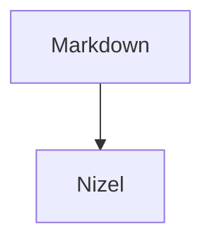
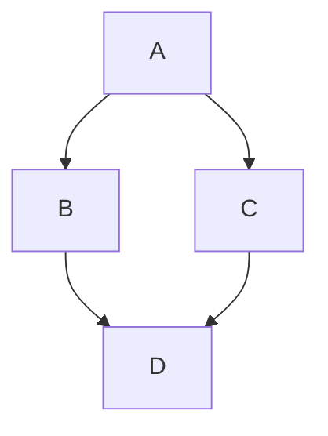

<p align="center">
  
</p>

# Nizel

Nizel is a Markdown content processor for modern applications.

It turns Markdown into structured content your app can use: rendered output, frontmatter, table of contents, headings, links, images, plain text, excerpts, reading time, and an AST.

```ts
import { useNizel } from 'nizel';

const nizel = useNizel();

const { result, html, meta, toc } = await nizel(`
---
title: Hello World
description: My first Nizel page
---

# {{ meta.title }}

Welcome to **Nizel**.
`);
```

## Why Nizel exists

Most Markdown parsers answer one question:

> How do I turn Markdown into HTML?

Nizel answers a more useful application-level question:

> How do I turn Markdown into structured content my app can use?

Markdown in real products usually needs more than HTML. It needs metadata, frontmatter, slugs, anchors, TOC generation, custom blocks, design-system classes, safe links, variables, filters, and plugin-based extension points.

Nizel should provide those things as one predictable pipeline.

## Core API

```ts
const nizel = useNizel(options);

const data = await nizel(markdown, runtimeOptions);
```

The main result object:

```ts
const {
  result,
  html,
  text,
  meta,
  frontmatter,
  toc,
  title,
  description,
  excerpt,
  headings,
  links,
  images,
  readingTime,
  ast,
} = await nizel(markdown);
```

`result` is the selected main output. By default it is the HTML output.

## Built-in formatting

Nizel should include formatting and case filters out of the box using the existing Sil packages:

- `@sil/format`
- `@sil/case`

Example:

```md
---
title: "{{ product.name | title }}"
slug: "{{ product.name | kebab }}"
---

# {{ meta.title }}

Price: {{ price | format('currency', 'EUR') }}
Date: {{ publishedAt | format('date', 'dd MMM yyyy') }}
```

## Main features

- Markdown to HTML
- Frontmatter extraction
- Typed metadata
- Template variables
- Built-in filters from `@sil/format` and `@sil/case`
- Table of contents generation
- Heading anchors and slugs
- Plain-text extraction
- Excerpt generation
- Reading-time calculation
- Link and image extraction
- Element customization
- Custom classes and attributes
- Element replacement
- Custom blocks
- Inline extensions
- AST transforms
- Plugin system
- Safe output defaults
- Presets for blog, docs, email, and minimal usage
- AST and portable document to Markdown
- Versioned, serializable documents
- Streaming Markdown completion
- Renderer-friendly tree traversal

## Documentation

- [Full reference](./docs/reference.md)
- [Getting started](./docs/getting-started.md)
- [API](./docs/api.md)
- [Result object](./docs/result.md)
- [Template variables and filters](./docs/template.md)
- [Built-in filters](./docs/filters.md)
- [Frontmatter](./docs/frontmatter.md)
- [Table of contents](./docs/toc.md)
- [Elements](./docs/elements.md)
- [Blocks](./docs/blocks.md)
- [Inline extensions](./docs/inline.md)
- [Transforms](./docs/transforms.md)
- [Plugins](./docs/plugins.md)
- [Plugin packages](./documentation/plugins/README.md)
- [Presets](./docs/presets.md)
- [Pipeline](./docs/pipeline.md)
- [Safety](./docs/safety.md)
- [Testing](./docs/testing.md)
- [Implementation plan](./docs/implementation-plan.md)
- [Application rendering roadmap](./docs/application-rendering-roadmap.md)

## Portable Documents and Streaming

Parse content once, serialize it, and render the AST later without shipping the parser with it:

```ts
import {
  completeStreamingMarkdown,
  deserializeNizelDocument,
  serializeNizelDocument,
  useNizel,
} from 'nizel';

const nizel = useNizel();
const document = await nizel.document('# Hello');
const payload = serializeNizelDocument(document);
const restored = deserializeNizelDocument(payload);

const html = nizel.render(restored.ast);
const markdown = nizel.markdown(restored);
const partial = completeStreamingMarkdown('Hello **world');
```

## Design principle

Nizel should not be a low-level Markdown parser with a nicer name.

It should be a content engine with Markdown as its input format.

The parser is an implementation detail. The public value is the stable content model and the simple API.
# nizel-format

Markdown formatter utilities for Nizel.

Use it from JavaScript, native WebViews, or directly from the command line.

## CLI

Format a file in place:

```bash
npx nizel-format notes.md
```

Format every Markdown file in a directory:

```bash
npx nizel-format docs/
```

Check whether files are already formatted:

```bash
npx nizel-format --check README.md docs/
```

Format stdin to stdout:

```bash
cat notes.md | npx nizel-format --stdin
```

Print one formatted file without writing it:

```bash
npx nizel-format --stdout notes.md
```

### CLI Options

| Option | Description |
| --- | --- |
| `--check` | List files that would change and exit with code `1` when any differ. |
| `--stdout` | Print formatted output for one file instead of writing it. |
| `--stdin` | Read Markdown from stdin and print formatted output. |
| `--write` | Write files in place. This is the default for file paths. |
| `--unordered-list-marker=-` | Choose `-`, `*`, or `+`. |
| `--nested-list-indent=2` | Choose `2` or `4`. |
| `--code-fence-marker=\`\`\`` | Choose backticks or `~~~`. |
| `--horizontal-rule=---` | Choose `---`, `***`, or `___`. |
| `--no-tables` | Disable table alignment. |
| `--no-heading-spacing` | Disable heading marker spacing. |
| `--no-blank-lines` | Disable blank-line normalization. |
| `--no-renumber-ordered-lists` | Preserve ordered-list numbers. |
| `--no-blockquote-spacing` | Disable blockquote spacing. |
| `--no-html-inline-tags` | Disable inline HTML cleanup. |
| `--no-image-shortcodes` | Disable `[img=url]` conversion. |
| `--no-bbcode` | Disable BBCode conversion. |

## JavaScript API

```js
import { formatMarkdown } from 'nizel-format';

const formatted = formatMarkdown(markdown, {
  tables: true,
  unorderedListMarker: '-',
  nestedListIndent: 2,
});
```

## Browser and Native Apps

For native apps and WebViews, load `dist/nizel-format.iife.js` and call:

```js
const formatted = NizelFormat.formatMarkdown(markdown);
```

This is the shape Lezin can use from `WKWebView` or another embedded JavaScript runtime: pass the Markdown string in, receive the formatted Markdown string back, then save it in native storage.

## What It Formats

- Pipe table alignment
- Heading marker spacing
- Blank-line normalization
- Ordered-list renumbering
- Unordered-list marker normalization
- Nested-list indentation
- Fence marker normalization
- Horizontal-rule normalization
- Blockquote spacing
- Common inline HTML cleanup
- Common BBCode conversion
- `[img=url]` image shortcodes

Fenced code content and frontmatter are preserved.

## License

MIT
# nizel-kit

Browser and native WebView integration bundle for Nizel.

`nizel-kit` packages the browser renderer plus a registry of official plugins. Native apps can show settings from `supportedPlugins`, store selected plugin IDs, and pass those IDs back to the renderer. The Swift app does not need to parse or convert Markdown extension syntax.

## Install

```bash
npm install nizel-kit
```

## Browser / IIFE

Use `dist/nizel-kit.iife.js` in `WKWebView`, `JSContext`, or a browser shell. It exposes `NizelKit`.

```js
const html = await NizelKit.markdownToHtml(markdown, {
  enabledPlugins: ['alert', 'deflist', 'footnotes', 'math', 'typography', 'diagrams'],
});
```

## Settings UI

`supportedPlugins` is intentionally serializable:

```js
NizelKit.supportedPlugins
// [{ id, label, description, defaultEnabled, category, exclusiveGroup? }, ...]
```

For Swift, store `[String]` plugin IDs such as:

```swift
let enabledPlugins = ["alert", "math", "typography"]
```

Then pass that array into JavaScript when rendering.

Code-rendering plugins use `exclusiveGroup: "code-renderer"`. If multiple code renderers are selected, `nizel-kit` keeps the last selected one so the renderer remains deterministic.

## API

- `supportedPlugins` - serializable plugin metadata for settings screens.
- `defaultEnabledPlugins()` - plugin IDs enabled by default.
- `normalizeEnabledPlugins(ids)` - validates plugin IDs and resolves exclusive groups.
- `createPlugins(ids, pluginOptions)` - returns Nizel plugin instances.
- `useNizelKit(options)` - creates a browser processor with selected plugins.
- `markdownToHtml(markdown, options)` - renders Markdown to HTML.
- `mountMarkdown(target, markdown, options)` - renders into a browser/WebView DOM target.

## Plugin IDs

`abbr`, `alert`, `autolink`, `citations`, `code-copy`, `deflist`, `details`, `diagrams`, `emoji`, `footnotes`, `frontmatter-ui`, `gfm`, `heading-anchors`, `math`, `media`, `sanitize`, `shiki`, `toc`, and `typography`.

## Swift / WebView Shape

```swift
struct NizelPluginSetting: Codable, Identifiable {
    let id: String
    let label: String
    let description: String
    let defaultEnabled: Bool
    let category: String
}
```

Load `nizel-kit.iife.js`, read `NizelKit.supportedPlugins` to build the settings UI, persist selected IDs, and call `NizelKit.markdownToHtml(markdown, { enabledPlugins })` when rendering.

## License

MIT

## Optional Wasm kit

Use `nizel-kit/wasm` with the same functions and options as the normal kit. To embed it in an offline WebView, use `dist/nizel-kit.wasm.iife.js` in place of the normal IIFE. Both expose `NizelKit` with the same methods. Use the matching Nizel release.

The Wasm backend accelerates supported inputs in both directions. Formats or plugin hooks that need the existing parser take the JavaScript path. Standard kit imports and the normal browser IIFE use JavaScript. See the [Nizel package documentation](../nizel/README.md#optional-webassembly-renderer) for syntax support and fallback behavior.
# nizel-plugin-badge

Inline badge and status label syntax for Nizel.

## Installation

```bash
npm install nizel-plugin-badge
```

## Basic Usage

```ts
import { useNizel } from 'nizel';
import { badgePlugin } from 'nizel-plugin-badge';
import 'nizel-plugin-badge/style.css';

const nizel = useNizel({
  plugins: [
    badgePlugin({
      defaultTone: 'neutral',
    }),
  ],
});
```

## Syntax

```md
:badge(beta)
:badge(v1.2.0)
:badge(deprecated, tone="warning")
:badge(done, tone="success", title="This task is complete")
:badge("Breaking Change", tone="danger")
```

The first positional argument is the label. Use quotes when the label contains a comma or closing parenthesis.

## Options

```ts
badgePlugin({
  className: 'nizel-badge',
  defaultTone: 'neutral',
  allowedTones: ['neutral', 'info', 'success', 'warning', 'danger', 'purple', 'blue', 'green', 'yellow', 'red'],
  collectMetadata: true,
  aliases: {
    beta: { label: 'Beta', tone: 'info' },
    deprecated: { label: 'Deprecated', tone: 'warning' },
    done: { label: 'Done', tone: 'success' },
  },
});
```

Supported Markdown options are `tone`, `title`, and `className`.

Unknown or disallowed tones fall back to the configured `defaultTone`, or `neutral` if the configured default is not allowed.

## Output

```md
:badge(deprecated, tone="warning")
```

```html
<span class="nizel-badge" data-tone="warning">deprecated</span>
```

All label, title, class, and tone values are escaped before rendering.

## Aliases

```ts
badgePlugin({
  aliases: {
    beta: { label: 'Beta', tone: 'info' },
    deprecated: { label: 'Deprecated', tone: 'warning' },
    done: { label: 'Done', tone: 'success' },
  },
});
```

Explicit Markdown options override alias defaults.

## Styling

Import the default stylesheet when you want the minimal bundled badge styles:

```ts
import 'nizel-plugin-badge/style.css';
```

The stylesheet only defines the base pill shape and tone colors. Host apps can override all selectors.

## Metadata

When `collectMetadata` is enabled, the plugin adds badge usage to `result.meta.badge.badges`.

```ts
{
  badge: {
    badges: [
      {
        label: 'Deprecated',
        tone: 'warning',
        original: 'deprecated'
      }
    ]
  }
}
```

## Security

The plugin escapes badge labels, titles, custom classes, and `data-tone` values. Unknown tones do not pass through to HTML; they fall back to `defaultTone` or `neutral`.

## Parser Behavior

The plugin transforms inline `:badge(...)` expressions in normal text. It does not transform fenced code, inline code, raw HTML blocks, or escaped syntax such as `\:badge(beta)`.

## Integration Example

```ts
const result = await nizel('# Release :badge(beta, tone="info")');

console.log(result.html);
console.log(result.meta.badge);
```
# nizel-plugin-hidden-comments

Render Markdown HTML comments as first-class Nizel content.

## Install

```sh
npm install nizel-plugin-hidden-comments
```

## Usage

```ts
import { useNizel } from 'nizel';
import { hiddenCommentsPlugin } from 'nizel-plugin-hidden-comments';

const html = await useNizel({
  plugins: [hiddenCommentsPlugin({ mode: 'hide' })],
}).html('Visible <!-- internal note --> text');
```

## Modes

- `hide` renders a copyable, PDF text-layer friendly hidden span.
- `small` renders the comment as small muted text.
- `render` renders the comment at the normal inline size.
- `remove` removes comments from the rendered document.

## Styling

The plugin does not inject CSS by default. Use `nizel-style` for standard styling:

```ts
import 'nizel-style/plugins/hidden-comments.css';
```

Pass `injectCss: true` when a standalone render needs inline rules:

```ts
hiddenCommentsPlugin({ injectCss: true });
```

## HTML to Markdown

The plugin exports an HTML-to-Markdown handler through the plugin object. Hidden comment spans generated by this plugin convert back to Markdown comments when the plugin is enabled for reverse conversion.

```ts
const markdown = useNizel({
  plugins: [hiddenCommentsPlugin()],
}).htmlToMarkdown(html);
```

## Options

| Option | Type | Default | Description |
| --- | --- | --- | --- |
| `mode` | `'hide' \| 'small' \| 'render' \| 'remove'` | `'hide'` | Controls how comments appear in rendered HTML. |
| `injectCss` | `boolean` | `false` | Prepends minimal CSS to rendered HTML. |
| `className` | `string` | `'nizel-hidden-comment'` | Base class used for generated spans. |

Browser IIFE: `NizelHiddenComments` from `dist/hidden-comments.iife.js`.
# nizel-plugin-kbd

Keyboard shortcut rendering for [Nizel](https://npmjs.com/package/nizel).

## Installation

```bash
npm install nizel-plugin-kbd
```

## Basic Usage

```ts
import { useNizel } from 'nizel';
import { kbdPlugin } from 'nizel-plugin-kbd';
import 'nizel-plugin-kbd/style.css';

const nizel = useNizel({
  plugins: [kbdPlugin({ platform: 'macos' })],
});
```

## Syntax

Use `:kbd(...)` inline syntax:

```md
Press :kbd(Cmd+K) to search.
Open commands with :kbd(Mod+Shift+P).
Cancel with :kbd(Escape).
```

The plugin renders real `<kbd>` elements inside a styleable wrapper:

```html
<span class="nizel-kbd-group" data-shortcut="Cmd+K"><kbd class="nizel-kbd">Cmd</kbd><span class="nizel-kbd-separator" aria-hidden="true">+</span><kbd class="nizel-kbd">K</kbd></span>
```

Whitespace around `+` is ignored, so `:kbd(Cmd+K)` and `:kbd(Cmd + K)` are equivalent.

## Options

```ts
type KbdPlatform = 'macos' | 'windows' | 'linux' | 'auto';

type KbdPluginOptions = {
  platform?: KbdPlatform;
  className?: string;
  separatorClassName?: string;
  groupClassName?: string;
  collectMetadata?: boolean;
  aliases?: Record<string, string>;
};
```

Defaults:

```ts
kbdPlugin({
  platform: 'auto',
  className: 'nizel-kbd',
  separatorClassName: 'nizel-kbd-separator',
  groupClassName: 'nizel-kbd-group',
  collectMetadata: true,
  aliases: {},
});
```

`Mod` resolves to `Cmd` on macOS and `Ctrl` on Windows, Linux, and `auto`.

## Aliases

```ts
kbdPlugin({
  platform: 'macos',
  aliases: {
    search: 'Mod+K',
    commandPalette: 'Mod+Shift+P',
  },
});
```

```md
:kbd(search)
:kbd(commandPalette)
```

## Styling

Import the minimal stylesheet when you want default shortcut styling:

```ts
import 'nizel-plugin-kbd/style.css';
```

The stylesheet defines the group layout, key shape, and separator opacity. Host apps can override all classes.

## Metadata

When `collectMetadata` is enabled, rendered shortcuts are exposed on `result.meta.kbd.shortcuts`.

```ts
{
  kbd: {
    shortcuts: [
      {
        original: 'Mod+K',
        resolved: 'Cmd+K',
        keys: ['Cmd', 'K']
      }
    ]
  }
}
```

## Security

All key text and attributes are escaped before rendering. Malicious input such as `:kbd(<script>)` is rendered as safe text inside `<kbd>`.

## Parser Safety

The plugin does not transform inline code, fenced code, raw HTML blocks, or escaped syntax:

```md
`:kbd(Cmd+K)`
\:kbd(Cmd+K)
```

All generated key text and attributes are HTML-escaped.

## Integration Example

```ts
const result = await nizel('Press :kbd(Mod+K).');

console.log(result.html);
console.log(result.meta.kbd);
```
# nizel-plugin-open-icon

Render [Open Icon](https://open-icon.org/) SVGs from compact inline Markdown.

The plugin uses the local `open-icon` package as its source. It never calls the Open Icon API, fetches remote SVGs, or makes Markdown preview rendering depend on network access.

## Installation

```bash
npm install nizel-plugin-open-icon open-icon
```

## Basic Usage

```ts
import { useNizel } from 'nizel';
import { openIconPlugin } from 'nizel-plugin-open-icon';
import 'nizel-plugin-open-icon/style.css';

const nizel = useNizel({
  plugins: [openIconPlugin()],
});

const result = await nizel('# Document\n\n:open-icon(ui/search-m) Search');
```

## Syntax

```md
:open-icon(ui/search-m)
:open-icon(ui/check-m, label="Success")
:open-icon(ui/search-m, size="1.25em")
:open-icon(ui/search-m, color="currentColor")
:open-icon(ui/search-m, strokeWidth=2)
:open-icon(ui/search-m, label="Search", size="1.25em", color="currentColor")
```

Only `:open-icon(...)` is supported. Generic `:icon(...)` syntax is intentionally left for a future multi-library plugin.

## Default Inline SVG Rendering

```md
# Document

:open-icon(ui/search-m) Search

:open-icon(ui/check-m, label="Done") Done
```

Output shape:

```html
<h1>Document</h1>

<p>
  <span class="nizel-open-icon" data-icon="ui/search-m" aria-hidden="true">
    <svg><!-- Open Icon SVG --></svg>
  </span>
  Search
</p>

<p>
  <span class="nizel-open-icon" data-icon="ui/check-m" role="img" aria-label="Done">
    <svg><!-- Open Icon SVG --></svg>
  </span>
  Done
</p>
```

The default size is `1em`, so icons inherit the surrounding text size. The plugin does not emit `data-size` for the default size.

## Accessibility

Icons without `label` are decorative:

```html
<span class="nizel-open-icon" data-icon="ui/search-m" aria-hidden="true">...</span>
```

Icons with `label` are exposed as images:

```html
<span class="nizel-open-icon" data-icon="ui/search-m" role="img" aria-label="Search">...</span>
```

The plugin does not render both `aria-hidden` and `aria-label` on the same icon.

## Aliases

```ts
const nizel = useNizel({
  plugins: [
    openIconPlugin({
      aliases: {
        search: 'ui/search-m',
        check: 'ui/check-m',
      },
    }),
  ],
});
```

```md
:open-icon(search)
:open-icon(check, label="Done")
```

Metadata records both the original alias and resolved icon name.

## Styling

```ts
import 'nizel-plugin-open-icon/style.css';
```

The stylesheet is intentionally small:

```css
.nizel-open-icon {
  display: inline-flex;
  width: 1em;
  height: 1em;
  vertical-align: -0.125em;
  line-height: 1;
}
```

Use the inline options for per-icon Open Icon variables:

```md
:open-icon(ui/search-m, color="currentColor", strokeWidth=2)
```

## Metadata

With `collectMetadata: true`, render results include used icons:

```ts
const result = await nizel(':open-icon(search, label="Search", size="1.25em")');

console.log(result.meta.openIcon);
```

```ts
{
  icons: [
    {
      name: 'ui/search-m',
      original: 'search',
      label: 'Search',
      options: {
        size: '1.25em',
      },
    },
  ],
}
```

## Security

The plugin validates icon name shape and escapes labels, classes, `data-*` attributes, and SVG transform attributes.

```md
:open-icon(ui/search-m, label="<script>alert(1)</script>")
```

renders the label as escaped text in `aria-label`; it does not create executable HTML.

Invalid or missing icons render a safe missing placeholder unless `strict: true` is set.

## Offline Rendering Guarantee

`inline-svg` mode reads SVG strings from the installed `open-icon` package through its synchronous local catalog. Rendering does not call `fetch`, does not load remote URLs, and does not output Open Icon API URLs.

## Semantic Mode

Host apps that replace icons themselves can use semantic mode:

```ts
const nizel = useNizel({
  plugins: [
    openIconPlugin({
      mode: 'semantic',
    }),
  ],
});
```

```md
:open-icon(ui/search-m, label="Search")
```

```html
<span class="nizel-open-icon" data-icon="ui/search-m" role="img" aria-label="Search"></span>
```

Semantic mode still validates names and collects metadata. It does not fetch external resources.
# nizel-plugin-print

Print and PDF layout controls for Nizel Markdown documents.

The plugin renders semantic wrapper elements for page breaks, print-only content, screen-only content, non-printing content, and blocks that should avoid splitting across pages.

## Installation

```bash
npm install nizel-plugin-print
```

## Usage

```ts
import { useNizel } from 'nizel';
import { printPlugin } from 'nizel-plugin-print';
import 'nizel-plugin-print/style.css';

const nizel = useNizel({
  plugins: [printPlugin()],
});

const html = await nizel.html(':::pagebreak\n:::');
```

The plugin can also inject its default CSS into rendered HTML:

```ts
printPlugin({
  injectCss: true,
  collectMetadata: true,
});
```

## Syntax

```md
:::pagebreak
:::

:::pagebreak-before
# New section
:::

:::pagebreak-after
End of section.
:::

:::keep


This chart and caption should stay together.
:::

:::print-only
Printed copy generated on 2026-07-03.
:::

:::screen-only
[Open interactive demo](./demo)
:::

:::no-print
This video is not included in the PDF.
:::

:::print-wide
| Very | Wide | Table |
|---|---|---|
| ... | ... | ... |
:::
```

## Output

`:::pagebreak` renders an empty structural break:

```html
<div class="nizel-pagebreak" aria-hidden="true"></div>
```

Other directives wrap their parsed Markdown content:

```html
<div class="nizel-print-only">
  <p>Printed copy generated on 2026-07-03.</p>
</div>
```

## Options

```ts
type PrintPluginOptions = {
  injectCss?: boolean;
  collectMetadata?: boolean;
  classPrefix?: string;
};
```

Defaults:

```ts
{
  injectCss: true,
  collectMetadata: true,
  classPrefix: 'nizel'
}
```

Set `injectCss: false` when importing `nizel-plugin-print/style.css` yourself.

## Styling

Import the default stylesheet when you want static CSS instead of injected CSS:

```ts
import 'nizel-plugin-print/style.css';
```

The stylesheet only defines print visibility and page-break behavior. It does not set page size, margins, colors, or typography.

## Metadata

With `collectMetadata: true`, render results include print controls:

```ts
const result = await nizel(':::pagebreak\n:::\n\n:::keep\nKeep this.\n:::');

console.log(result.meta.print);
```

```ts
{
  controls: [
    { type: 'pagebreak' },
    { type: 'keep' }
  ]
}
```

If frontmatter includes a `print` object, supported print settings are copied to `result.meta.print.settings`:

```yaml
---
print:
  title: Markdown Plugin Guide
  pageSize: A4
  orientation: portrait
  margins: normal
  showDate: true
  showUrl: true
---
```

The plugin exposes metadata for renderers and exporters. It does not set page size, margins, colors, or typography.

## Parser Exclusions

Print directives are ignored inside fenced code blocks and raw HTML blocks. Escaped directive syntax remains literal Markdown text.

## Security

The plugin renders only known print directive names and escapes generated class names. Directive content is parsed by Nizel using the active safe-rendering settings.

## Integration Example

```ts
const result = await nizel(':::print-only\nPrinted copy.\n:::');

console.log(result.html);
console.log(result.meta.print);
```
# nizel-style

Scoped CSS for rendered Markdown content and official Nizel plugins.

## Install

```sh
npm install nizel-style
```

## Full stylesheet

Import or link the complete stylesheet when you use the standard Nizel renderer and want plugin styles included.

```js
import 'nizel-style';
```

```html
<link rel="stylesheet" href="/node_modules/nizel-style/dist/nizel-style.css">
```

When compiling Sass, use the public Sass entrypoint:

```scss
@use "nizel-style/style";
```

Wrap rendered content with one of the supported roots:

```html
<article class="nizel-content">
  <!-- rendered Nizel HTML -->
</article>
```

The root selector also supports `[data-nizel-content]` and `.nizel-prose`.

The base layer targets ordinary rendered Markdown HTML such as headings, paragraphs, lists, blockquotes, code, images, and tables. It can style HTML from Nizel, `marked`, `markdown-it`, CMS content, or another Markdown renderer as long as the content is wrapped in a supported root. Plugin styles are the Nizel-specific layer.

## Partial styles

Load only the pieces you use:

```js
import 'nizel-style/tokens.css';
import 'nizel-style/base.css';
import 'nizel-style/plugins/alert.css';
import 'nizel-style/plugins/code-copy.css';
import 'nizel-style/plugins/task-list.css';
```

Available plugin styles:

- `nizel-style/plugins/abbr.css`
- `nizel-style/plugins/alert.css`
- `nizel-style/plugins/citations.css`
- `nizel-style/plugins/code-copy.css`
- `nizel-style/plugins/deflist.css`
- `nizel-style/plugins/details.css`
- `nizel-style/plugins/diagrams.css`
- `nizel-style/plugins/footnotes.css`
- `nizel-style/plugins/frontmatter-ui.css`
- `nizel-style/plugins/heading-anchors.css`
- `nizel-style/plugins/hidden-comments.css`
- `nizel-style/plugins/math.css`
- `nizel-style/plugins/media.css`
- `nizel-style/plugins/shiki.css`
- `nizel-style/plugins/task-list.css`
- `nizel-style/plugins/toc.css`
- `nizel-style/plugins/typography.css`

## Theme variables

Set variables on `:root`, a theme container, or directly on `.nizel-content`.

```css
.nizel-content {
  --nizel-foreground: #1f2328;
  --nizel-background: #ffffff;
  --nizel-primary: #2563eb;
  --nizel-secondary: #7c3aed;
  --nizel-error: #b42318;
  --nizel-info: #0969da;
  --nizel-font-body: Inter, system-ui, sans-serif;
  --nizel-font-heading: Inter, system-ui, sans-serif;
  --nizel-font-code: "SF Mono", Menlo, Monaco, monospace;
}
```

The token layer falls back to common app tokens such as `--foreground`, `--background`, `--primary`, `--secondary`, `--error`, and `--info`.

The package source is Sass and the published `dist` files are compiled CSS. Spacing tokens use `--nizel-space-xxs`, `--nizel-space-xs`, `--nizel-space-s`, `--nizel-space`, `--nizel-space-l`, `--nizel-space-xl`, and `--nizel-space-xxl`, all expressed in `em` so the layout scales with the content font size.

## Rhythm presets

For rendered Markdown, the main reading rhythm is controlled by three variables:

```css
.nizel-content {
  --nizel-size: 1em;
  --nizel-leading: 1.66;
  --nizel-flow: 1.35em;
}
```

- `--nizel-size` controls the base content font size.
- `--nizel-leading` controls the base line height.
- `--nizel-flow` controls the space between adjacent blocks. Section spacing derives from this value.

The older aliases still work through the same system: `--nizel-font-size`, `--nizel-line-height`, and `--nizel-flow-space`.

Use a preset class or data attribute when the same renderer appears in different contexts:

```html
<div class="nizel-content nizel-compact">Chat output</div>
<article class="nizel-content nizel-docs">Documentation</article>
<article class="nizel-content nizel-reading">Long-form article</article>
<article class="nizel-content nizel-large">Large text mode</article>
```

```html
<article class="nizel-content" data-nizel-preset="docs">
  <!-- rendered Markdown HTML -->
</article>
```

## Defaults

Code blocks use a flat surface without a border by default. Override `--nizel-code-block-background` or `--nizel-code-block-radius` on the root to tune the treatment.

Tables use minimal horizontal separators instead of boxed cells, which keeps dense documentation and generated Markdown readable without making every cell feel like an input grid.
# nizel

Markdown content processor for modern applications.

Custom CommonMark 0.31 parser with frontmatter, templates, filters, elements, plugins, custom blocks, and transforms. No third-party markdown libraries.

## Install

```bash
npm install nizel
```

## Usage

```js
import { useNizel } from 'nizel';

const processor = useNizel({
  // optional configuration
});

const result = await processor('# Hello {{ name }}', {
  data: { name: 'World' }
});
```

## Result

The processor returns:

- `result`, `html`, `text`, and `ast`
- `meta` and `frontmatter`
- `title`, `description`, and `excerpt`
- `toc`, `headings`, `links`, and `images`
- `readingTime`

## Convenience Methods

```js
await processor.parse(markdown);   // AST only
processor.render(ast);             // AST to HTML
processor.markdown(ast);           // AST to Markdown
await processor.document(markdown); // portable document
```

Portable documents use the versioned `nizel/document` schema and can be passed
through `serializeNizelDocument()` and `deserializeNizelDocument()`. Use
`completeStreamingMarkdown()` before parsing incomplete streamed content.

## Features

- **CommonMark 0.31** — full spec compliance (652/652 tests)
- **Frontmatter** — YAML with arrays, templates, and variable resolution
- **Filters** — 14 built-in: camel, capital, const, dot, header, kebab, lower, pascal, path, sentence, slug, snake, upper, format
- **Elements** — customize HTML tags and attributes for any node type
- **Templates** — `{{ variable }}` syntax with filter chains
- **Plugins** — `defineNizelPlugin()` with `beforeParse`, `afterParse`, `afterRender` hooks
- **Custom blocks** — `defineBlock()` for domain-specific content
- **Transforms** — post-processing pipeline
- **Presets** — `blog`, `email` built-in, or create your own
- **Safety** — `onclick`/`onerror` handlers stripped, `javascript:` URLs stripped
- **TOC** — table of contents with level/slug aliases

## Options

```js
useNizel({
  data: {},              // template variables
  variables: {},         // alias for data
  preset: 'blog',       // or 'email', or custom object
  slugStyle: 'kebab',   // slug generation style
  elements: {
    a: { tag: 'a', attrs: { target: '_blank' } }
  },
  plugins: [myPlugin()],
  filters: { custom: (v) => v.toUpperCase() },
  blocks: { note: myNoteBlock },
});
```

## Plugins

Official plugins available:

- `nizel-plugin-abbr` — abbreviation definitions with `<abbr>` output
- `nizel-plugin-alert` — GitHub-style and custom alert blocks
- `nizel-plugin-autolink` — configurable bare URL and email links
- `nizel-plugin-citations` — citation references and bibliography output
- `nizel-plugin-code-copy` — copy controls for code blocks
- `nizel-plugin-deflist` — definition-list syntax
- `nizel-plugin-details` — disclosure/details blocks
- `nizel-plugin-diagrams` — Mermaid code block containers
- `nizel-plugin-emoji` — `:name:` emoji shortcuts
- `nizel-plugin-footnotes` — footnote references and definitions
- `nizel-plugin-frontmatter-ui` — frontmatter metadata rendering helpers
- `nizel-plugin-gfm` — GFM-oriented plugin preset
- `nizel-plugin-heading-anchors` — visible anchor links on headings
- `nizel-plugin-math` — inline and display math wrappers
- `nizel-plugin-media` — figure, caption, lazy, and responsive image helpers
- `nizel-plugin-sanitize` — additional rendered HTML sanitizing
- `nizel-plugin-shiki` — code syntax highlighting via Shiki
- `nizel-plugin-task-list` — task-list checkbox rendering
- `nizel-plugin-toc` — rendered `[[toc]]` table of contents
- `nizel-plugin-typography` — mark, subscript, and superscript extensions

For native apps or WebViews that need a single browser bundle with a settings-friendly plugin registry, use `nizel-kit`.

For ready-to-link content styling, use `nizel-style`. It ships scoped CSS for core rendered content plus optional plugin CSS entrypoints such as `nizel-style/plugins/alert.css` and `nizel-style/plugins/code-copy.css`.

## License

MIT

## Optional WebAssembly renderer

Import from `nizel/wasm` on Node or `nizel/browser/wasm` in a browser build. The opt-in entry points have the same exports and call signatures as the corresponding JavaScript entry points.

```js
import { useNizel, htmlToMarkdown } from 'nizel/wasm';

const nizel = useNizel();
const html = await nizel.html('A **bold** word.');
const markdown = htmlToMarkdown(html);
```

The module is compiled lazily on the first eligible call. The binary is included in the package, so initialization needs no network request. Standard imports keep using JavaScript. Consumers can switch imports independently in the same process. To disable Wasm, switch back to the original entry point.

- Markdown acceleration covers ASCII paragraphs, line breaks, uncomplicated ATX headings and IDs, and simple inline code and emphasis. HTML conversion covers the corresponding semantic markup, common named entities, and simple headings with matching IDs.
- The backend falls back for unsupported syntax, custom rendering rules, AST transforms, reverse plugin handlers, or inputs over 1,048,576 UTF-16 code units. It also falls back when the runtime blocks compilation or a Wasm operation fails. Before-parse and after-render hooks run in either path.
- AST, document, metadata, and text APIs continue to use the existing JS implementation. The browser wrapper accepts the same strings, nodes, ranges, and selections.
- Run `npm run build --workspace nizel` to build the optional binary from `packages/nizel/assembly/renderer.ts`. The AssemblyScript compiler is a build dependency. The package verification suite compares both entry points, both conversion directions, missing-Wasm fallback, options, and plugin behavior against the stock implementation.

For the offline WebView bundle, use `nizel-kit/wasm` or the `nizel-kit.wasm.iife.js` build from the matching `nizel-kit` release. Keep JavaScript fallback enabled and measure the HTML subset and plugin configuration you actually ship. On a site with a restrictive Content Security Policy, compilation must be permitted for the fast path to run.
# Test fixtures

- `gfm-spec.json`: every example of the GitHub Flavored Markdown Spec 0.29
  (2019-04-06), from `test/spec.txt` in
  [github/cmark-gfm](https://github.com/github/cmark-gfm), with `→` turned
  into tabs. The spec is licensed
  [CC-BY-SA 4.0](http://creativecommons.org/licenses/by-sa/4.0/). Gate 2 of
  the WebAssembly engine (`test/wasm-gfm-spec.test.mjs`) runs it.
# nizel-plugin-abbr

Abbreviation definitions for [Nizel](https://npmjs.com/package/nizel).

The plugin removes abbreviation definition lines from the Markdown body and renders matching terms as `<abbr title="...">...</abbr>` in paragraphs, headings, lists, blockquotes, and custom blocks.

The browser build exposes `NizelAbbr` from `dist/abbr.iife.js`.

## Install

```bash
npm install nizel-plugin-abbr
```

## Usage

```ts
import { useNizel } from 'nizel';
import { abbrPlugin } from 'nizel-plugin-abbr';

const nizel = useNizel({
  plugins: [abbrPlugin()],
});
```

## Syntax

```md
*[HTML]: HyperText Markup Language
*[CSS]: Cascading Style Sheets

HTML and CSS work together.
```

Definitions can also be supplied from options when the source document should not contain definition lines.

## Options

| Option | Type | Default | Description |
| --- | --- | --- | --- |
| `definitions` | `Record<string, string>` | `{}` | Additional abbreviation definitions merged with document definitions. |

## Output

```html
<p><abbr title="HyperText Markup Language">HTML</abbr> is a markup language.</p>
```

## License

MIT
# nizel-plugin-alert

GitHub-style alert blocks for [Nizel](https://npmjs.com/package/nizel).

The browser build exposes `NizelAlert` from `dist/alert.iife.js`.

## Install

```bash
npm install nizel-plugin-alert
```

## Usage

```ts
import { useNizel } from 'nizel';
import { alertPlugin } from 'nizel-plugin-alert';

const nizel = useNizel({
  plugins: [alertPlugin()],
});

const html = await nizel.html(`::warning Careful
Pay **attention**.
::`);
```

## Syntax

The plugin registers these custom block names:

- `note`
- `tip`
- `important`
- `warning`
- `caution`

The first argument or `title` prop is rendered as the alert title.

```md
::tip Helpful
Use Markdown inside the alert body.
::
```

```md
::tip
title: Helpful
::
Use Markdown inside the alert body.
::
```

## Options

| Option | Type | Default | Description |
| --- | --- | --- | --- |
| `className` | `string` | `'alert'` | Root CSS class used for generated alert markup. |

## Output

```html
<div class="alert alert--warning" data-alert="warning">
  <p class="alert__title">Careful</p>
  <div class="alert__content">...</div>
</div>
```

## License

MIT
# nizel-plugin-autolink

Autolink behavior plugin for [Nizel](https://npmjs.com/package/nizel).

Configures how bare URLs and email addresses are converted to links.

## Install

```bash
npm install nizel-plugin-autolink
```

## Usage

```js
import { useNizel } from 'nizel';
import { autolinkPlugin } from 'nizel-plugin-autolink';

const processor = useNizel({
  plugins: [
    autolinkPlugin({
      enabled: true,
      target: '_blank',
      rel: 'noopener noreferrer',
    }),
  ],
});

const result = processor.process('Visit https://example.com');
// <p>Visit <a href="https://example.com" target="_blank" rel="noopener noreferrer">https://example.com</a></p>
```

## Options

| Option | Type | Default | Description |
| --- | --- | --- | --- |
| `enabled` | `boolean` | `true` | Enable or disable autolinking |
| `target` | `string` | — | `target` attribute for generated links |
| `rel` | `string` | — | `rel` attribute for generated links |

## License

MIT
# nizel-plugin-citations

Citation references and bibliography output for [Nizel](https://npmjs.com/package/nizel).

The plugin recognizes inline references such as `[@doe]`, removes citation definition lines from the document body, and appends a bibliography section at the end of the rendered document.

The browser build exposes `NizelCitations` from `dist/citations.iife.js`.

## Install

```bash
npm install nizel-plugin-citations
```

## Usage

```ts
import { useNizel } from 'nizel';
import { citationsPlugin } from 'nizel-plugin-citations';

const nizel = useNizel({
  plugins: [citationsPlugin()],
});
```

## Syntax

```md
This sentence cites a source [@smith2026].

[@smith2026]: Smith, A. Markdown Rendering Notes, 2026.
```

Unknown citation IDs are left as text.

## Options

| Option | Type | Default | Description |
| --- | --- | --- | --- |
| `className` | `string` | `'citations'` | CSS class for the generated bibliography section. |

## Output

```html
<a class="citation" href="#cite-smith2026">[smith2026]</a>
<section class="citations"><ol><li id="cite-smith2026">...</li></ol></section>
```

## License

MIT
# nizel-plugin-code-copy

Code copy plugin for [Nizel](https://npmjs.com/package/nizel).

Renders copy buttons on fenced code blocks. By default, buttons include inline JavaScript that copies the original source text.

The plugin wraps code-like blocks instead of replacing the active code renderer, so it can be combined with syntax highlighting or explicit diagram plugins.

## Install

```bash
npm install nizel-plugin-code-copy
```

## Usage

```js
import { useNizel } from 'nizel';
import { codeCopyPlugin } from 'nizel-plugin-code-copy';

const processor = useNizel({
  plugins: [
    codeCopyPlugin({ label: 'Copy' }),
  ],
});

const result = processor.process('```js\nconsole.log("hello")\n```');
// Produces a <figure> with a copying <button data-nizel-copy-button> and the code block
```

## Output Structure

```html
<figure class="nizel-code-copy" data-nizel-code-copy>
  <figcaption>filename.js</figcaption>  <!-- if filename provided -->
  <textarea class="nizel-code-copy__source" data-nizel-copy-source hidden readonly tabindex="-1" aria-hidden="true" style="display: none">console.log("hello")</textarea>
  <button type="button" class="nizel-code-copy__button" data-nizel-copy-button onclick="...">
    <span class="nizel-code-copy__label" data-nizel-copy-label>Copy</span>
  </button>
  <pre><code class="language-js">console.log("hello")</code></pre>
</figure>
```

The hidden textarea contains the original escaped source text. The button copies from `[data-nizel-copy-source]`, so syntax highlighting or renderer changes do not affect the copied value.

For strict Content Security Policy or framework-owned behavior, switch to button-only mode:

```js
codeCopyPlugin({ mode: 'button' });
```

Then wire up copy behavior with your own JS by querying `[data-nizel-copy-button]`.

Because code-copy is a wrapper, this works with another plugin that renders the child code block:

```js
useNizel({
  plugins: [
    shikiPlugin({ highlighter }),
    diagramsPlugin(),
    codeCopyPlugin(),
  ],
});
```

Only explicit Mermaid fences such as ```` ```mermaid ```` become diagrams when the diagrams plugin is enabled.

## Options

| Option | Type | Default | Description |
| --- | --- | --- | --- |
| `label` | `string` | `'Copy'` | Button text |
| `copiedLabel` | `string` | `'Copied'` | Temporary button text after copying |
| `mode` | `'inline' \| 'button'` | `'inline'` | Inline copy handler or button-only markup |

## License

MIT
# nizel-plugin-deflist

Definition list support for [Nizel](https://npmjs.com/package/nizel).

The browser build exposes `NizelDeflist` from `dist/deflist.iife.js`.

## Install

```bash
npm install nizel-plugin-deflist
```

## Usage

```ts
import { useNizel } from 'nizel';
import { deflistPlugin } from 'nizel-plugin-deflist';

const nizel = useNizel({
  plugins: [deflistPlugin()],
});

const html = await nizel.html(`Term
: Definition`);
```

## Syntax

```md
Term
: Definition

Other term
: First definition
: Second definition
```

The plugin converts definition-list syntax into an internal Nizel custom block before parsing. It does not require disabling safe mode.

## Options

| Option | Type | Default | Description |
| --- | --- | --- | --- |
| `className` | `string` | - | Optional CSS class on the generated `<dl>`. |

## Output

```html
<dl>
  <dt>Term</dt>
  <dd>Definition</dd>
</dl>
```

## License

MIT
# nizel-plugin-details

Disclosure block support for [Nizel](https://npmjs.com/package/nizel).

The plugin converts `:::details` fenced blocks into Nizel custom blocks and renders them as native HTML `<details>` / `<summary>` markup.

The browser build exposes `NizelDetails` from `dist/details.iife.js`.

## Install

```bash
npm install nizel-plugin-details
```

## Usage

```ts
import { useNizel } from 'nizel';
import { detailsPlugin } from 'nizel-plugin-details';

const nizel = useNizel({
  plugins: [detailsPlugin()],
});
```

## Syntax

```md
:::details Click to expand
Hidden **Markdown** content.

- Nested content works
:::
```

If no summary is supplied, the plugin uses `Details`.

## Options

| Option | Type | Default | Description |
| --- | --- | --- | --- |
| `className` | `string` | `'details'` | CSS class for the generated `<details>` element. |

## Output

```html
<details class="details"><summary>Click to expand</summary>...</details>
```

## License

MIT
# nizel-plugin-diagrams

Diagram code block containers for [Nizel](https://npmjs.com/package/nizel).

The plugin turns explicit diagram code fences into renderer-friendly HTML containers. It does not bundle a diagram renderer; for Mermaid, load Mermaid in the host app and initialize it over `.mermaid` elements.

Only fences marked with `mermaid` are converted. Other code fences are left for the active code renderer, so this plugin can be combined with Shiki and code-copy.

The browser build exposes `NizelDiagrams` from `dist/diagrams.iife.js`.

## Install

```bash
npm install nizel-plugin-diagrams
```

## Usage

```ts
import { useNizel } from 'nizel';
import { diagramsPlugin } from 'nizel-plugin-diagrams';

const nizel = useNizel({
  plugins: [diagramsPlugin()],
});
```

## Syntax

````md

````

The language marker is required:

````md

````

## Options

| Option | Type | Default | Description |
| --- | --- | --- | --- |
| `mermaid` | `boolean` | `true` | Render Mermaid fences as diagram containers. |
| `className` | `string` | `'mermaid'` | CSS class used for Mermaid containers. |

## Output

```html
<div class="mermaid">flowchart TD...</div>
```

Non-diagram code fences continue to render as normal code blocks.

## License

MIT
# nizel-plugin-emoji

Emoji shortcut support for [Nizel](https://npmjs.com/package/nizel).

## Install

```bash
npm install nizel-plugin-emoji
```

## Usage

```ts
import { useNizel } from 'nizel';
import { emojiPlugin } from 'nizel-plugin-emoji';

const nizel = useNizel({
  plugins: [emojiPlugin()],
});

const text = await nizel.text('Ship it :rocket:');
```

## Built-In Shortcuts

The plugin includes common shortcuts such as:

- `:smile:`
- `:heart:`
- `:thumbsup:`
- `:fire:`
- `:rocket:`
- `:check:`
- `:warning:`
- `:tada:`

Unknown shortcuts are left unchanged. Fenced code blocks and inline code spans are preserved.

## Options

| Option | Type | Default | Description |
| --- | --- | --- | --- |
| `emojiMap` | `Record<string, string>` | built-in map | Custom shortcuts merged over the built-in map. |

## License

MIT
# nizel-plugin-footnotes

Footnote references and definitions for [Nizel](https://npmjs.com/package/nizel).

The plugin converts `[^id]` references into linked superscripts, removes footnote definition lines from the document body, and appends a footnotes section.

The browser build exposes `NizelFootnotes` from `dist/footnotes.iife.js`.

## Install

```bash
npm install nizel-plugin-footnotes
```

## Usage

```ts
import { useNizel } from 'nizel';
import { footnotesPlugin } from 'nizel-plugin-footnotes';

const nizel = useNizel({
  plugins: [footnotesPlugin()],
});
```

## Syntax

```md
This sentence has a note.[^simple]

[^simple]: This is the footnote text.
```

Unknown references are left untouched.

## Options

| Option | Type | Default | Description |
| --- | --- | --- | --- |
| `className` | `string` | `'footnotes'` | CSS class for the generated footnotes section. |

## Output

```html
<sup id="fnref-simple"><a href="#fn-simple" class="footnote-ref">1</a></sup>
<section class="footnotes"><ol><li id="fn-simple">...</li></ol></section>
```

## License

MIT
# nizel-plugin-frontmatter-ui

Frontmatter-style metadata rendering helpers for [Nizel](https://npmjs.com/package/nizel).

This plugin registers a `::frontmatter` custom block and exports `renderFrontmatterMeta()` for apps that want to render document metadata with consistent definition-list markup.

The browser build exposes `NizelFrontmatterUi` from `dist/frontmatter-ui.iife.js`.

## Install

```bash
npm install nizel-plugin-frontmatter-ui
```

## Usage

```ts
import { useNizel } from 'nizel';
import { frontmatterUiPlugin } from 'nizel-plugin-frontmatter-ui';

const nizel = useNizel({
  plugins: [frontmatterUiPlugin()],
});
```

## Syntax

```md
::frontmatter
title: Markdown Kitchen Sink
author: Lezin Renderer Test
::
```

You can also pass block props when using Nizel custom block syntax.

## Options

| Option | Type | Default | Description |
| --- | --- | --- | --- |
| `className` | `string` | `'frontmatter'` | CSS class for the generated `<dl>`. |

## Output

```html
<dl class="frontmatter"><dt>title</dt><dd>Markdown Kitchen Sink</dd></dl>
```

## License

MIT
# nizel-plugin-gfm

GFM-oriented companion preset for [Nizel](https://npmjs.com/package/nizel).

Nizel core already handles Markdown fundamentals such as tables, task-list metadata, strikethrough, and raw/autolink syntax that belongs in the parser. This package provides a small opt-in preset for first-party plugins that commonly accompany GitHub Flavored Markdown workflows.

The browser build exposes `NizelGfm` from `dist/gfm.iife.js`.

## Install

```bash
npm install nizel-plugin-gfm
```

## Usage

```ts
import { useNizel } from 'nizel';
import { gfmPlugin, gfmPlugins } from 'nizel-plugin-gfm';

const nizel = useNizel({
  plugins: [gfmPlugin()],
});

const explicit = useNizel({
  plugins: gfmPlugins({ alerts: true, autolinks: true, taskLists: { mode: 'view' } }),
});
```

## Included Plugins

By default the preset enables:

- `nizel-plugin-autolink`
- `nizel-plugin-alert`
- `nizel-plugin-task-list`

## Options

| Option | Type | Default | Description |
| --- | --- | --- | --- |
| `alerts` | `boolean` | `true` | Include GitHub-style alert/callout support. |
| `autolinks` | `boolean` | `true` | Include configurable bare URL and email autolinks. |
| `taskLists` | `boolean \| TaskListPluginOptions` | `true` | Include task-list checkbox rendering. |

## License

MIT
# nizel-plugin-heading-anchors

Subtle heading anchor links for [Nizel](https://npmjs.com/package/nizel).

The plugin appends a copyable section link to parsed headings that already have generated IDs. By default the link has no visible text, so apps can reveal it with CSS on hover or focus without adding a literal marker to the heading content.

The browser build exposes `NizelHeadingAnchors` from `dist/heading-anchors.iife.js`.

## Install

```bash
npm install nizel-plugin-heading-anchors
```

## Usage

```ts
import { useNizel } from 'nizel';
import { headingAnchorsPlugin } from 'nizel-plugin-heading-anchors';

const nizel = useNizel({
  plugins: [headingAnchorsPlugin()],
});
```

## Options

| Option | Type | Default | Description |
| --- | --- | --- | --- |
| `className` | `string` | `'heading-anchor'` | CSS class for the generated anchor. |
| `label` | `string` | `''` | Optional visible marker text appended to the heading. |
| `ariaLabel` | `string` | `'Link to section'` | Accessible label for the generated anchor. |

## Output

```html
<h2 id="install">Install<a class="heading-anchor" href="#install" aria-label="Link to section"></a></h2>
```

## License

MIT
# nizel-plugin-math

Math wrappers for [Nizel](https://npmjs.com/package/nizel).

This plugin preserves TeX source in HTML wrappers. Rendering with KaTeX or MathJax can be applied by the host app.

The browser build exposes `NizelMath` from `dist/math.iife.js`.

## Install

```bash
npm install nizel-plugin-math
```

## Usage

```ts
import { useNizel } from 'nizel';
import { mathPlugin } from 'nizel-plugin-math';

const nizel = useNizel({
  plugins: [mathPlugin()],
});
```

## Syntax

```md
Inline math: $E = mc^2$

$$
f(x) = x^2
$$
```

## Options

| Option | Type | Default | Description |
| --- | --- | --- | --- |
| `inlineClassName` | `string` | `'math math-inline'` | CSS class for inline math spans. |
| `blockClassName` | `string` | `'math math-display'` | CSS class for display math blocks. |

## Output

```html
<span class="math math-inline">E = mc^2</span>
<div class="math math-display">f(x) = x^2</div>
```

## License

MIT
# nizel-plugin-media

Media and figure rendering helpers for [Nizel](https://npmjs.com/package/nizel).

The plugin enhances standalone image paragraphs after rendering. It wraps them in `<figure>`, copies the image `alt` text into a `<figcaption>`, and can add lazy/responsive image attributes.

The browser build exposes `NizelMedia` from `dist/media.iife.js`.

## Install

```bash
npm install nizel-plugin-media
```

## Usage

```ts
import { useNizel } from 'nizel';
import { mediaPlugin } from 'nizel-plugin-media';

const nizel = useNizel({
  plugins: [mediaPlugin()],
});
```

## Syntax

```md

```

Only standalone images wrapped in their own paragraph are converted into figures. Inline images remain inline.

## Options

| Option | Type | Default | Description |
| --- | --- | --- | --- |
| `lazy` | `boolean` | `true` | Add `loading="lazy"` when missing. |
| `responsive` | `boolean` | `true` | Add `decoding="async"` when missing. |
| `figureClassName` | `string` | `'media-figure'` | CSS class for generated figures. |

## Output

```html
<figure class="media-figure"><figcaption>Figure caption</figcaption></figure>
```

## License

MIT
# nizel-plugin-sanitize

Rendered HTML sanitizer for [Nizel](https://npmjs.com/package/nizel).

The plugin adds a final `afterRender` pass that removes script/style blocks, inline event handlers, and `javascript:` URLs. It is intended as an extra hardening layer for native app and WebView contexts.

The browser build exposes `NizelSanitize` from `dist/sanitize.iife.js`.

## Install

```bash
npm install nizel-plugin-sanitize
```

## Usage

```ts
import { useNizel } from 'nizel';
import { sanitizePlugin } from 'nizel-plugin-sanitize';

const nizel = useNizel({
  plugins: [sanitizePlugin()],
});
```

## Options

| Option | Type | Default | Description |
| --- | --- | --- | --- |
| `allowRawHtml` | `boolean` | `false` | When `true`, disables Nizel's core safe rendering option, while this plugin still removes the risky patterns it knows about. |

## Notes

This plugin is intentionally small and deterministic. It is not a full browser-grade HTML sanitizer. For untrusted hostile HTML, combine it with platform-level WebView restrictions or a dedicated sanitizer in the host environment.

## License

MIT
# nizel-plugin-shiki

Code syntax highlighting integration for [Nizel](https://npmjs.com/package/nizel).

Accepts a Worker-compatible highlighter function and passes code blocks through it. Falls back to plain `<pre><code>` when no highlighter is provided.

## Install

```bash
npm install nizel-plugin-shiki
```

Install Shiki separately when you want Shiki-powered output:

```bash
npm install shiki
```

## Usage

```js
import { useNizel } from 'nizel';
import { shikiPlugin } from 'nizel-plugin-shiki';
import { createHighlighter } from 'shiki';

const highlighter = await createHighlighter({
  themes: ['github-dark'],
  langs: ['javascript', 'typescript'],
});

const processor = useNizel({
  plugins: [
    shikiPlugin({
      highlighter(code, { lang, theme }) {
        return highlighter.codeToHtml(code, { lang, theme: theme || 'github-dark' });
      },
      theme: 'github-dark',
    }),
  ],
});

const result = processor.process('```js\nconsole.log("hello")\n```');
// Highlighted HTML from Shiki
```

## Worker and no-WASM usage

Use the `nizel-plugin-shiki/javascript` entrypoint when Shiki must run without the Oniguruma WASM engine, such as in Worker bundles.

```js
import { useNizel } from 'nizel';
import { shikiPlugin } from 'nizel-plugin-shiki';
import { createJavaScriptShikiHighlighter } from 'nizel-plugin-shiki/javascript';

const highlighter = await createJavaScriptShikiHighlighter({
  themes: ['github-dark'],
  langs: ['javascript', 'typescript'],
  defaultTheme: 'github-dark',
  defaultLang: 'text',
});

const processor = useNizel({
  plugins: [shikiPlugin({ highlighter })],
});
```

The root `nizel-plugin-shiki` entrypoint does not import Shiki. The `/javascript` entrypoint imports Shiki with `shiki/engine/javascript`, so bundlers can select the JavaScript regex engine intentionally.

## Options

| Option | Type | Default | Description |
| --- | --- | --- | --- |
| `highlighter` | `function` | — | Function receiving `(code, { lang, theme, meta, filename, highlightLines })`, returns HTML string |
| `theme` | `string` | — | Default theme name passed to the highlighter |
| `mode` | `'blocks' \| 'inline'` | `'blocks'` | Set to `'inline'` to skip highlighting (plain fallback) |

## License

MIT
# nizel-plugin-task-list

Task-list checkbox rendering plugin for [Nizel](https://npmjs.com/package/nizel).

Core Nizel parses `- [ ]` and `- [x]` markers into list item metadata (`checked`). This plugin turns that metadata into checkbox markup so applications can choose static or editable behavior without re-parsing the document.

## Install

```bash
npm install nizel-plugin-task-list
```

## Usage

```ts
import { useNizel } from 'nizel';
import { taskListPlugin } from 'nizel-plugin-task-list';

const nizel = useNizel({
  plugins: [taskListPlugin()],
});

const html = await nizel.html(`- [x] Done
- [ ] Todo`);
```

Task markers work on ordered and unordered lists, including nested lists and blockquotes.

## Options

| Option | Type | Default | Description |
| --- | --- | --- | --- |
| `mode` | `'view' \| 'edit'` | `'view'` | `view` renders disabled checkboxes; `edit` renders enabled checkboxes the user can toggle. |

## Modes

### View mode (default)

Checkboxes are rendered with the `disabled` attribute so they stay in sync with the source Markdown and cannot be toggled by the reader.

```ts
taskListPlugin({ mode: 'view' });
```

### Edit mode

Checkboxes render without `disabled`, so readers can toggle them in the rendered page.

```ts
taskListPlugin({ mode: 'edit' });
```

Edit mode only updates the rendered checkbox state in the browser. The plugin does not persist edits back to Markdown. Applications that need persistence should listen for checkbox changes and update their own document state:

```ts
document.querySelectorAll('[data-nizel-task-checkbox]').forEach((checkbox) => {
  checkbox.addEventListener('change', () => {
    const item = checkbox.closest('li');
    item?.toggleAttribute('data-checked', checkbox.checked);
    // Sync checkbox.checked back to your Markdown document source here.
  });
});
```

## Output

Each task item's first paragraph is wrapped in a `<label>` containing the checkbox input and a content `<span>`. Non-task items are left untouched.

```html
<ul>
  <li data-checked><label class="nizel-task-list__label"><input class="nizel-task-list__checkbox" data-nizel-task-checkbox type="checkbox" checked disabled><span class="nizel-task-list__content">Done</span></label></li>
  <li><label class="nizel-task-list__label"><input class="nizel-task-list__checkbox" data-nizel-task-checkbox type="checkbox" disabled><span class="nizel-task-list__content">Todo</span></label></li>
</ul>
```

## CSS Classes

| Selector | Element |
| --- | --- |
| `.nizel-task-list__label` | `<label>` wrapping the checkbox and its text. |
| `.nizel-task-list__checkbox` | The `<input type="checkbox">` control. |
| `.nizel-task-list__content` | `<span>` wrapping the task text. |
| `[data-nizel-task-checkbox]` | Attribute hook for the checkbox, stable across class name changes. |

## Styling

Use the standalone style entrypoint when loading plugin CSS selectively:

```ts
import 'nizel-style/plugins/task-list.css';
```

## API

```ts
export type TaskListPluginMode = 'view' | 'edit';

export type TaskListPluginOptions = {
  mode?: TaskListPluginMode;
};

export const taskListPlugin: (options?: TaskListPluginOptions) => NizelPlugin;
export const transformTaskLists: (ast: NizelRootNode, mode?: TaskListPluginMode) => NizelRootNode;

export default taskListPlugin;
```

`transformTaskLists` is exported for applications that apply the same transformation outside the plugin pipeline.

## License

MIT
# nizel-plugin-toc

Rendered table of contents support for [Nizel](https://npmjs.com/package/nizel).

The plugin converts a standalone `[[toc]]` marker into a linked `<nav>` built from parsed heading IDs.

The browser build exposes `NizelToc` from `dist/toc.iife.js`.

## Install

```bash
npm install nizel-plugin-toc
```

## Usage

```ts
import { useNizel } from 'nizel';
import { tocPlugin } from 'nizel-plugin-toc';

const nizel = useNizel({
  plugins: [tocPlugin()],
});
```

## Syntax

```md
[[toc]]

## Install

## Usage
```

## Options

| Option | Type | Default | Description |
| --- | --- | --- | --- |
| `className` | `string` | `'toc'` | CSS class for the generated `<nav>`. |
| `minDepth` | `number` | `2` | Minimum heading depth included. |
| `maxDepth` | `number` | `6` | Maximum heading depth included. |

## Output

```html
<nav class="toc"><ol><li data-depth="2"><a href="#install">Install</a></li></ol></nav>
```

## License

MIT
# nizel-plugin-typography

Inline typography extensions for [Nizel](https://npmjs.com/package/nizel).

The plugin adds small, explicit inline extensions that are common in writing apps but not part of pure Markdown: mark/highlight, subscript, and superscript.

The browser build exposes `NizelTypography` from `dist/typography.iife.js`.

## Install

```bash
npm install nizel-plugin-typography
```

## Usage

```ts
import { useNizel } from 'nizel';
import { typographyPlugin } from 'nizel-plugin-typography';

const nizel = useNizel({
  plugins: [typographyPlugin()],
});
```

## Syntax

```md
==highlighted text==
H~2~O
E = mc^2^
```

## Options

| Option | Type | Default | Description |
| --- | --- | --- | --- |
| `mark` | `boolean` | `true` | Enable `==mark==` output. |
| `subscript` | `boolean` | `true` | Enable `~sub~` output. |
| `superscript` | `boolean` | `true` | Enable `^sup^` output. |

## Output

```html
<mark>highlighted text</mark>
H<sub>2</sub>O
E = mc<sup>2</sup>
```

## License

MIT
