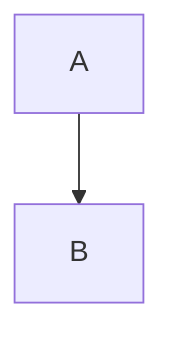
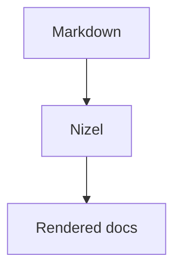

# API

## `useNizel(options?)`

Creates a Nizel processor.

```ts
import { useNizel } from 'nizel';

const nizel = useNizel({
  output: 'html',
  frontmatter: true,
  toc: true,
  anchors: true,
});
```

## `nizel(markdown, runtimeOptions?)`

Processes Markdown and returns a full `NizelResult` object.

```ts
const { result, html, meta, toc } = await nizel(markdown);
```

Runtime options are merged on top of the processor options for that call only.

```ts
await nizel(markdown, {
  data: {
    title: 'Runtime title',
  },
});
```

## Helper methods

Nizel should expose common output helpers for simpler usage.

```ts
await nizel.html(markdown);
await nizel.text(markdown);
await nizel.ast(markdown);
await nizel.meta(markdown);
```

These helpers should use the same configured processor, plugins, filters, blocks, elements, and safety rules.

## `htmlToMarkdown(html, options?)`

Converts semantic HTML into Markdown.

```ts
import { htmlToMarkdown } from 'nizel';

const markdown = htmlToMarkdown('<h1>Intro</h1><p>Hello <strong>world</strong>.</p>');
```

### Options

## Browser API

Browser-specific helpers are available from `nizel/browser`.

```ts
import {
  htmlToMarkdown,
  markdownToHtml,
  mountMarkdown,
  selectionToMarkdown,
  useBrowserNizel,
} from 'nizel/browser';

const html = await markdownToHtml('# Preview');
const markdown = htmlToMarkdown(document.querySelector('article')!);
const selected = selectionToMarkdown();

await mountMarkdown('#preview', '# Preview');

const nizel = useBrowserNizel();
await nizel.mount('#preview', '# Preview');
```

The browser entry also exports the core API (`useNizel`, `defineNizelPlugin`, `defineBlock`, and types), so it can be used as the single Nizel entry in browser bundles.

For embedded webviews such as `WKWebView`, the package build emits explicit browser artifacts:

```txt
dist/browser/nizel.js       ESM bundle
dist/browser/nizel.iife.js  IIFE bundle exposing globalThis.Nizel
```

Use `dist/browser/nizel.iife.js` when loading scripts directly into a webview, then call `Nizel.markdownToHtml()`, `Nizel.htmlToMarkdown()`, or `Nizel.useBrowserNizel()` from the preview bridge.

## Options

```ts
type NizelOptions<TMeta = Record<string, unknown>> = {
  output?: 'html' | 'text' | 'ast';

  frontmatter?: boolean | NizelFrontmatterOptions;
  template?: boolean | NizelTemplateOptions;
  toc?: boolean | NizelTocOptions;
  anchors?: boolean | NizelAnchorOptions;
  safe?: boolean | NizelSafetyOptions;
  unwrapStandaloneImages?: boolean;

  elements?: NizelElementRules;
  blocks?: NizelBlockMap;
  inline?: NizelInlineMap;
  transforms?: NizelTransform[];
  plugins?: NizelPlugin[];

  data?: Record<string, unknown>;
};
```

## Merge order

Configuration should be merged in this order:

```txt
defaults
→ preset options
→ plugin options, in order
→ useNizel options
→ runtime options
```

Later layers override earlier layers.

## Default behavior

The default processor should be useful without configuration.

```ts
const nizel = useNizel();
```

Default behavior should include:

Nizel's renderer roadmap keeps the core focused on application-ready content while adding framework-native and streaming presentation.

## Shipped Foundation

The document schema is deliberately separate from `NizelResult`. Derived values such as HTML and reading time are recomputed rather than duplicated in network payloads.

## Phase 2: Renderer Contract

Define a small renderer package that maps every core node type to a host callback. Requirements:

## Phase 3: React and Vue

React and Vue come first because they validate two different rendering models. Svelte, Angular, and other adapters should follow only after the contract is stable.

## Phase 4: Streaming

The shipped completion helper provides stable frames while reparsing accumulated source. Follow-up work:

## Phase 5: Playground

Build an interactive documentation route with:

## Compatibility Rules

Nizel uses a normalized AST as the central content model.

The AST is the contract between parsing, transforms, plugins, elements, blocks, renderers, and result extraction.

## Design goals

## Base node

Every node should have a `type`.

```ts
type NizelNode =
  | NizelRootNode
  | NizelTextNode
  | NizelParagraphNode
  | NizelHeadingNode
  | NizelEmphasisNode
  | NizelStrongNode
  | NizelDeleteNode
  | NizelInlineCodeNode
  | NizelCodeNode
  | NizelLinkNode
  | NizelImageNode
  | NizelListNode
  | NizelListItemNode
  | NizelBlockquoteNode
  | NizelThematicBreakNode
  | NizelTableNode
  | NizelTableRowNode
  | NizelTableCellNode
  | NizelHtmlNode
  | NizelComponentNode
  | NizelCustomBlockNode;
```

## Root

```ts
type NizelRootNode = {
  type: 'root';
  children: NizelNode[];
};
```

## Text

```ts
type NizelTextNode = {
  type: 'text';
  value: string;
};
```

## Paragraph

```ts
type NizelParagraphNode = {
  type: 'paragraph';
  children: NizelInlineNode[];
};
```

## Heading

```ts
type NizelHeadingNode = {
  type: 'heading';
  depth: 1 | 2 | 3 | 4 | 5 | 6;
  id?: string;
  text: string;
  children: NizelInlineNode[];
};
```

Headings should generate stable `id` values when anchors are enabled.

## Emphasis

```ts
type NizelEmphasisNode = {
  type: 'emphasis';
  children: NizelInlineNode[];
};
```

## Strong

```ts
type NizelStrongNode = {
  type: 'strong';
  children: NizelInlineNode[];
};
```

## Delete

```ts
type NizelDeleteNode = {
  type: 'delete';
  children: NizelInlineNode[];
};
```

## Inline code

```ts
type NizelInlineCodeNode = {
  type: 'inlineCode';
  code: string;
};
```

Inline code should not be syntax-highlighted by default.

## Code block

```ts
type NizelCodeNode = {
  type: 'code';
  code: string;
  lang?: string;
  meta?: string;
  filename?: string;
  highlightLines?: number[];
};
```

Code copy buttons and syntax highlighting are plugin-owned.

## Link

```ts
type NizelLinkNode = {
  type: 'link';
  href: string;
  title?: string;
  external?: boolean;
  children: NizelInlineNode[];
};
```

Autolinks should create normal link nodes.

## Image

```ts
type NizelImageNode = {
  type: 'image';
  src: string;
  alt?: string;
  title?: string;
};
```

## List

```ts
type NizelListNode = {
  type: 'list';
  ordered: boolean;
  start?: number;
  spread?: boolean;
  children: NizelListItemNode[];
};
```

## List item

```ts
type NizelListItemNode = {
  type: 'listItem';
  checked?: boolean;
  spread?: boolean;
  children: NizelBlockNode[];
};
```

## Blockquote

```ts
type NizelBlockquoteNode = {
  type: 'blockquote';
  children: NizelBlockNode[];
};
```

## Thematic break

```ts
type NizelThematicBreakNode = {
  type: 'thematicBreak';
};
```

## Table

```ts
type NizelTableNode = {
  type: 'table';
  align?: Array<'left' | 'center' | 'right' | null>;
  children: NizelTableRowNode[];
};
```

## Table row

```ts
type NizelTableRowNode = {
  type: 'tableRow';
  children: NizelTableCellNode[];
};
```

## Table cell

```ts
type NizelTableCellNode = {
  type: 'tableCell';
  children: NizelInlineNode[];
};
```

## Raw HTML

```ts
type NizelHtmlNode = {
  type: 'html';
  value: string;
};
```

Raw HTML should be disabled by default when `safe` mode is enabled.

## Component

```ts
type NizelComponentNode = {
  type: 'component';
  name: string;
  props?: Record<string, unknown>;
  children?: NizelNode[];
};
```

Component nodes are useful for framework renderers such as Vue, React, or Nuxt.

## Custom block

```ts
type NizelCustomBlockNode = {
  type: 'block';
  name: string;
  props?: Record<string, unknown>;
  children?: NizelNode[];
  value?: string;
};
```

Custom blocks are produced by block definitions.

## Inline nodes

```ts
type NizelInlineNode =
  | NizelTextNode
  | NizelEmphasisNode
  | NizelStrongNode
  | NizelDeleteNode
  | NizelInlineCodeNode
  | NizelLinkNode
  | NizelImageNode
  | NizelHtmlNode
  | NizelComponentNode;
```

## Block nodes

```ts
type NizelBlockNode =
  | NizelParagraphNode
  | NizelHeadingNode
  | NizelCodeNode
  | NizelListNode
  | NizelBlockquoteNode
  | NizelThematicBreakNode
  | NizelTableNode
  | NizelHtmlNode
  | NizelComponentNode
  | NizelCustomBlockNode;
```

## Normalization rules

Nizel should normalize parser output into this AST.

Rules:

## Plugin rules

Plugins should modify AST nodes, not rendered strings, unless they are renderer-specific plugins.

Plugins may:

Plugins should not mutate shared global state.

## Renderer rules

Renderers consume the normalized AST.

Renderers should not parse Markdown, frontmatter, or template syntax.

Renderers may output:

Nizel should automatically convert URLs into links.

## Default behavior

This feature should be enabled by default.

```md
Visit https://example.com
```

Output:

```html
<p>Visit <a href="https://example.com">https://example.com</a></p>
```

## Rules

## Email support

```md
Contact me@example.com
```

Should become:

```html
<a href="mailto:me@example.com">me@example.com</a>
```

## Customization

```ts
const nizel = useNizel({
  autolinks: {
    enabled: true,
    target: '_blank',
    rel: 'noopener noreferrer'
  }
});
```

## Plugin override

Autolink behavior can be replaced by a plugin if needed.

## Purpose

Blocks define structured content.

## Syntax

```md
::alert warning
This is a warning
::
```

## Definition

```ts
defineBlock({
  name: 'alert',

  parse({ args, content }) {
    return {
      kind: args[0],
      content
    };
  },

  formats: {
    html(node, ctx) {
      return `<div class="alert alert--${node.kind}">
        ${ctx.render(node.content)}
      </div>`;
    }
  }
});
```

## Props

```md
::card
title: Hello
image: /img.jpg
::

Content

::
```

## Purpose

Nizel should use GitHub Actions for validation and npm publishing.

The repository is planned as a monorepo, so CI and publishing must work for all packages.

## Goals

## Recommended stack

## npm authentication

Nizel packages should use npm Trusted Publishing through GitHub Actions OIDC.

Each npm package must be configured on npmjs.com with this GitHub repository and the release workflow as its trusted publisher.

Required GitHub Actions permissions:

```yaml
permissions:
  contents: write
  id-token: write
```

## Workflows

### CI

Runs on pull requests and pushes to `main`.

Checks:

### Publish

Runs on pushes to `main`.

The workflow does not rely on manual version edits before merging to `main`.
If any publish step fails, the generated version files and release notes are not committed. Publish runs triggered by the workflow's own version/release-note commit are skipped so the version commit does not start another release loop.

### Bootstrap tags

Packages first published manually (for example to enable Trusted Publishing) have no baseline tag. On the first CI run after that, `publish-workspace-if-new.mjs` detects the published version without a tag and records a baseline tag without republishing. From then on the package only republishes when it changes.

### Change detection

A package republishes when:

Because every plugin depends on `nizel`, a change to core cascades to all plugins and to `nizel-kit`. Editing a single plugin republishes only that plugin (plus `nizel-plugin-gfm` and `nizel-kit` if they consume it).

## Package release model

Every package should have its own `package.json`.

```txt
packages/
  nizel/
    package.json
  plugin-shiki/
    package.json
  plugin-code-copy/
    package.json
  plugin-autolink/
    package.json
```

Each package is versioned independently by `scripts/version-workspaces-for-publish.mjs`, but only when it (or a workspace dependency) has changed since its last publish tag.

## Package names

Planned packages:

```txt
nizel
nizel-plugin-shiki
nizel-plugin-code-copy
nizel-plugin-autolink
nizel-plugin-docs
nizel-plugin-blog
nizel-plugin-email
```

## Version command

```bash
node scripts/version-workspaces-for-publish.mjs
```

Use `--dry-run` to inspect the next versions without writing files:

```bash
node scripts/version-workspaces-for-publish.mjs --dry-run
```

## Publish command

```bash
node scripts/publish-workspace-if-new.mjs nizel
```

## First publish for new packages

New npm package names must exist before Trusted Publishing can be configured for them on npmjs.com.

For that one-time bootstrap, publish locally with normal npm authentication and without provenance:

```bash
NPM_PROVENANCE=false node scripts/publish-workspace-if-new.mjs nizel-plugin-example
```

After the package exists, configure npm Trusted Publishing for the package with this repository and `.github/workflows/publish.yml`. CI publishes should then use OIDC and provenance.

## Safety

Publishing should only happen from `main`.

Pull requests should never publish.

Packages should include:

```json
{
  "publishConfig": {
    "access": "public",
    "provenance": true
  }
}
```

## Provenance

GitHub Actions should publish with npm provenance.

Code blocks are a core node type in Nizel.

Syntax highlighting and copy buttons should be implemented through first-party plugins. The code-block data model belongs in core.

## AST shape

```ts
type NizelCodeNode = {
  type: 'code';
  code: string;
  lang?: string;
  meta?: string;
  filename?: string;
  highlightLines?: number[];
};
```

## Markdown input

````md
```ts filename="example.ts" {1,3-5}
const message = 'Hello';
console.log(message);
```
````

Should produce something like:

```ts
{
  type: 'code',
  lang: 'ts',
  filename: 'example.ts',
  highlightLines: [1, 3, 4, 5],
  code: "const message = 'Hello';\nconsole.log(message);"
}
```

## Copy support

Copy buttons are plugin-owned.

Core should not render copy-button HTML automatically and should never inject inline JavaScript.

A plugin can add copy markup, inline handlers, runtime helpers, framework components, or metadata.

```ts
import { codeCopyPlugin } from 'nizel-plugin-code-copy';

const nizel = useNizel({
  plugins: [codeCopyPlugin()]
});
```

The plugin may transform the code node or renderer output, but core remains clean and safe.

## Highlighting mode

Syntax highlighting is plugin-owned.

The Shiki plugin should highlight code blocks by default, while inline code should remain unhighlighted unless explicitly configured.

```ts
import { shikiPlugin } from 'nizel-plugin-shiki';

const nizel = useNizel({
  plugins: [
    shikiPlugin({
      theme: 'github-dark',
      highlighter(code, meta) {
        return highlight(code, meta);
      },
      mode: 'blocks' // 'blocks' | 'inline'
    })
  ]
});
```

## Inline code

Inline code should not be highlighted by default.

```md
Use `const value = true` here.
```

It should render as normal inline code unless a highlighting plugin is configured to handle inline code.

## Worker compatibility

The first-party highlighting plugin should prefer Shiki, but it must be usable in Worker-style runtimes.

The plugin should avoid Node-only APIs and should support async initialization.

Use `nizel-plugin-shiki/javascript` when the bundle must avoid Shiki's Oniguruma WASM engine:

```ts
import { shikiPlugin } from 'nizel-plugin-shiki';
import { createJavaScriptShikiHighlighter } from 'nizel-plugin-shiki/javascript';

const highlighter = await createJavaScriptShikiHighlighter({
  themes: ['github-dark'],
  langs: ['javascript', 'typescript'],
  defaultTheme: 'github-dark',
  defaultLang: 'text',
});

const nizel = useNizel({
  plugins: [shikiPlugin({ highlighter })],
});
```

## Fallback

If Shiki is not loaded, code blocks must still render safely.

```html
<pre><code class="language-ts">const value = true;</code></pre>
```

## Responsibility split

Core owns:

Plugin owns:

Syntax highlighting should be implemented as a plugin.

## Why a plugin

## Default behavior (core)

Without a plugin, code blocks should render safely:

```html
<pre><code>const x = 1;</code></pre>
```

No highlighting, no extra markup.

## Plugin example

```ts
import { codeHighlightPlugin } from 'nizel-plugin-code-highlight';

const nizel = useNizel({
  plugins: [codeHighlightPlugin()]
});
```

## Plugin responsibilities

The plugin should:

## Example implementation

```ts
defineNizelPlugin({
  name: 'code-highlight',

  blocks: {
    code: {
      formats: {
        html(node) {
          return highlight(node.code, node.lang);
        }
      }
    }
  }
});
```

## Optional features

Plugins may add:

## Integration with result

Highlighted code should still be part of the AST.

Elements control how HTML is generated.

## Classes

```ts
elements: {
  h1: { class: 'heading-xl' },
  p: { class: 'text' }
}
```

## Attributes

```ts
a: {
  attrs: {
    target: '_blank',
    rel: 'noopener noreferrer'
  }
}
```

## Dynamic rules

```ts
a(node) {
  const external = node.href?.startsWith('http');

  return {
    class: external ? 'link-external' : 'link'
  };
}
```

## Replace elements

```ts
h1: {
  replace(node, ctx) {
    return `<MyHeading>${ctx.render(node.children)}</MyHeading>`;
  }
}
```

## Structured replace

```ts
h1: {
  replace(node) {
    return {
      type: 'component',
      name: 'Heading',
      props: { level: 1 },
      children: node.children
    };
  }
}
```

## Purpose

Elements provide a safe and predictable way to integrate Markdown output into a design system.

They avoid:

Filters transform template values before Markdown parsing.

```md
# {{ title | title }}
{{ slug | kebab }}
{{ amount | format('currency', 'EUR') }}
```

## Built-In Filters

Nizel includes these filters by default:

## Custom Filters

```ts
const nizel = useNizel({
  template: {
    filters: {
      shout(value) {
        return String(value).toUpperCase();
      },
    },
  },
});
```

Filters can also be provided by plugins.

# Frontmatter

Nizel extracts a leading frontmatter block before template rendering and Markdown parsing.

```md
---
title: Hello
description: A page
draft: false
count: 3
---

# {{ meta.title }}
```

Frontmatter values are exposed through:

Supported values are flat scalar values:

Disable frontmatter:

```ts
const nizel = useNizel({ frontmatter: false });
```

# Getting Started

## Install

```bash
npm install nizel
```

## Basic usage

```ts
import { useNizel } from 'nizel';

const nizel = useNizel();

const { html } = await nizel('# Hello');
```

## With options

```ts
const nizel = useNizel({
  output: 'html',
  frontmatter: true,
  toc: true,
  anchors: true
});
```

## With variables

```ts
await nizel('# {{ title }}', {
  data: { title: 'Hello Nizel' }
});
```}}# HTML to Markdown

Nizel exposes `htmlToMarkdown(html, options)` for importing semantic HTML into Markdown.

```ts
import { htmlToMarkdown } from 'nizel';

const markdown = htmlToMarkdown('<h1>Intro</h1><p>Hello <strong>world</strong>.</p>');
```

In browser code, import from `nizel/browser` when the source is already a DOM node, range, selection, or node list:

```ts
import { htmlToMarkdown, selectionToMarkdown } from 'nizel/browser';

const article = document.querySelector('article');
const markdown = article ? htmlToMarkdown(article) : '';
const selectedMarkdown = selectionToMarkdown();
```

The browser helper serializes DOM sources before handing them to the same conversion policy documented below.

## API

```ts
htmlToMarkdown(html: string, options?: NizelHtmlToMarkdownOptions): string
```

The `nizel/browser` overload also accepts browser sources:

```ts
htmlToMarkdown(source: string | Node | Range | Selection | ArrayLike<Node>, options?: NizelHtmlToMarkdownOptions): string
```

### `unsupported: 'preserve'`

This is the default. Nizel converts safe semantic equivalents and keeps unsupported or attribute-sensitive HTML as raw HTML.

Use this for migration tools, CMS imports, editor paste handling, and any workflow where losing attributes or custom structure would be worse than keeping raw HTML.

```ts
htmlToMarkdown('<p class="lead">Intro</p>');
// <p class="lead">Intro</p>
```

### `unsupported: 'drop'`

This mode emits more portable Markdown by removing unsupported tags and unsupported attributes. It keeps readable child text where possible.

Use this for plain Markdown targets where raw HTML is undesirable and lossy conversion is acceptable.

```ts
htmlToMarkdown('<p class="lead">Intro</p>', { unsupported: 'drop' });
// Intro
```

## Conversion Rules

Nizel converts these semantic HTML structures:

## Attribute Policy

Markdown cannot carry arbitrary HTML attributes. In default `preserve` mode, Nizel preserves an element as raw HTML when converting it would drop attributes.

Supported attributes that can be converted:

Any other attribute marks the element as attribute-sensitive in `preserve` mode.

```ts
htmlToMarkdown('<a href="/docs" target="_blank">Docs</a>');
// <a href="/docs" target="_blank">Docs</a>
```

In `drop` mode, unsupported attributes are discarded and the element is converted when possible.

```ts
htmlToMarkdown('<a href="/docs" target="_blank">Docs</a>', { unsupported: 'drop' });
// [Docs](/docs)
```

## Tables

Only simple rectangular tables map cleanly to GFM table syntax. Nizel converts simple `table`, `thead`, `tbody`, `tfoot`, `tr`, `th`, and `td` structures.

Tables with cell attributes such as `colspan`, `rowspan`, or custom alignment are preserved as raw HTML in default mode because GFM tables cannot represent that structure.

```ts
htmlToMarkdown('<table><tr><th colspan="2">Name</th></tr></table>');
// <table><tr><th colspan="2">Name</th></tr></table>
```

In `drop` mode, Nizel emits the best simple table it can, even when table structure is lossy.

## Code

Inline code uses enough backticks to avoid conflicting with the code content. Fenced code blocks also grow their fence when the code contains triple backticks.

```ts
htmlToMarkdown('<pre><code>```nested```</code></pre>');
// ````
// ```nested```
// ````
```

## Entities and Whitespace

Nizel decodes common named entities and numeric entities before emitting Markdown. HTML text whitespace is collapsed to the Markdown shape that most closely matches browser text rendering.

Block output is normalized to a stable form:

## Parser Tolerance

The converter is intentionally dependency-free and tolerant rather than a full browser DOM implementation. It recognizes normal HTML tags, comments, declarations, processing instructions, and CDATA tokens.

Malformed or unmatched HTML is handled conservatively:

## Unsupported HTML

Markdown has no native representation for many HTML features:

This document defines the recommended build order for Nizel.

The goal is to make the first implementation small, working, typed, and extensible.

## Phase 0: Monorepo setup

Create the base workspace.

```txt
packages/
  nizel/
    src/
      index.ts
      use-nizel.ts
      types.ts
      defaults.ts
      pipeline.ts
      template/
      frontmatter/
      parse/
      normalize/
      render/
      collect/
      plugins/
    package.json

  plugin-shiki/
    src/index.ts
    package.json

  plugin-code-copy/
    src/index.ts
    package.json

  plugin-autolink/
    src/index.ts
    package.json
```

Root files:

```txt
package.json
package-lock.json
tsconfig.json
tsconfig.base.json
.changeset/config.json
.github/workflows/ci.yml
.github/workflows/release.yml
```

## Phase 1: Core package skeleton

Implement `packages/nizel`.

Required exports:

```ts
export { useNizel } from './use-nizel';
export { defineNizelPlugin } from './plugins/define-nizel-plugin';
export { defineBlock } from './blocks/define-block';
export type * from './types';
```

Initial API:

```ts
const nizel = useNizel();

const data = await nizel('# Hello');
```

Helper methods:

```ts
await nizel.html(markdown);
await nizel.text(markdown);
await nizel.ast(markdown);
await nizel.meta(markdown);
```

## Phase 2: Result model and types

Implement the documented `NizelResult` and AST node types.

The result object must include:

## Phase 3: Frontmatter

Implement frontmatter extraction before template rendering.

Supported format:

```md
---
title: Hello
---

# Hello
```

Rules:

## Phase 4: Template engine

Implement small variable interpolation.

Supported syntax:

```md
{{ value }}
{{ user.name }}
{{ meta.title }}
{{ value | kebab }}
{{ amount | format('currency', 'EUR') }}
```

Do not implement arbitrary JavaScript or EJS logic.

Rules:

Built-in filters must include functions from:

## Phase 5: Markdown parse and normalization

Use an existing Markdown parser for v0.1.

Recommended:

Normalize parser output into the Nizel AST from `docs/ast.md`.

Do not expose third-party AST types as public API.

## Phase 6: HTML renderer

Implement a safe HTML renderer from the normalized AST.

Minimum node support:

Raw HTML should be disabled or escaped by default in safe mode.

## Phase 7: Collectors

Implement collectors from the AST:

Collectors should not parse Markdown strings. They should walk the AST.

## Phase 8: Autolinks

Automatic links should be enabled by default.

Rules:

Autolink behavior can later be externalized or overridden by plugin.

## Phase 9: Elements system

Implement element decoration.

Supported features:

```ts
elements: {
  h1: { class: 'heading' },
  a: { attrs: { rel: 'noopener noreferrer' } },
  p(node, ctx) {
    return { class: 'text' };
  }
}
```

Element rules should affect rendering, not parsing.

## Phase 10: Plugins

Implement plugin registration and option merging.

Plugins may provide:

Merge order:

```txt
defaults
→ presets
→ plugins
→ useNizel options
→ runtime options
```

## Phase 11: Blocks

Implement basic custom block parsing.

Syntax:

```md
::alert warning
Content
::
```

Props syntax:

```md
::card
title: Hello
image: /image.jpg
::

Content

::
```

Blocks should become structured AST nodes, not raw HTML strings.

## Phase 12: First-party plugins

Create initial plugin packages:

### `nizel-plugin-shiki`

### `nizel-plugin-code-copy`

### `nizel-plugin-autolink`

Optional override/plugin form of the default autolink behavior.

## Phase 13: Presets

Implement:

```ts
useNizel.preset('minimal')
useNizel.preset('blog')
useNizel.preset('docs')
useNizel.preset('email')
```

Presets should just be option/plugin bundles.

## Phase 14: Tests

Minimum tests:

## Phase 15: Release readiness

Before publishing:

## v0.1 Scope

v0.1 should ship:

Nizel supports these inline features:

Autolinks are enabled by default:

```md
Visit https://example.com
Contact me@example.com
```

Disable autolinks:

```ts
const nizel = useNizel({ autolinks: false });
```

Autolinks are not applied inside existing links, inline code, or code blocks.

Standalone images are rendered inside a paragraph by default because images are inline Markdown content:

```html
<p></p>
```

Set `unwrapStandaloneImages: true` to render image-only paragraphs as bare image elements:

```ts
const nizel = useNizel({ unwrapStandaloneImages: true });
```
# Monorepo Architecture

Nizel should be developed as a monorepo.

The core package should stay small, while larger or optional features can live in first-party plugin packages.

## Goals

## Proposed structure

```txt
packages/
  nizel/
    src/
    package.json

  plugin-code-highlight/
    src/
    package.json

  plugin-autolink/
    src/
    package.json

  plugin-sil/
    src/
    package.json

  plugin-docs/
    src/
    package.json

  plugin-blog/
    src/
    package.json

  plugin-email/
    src/
    package.json
```

## Root files

```txt
package.json
package-lock.json
tsconfig.json
tsconfig.base.json
README.md
docs/
```

## Package naming

The main package should be published as:

```txt
nizel
```

First-party plugin packages can be published as unscoped names if available, or as scoped packages later if needed.

Recommended internal workspace names:

```txt
@nizel/core-internal only if needed internally
nizel
nizel-plugin-code-highlight
nizel-plugin-autolink
nizel-plugin-sil
nizel-plugin-docs
nizel-plugin-blog
nizel-plugin-email
```

If npm package names become a problem, the repository structure can stay the same and publication names can be adjusted later.

## What belongs in core

Core should include features that are part of the default Nizel contract:

## What should be externalized

Large or optional features should be plugins:

## First-party plugins

First-party plugins should be developed inside the monorepo and exported as normal packages.

Example:

```ts
import { useNizel } from 'nizel';
import { codeHighlightPlugin } from 'nizel-plugin-code-highlight';

const nizel = useNizel({
  plugins: [codeHighlightPlugin()]
});
```

## Bundled defaults

Some plugins can also be bundled into core presets.

Example:

```ts
const nizel = useNizel.preset('docs');
```

The docs preset can internally enable:

## Dependency strategy

Core should avoid heavy dependencies when possible.

Syntax highlighting is a good example: Shiki is powerful but heavy, so it should live in a plugin.

Nizel can be embedded in native apps through a JavaScript runtime such as `WKWebView` or `JSContext`.

Use `nizel-kit` when the app should let users choose supported plugins from settings. The native app only stores plugin IDs; Markdown parsing and extension handling remain inside Nizel.

Use `nizel-format` when the app needs to normalize Markdown source before saving.

## Bundle

Build the kit:

```bash
npm run build --workspace nizel-kit
```

Load this file in the native JavaScript environment:

```text
packages/nizel-kit/dist/nizel-kit.iife.js
```

It exposes a global:

```js
NizelKit
```

## Plugin Settings

Use `NizelKit.supportedPlugins` to build a settings screen:

```js
NizelKit.supportedPlugins
```

Each item contains:

Store selected plugin IDs in Swift:

```swift
let enabledPlugins = ["sanitize", "autolink", "alert", "deflist", "footnotes", "math", "typography", "diagrams"]
```

Pass the IDs into the renderer:

```js
const html = await NizelKit.markdownToHtml(markdown, {
  enabledPlugins: ["sanitize", "autolink", "alert", "deflist", "footnotes", "math", "typography", "diagrams"]
});
```

## Supported Plugin IDs

## Code Renderers

The first-party code-related plugins are composable:

They can be enabled together.

## Source Formatting

Build the formatter:

```bash
npm run build --workspace nizel-format
```

Load:

```text
packages/nizel-format/dist/nizel-format.iife.js
```

Format Markdown before saving:

```js
const formatted = NizelFormat.formatMarkdown(markdown);
```

## Kitchen Sink

The Markdown kitchen-sink fixture should be rendered with the plugins it is intended to test. It is not a plugin itself.

For the current fixture, enable:

```js
[
  "sanitize",
  "autolink",
  "alert",
  "deflist",
  "footnotes",
  "math",
  "typography",
  "diagrams",
  "shiki",
  "code-copy"
]
```

## Plugin Overhead Benchmarks

Run the per-plugin overhead benchmark to measure the cost of each checkbox independently:

```bash
npm run benchmark:plugins -- --time=100 --warmup=25
```

The benchmark compares `core` versus `core + plugin` on a focused fixture for each plugin and writes:

```text
apps/benchmarks/results/plugin-overhead-latest.json
```
# Nizel Format

## CLI

```bash
npx nizel-format notes.md
npx nizel-format docs/
npx nizel-format --check README.md docs/
cat notes.md | npx nizel-format --stdin
```

File paths are formatted in place by default. `--check` reports files that would change and exits with code `1` when any differ.

## JavaScript

```ts
import { formatMarkdown } from 'nizel-format';

const formatted = formatMarkdown(markdown);
```

## Native Apps

Build the bundle:

```bash
npm run build --workspace nizel-format
```

Load:

```txt
packages/nizel-format/dist/nizel-format.iife.js
```

Call:

```js
NizelFormat.formatMarkdown(markdown)
```

## Scope

The formatter handles common Markdown cleanup: tables, heading spacing, blank lines, list markers, ordered-list numbers, code fences, horizontal rules, blockquote spacing, inline HTML emphasis cleanup, image shortcodes, and common BBCode.

Nizel processes content in a predictable order.

```txt
resolve options
extract frontmatter
render frontmatter templates
render body templates
run beforeParse hooks
parse Markdown to AST
run afterParse hooks
run transforms
collect result metadata
render HTML
select result output
```

Options are merged in this order:

```txt
defaults
plugins
useNizel options
runtime options
```

The parser is an implementation detail. The public contract is the normalized Nizel result object and AST.

# Plugins

Plugins bundle optional functionality. The core `nizel` package stays focused on Markdown parsing, rendering, templates, blocks, and the plugin pipeline. Syntax that is GFM-specific, app-specific, or extension-specific lives in plugins.

## Example

```ts
defineNizelPlugin({
  name: 'docs',

  elements: {
    h2: { class: 'docs-h2' }
  },

  template: {
    filters: {
      uppercase: (v) => String(v).toUpperCase()
    }
  }
});
```

## Usage

```ts
const nizel = useNizel({
  plugins: [docsPlugin()]
});
```

## Capabilities

Plugins can define:

## Official Plugins

Nizel publishes these first-party plugins from this workspace:

Each plugin is authored in TypeScript, builds to `dist`, publishes declaration files, and has unit and integration tests.

Website docs for every plugin live in `documentation/plugins`. Native/WebView integration docs live in `docs/native-apps.md`.

## Priority

```txt
defaults
→ presets
→ plugins
→ options
→ runtime options
```
# Presets

Nizel exposes built-in option bundles.

```ts
const minimal = useNizel.preset('minimal');
const blog = useNizel.preset('blog');
const docs = useNizel.preset('docs');
const email = useNizel.preset('email');
```

## `minimal`

Disables:

## `blog`

Keeps default content behavior with TOC and anchors enabled.

## `docs`

Adds documentation-oriented element classes.

## `email`

Keeps link output conservative for email contexts.

# Nizel Reference

This is the end-user reference for the current Nizel package.

Nizel turns Markdown into structured content:

## Install

```bash
npm install nizel
```

## Basic Usage

```ts
import { useNizel } from 'nizel';

const nizel = useNizel();

const result = await nizel(`
---
title: Hello World
---

# {{ meta.title }}

Welcome to **Nizel**.
`);

console.log(result.html);
console.log(result.meta.title);
console.log(result.toc);
```

## Main API

### `useNizel(options?)`

Creates a configured processor.

```ts
const nizel = useNizel({
  output: 'html',
  toc: true,
  anchors: true,
});
```

### `nizel(markdown, runtimeOptions?)`

Processes Markdown and returns a full result object.

```ts
const result = await nizel(markdown, {
  data: {
    product: { name: 'Nizel' },
  },
});
```

Runtime options are merged on top of processor options for that call only.

### Helper Methods

```ts
await nizel.html(markdown);
await nizel.text(markdown);
await nizel.ast(markdown);
await nizel.meta(markdown);
```

Helpers use the same configured processor, plugins, filters, elements, blocks, and safety rules.

## Result Object

```ts
type NizelResult = {
  result: unknown;

  html: string;
  text: string;
  ast: NizelRootNode;

  meta: Record<string, unknown>;
  frontmatter: Record<string, unknown>;

  title?: string;
  description?: string;
  excerpt?: string;

  toc: NizelTocItem[];
  headings: NizelHeading[];
  links: NizelLink[];
  images: NizelImage[];

  readingTime: {
    words: number;
    minutes: number;
  };
};
```

## Options

```ts
type NizelOptions = {
  output?: 'html' | 'text' | 'ast';

  frontmatter?: boolean;
  template?: boolean | NizelTemplateOptions;
  toc?: boolean;
  anchors?: boolean;
  autolinks?: boolean | NizelAutolinkOptions;
  safe?: boolean;
  unwrapStandaloneImages?: boolean;

  elements?: NizelElementRules;
  blocks?: NizelBlockMap;
  transforms?: NizelTransform[];
  plugins?: NizelPlugin[];

  data?: Record<string, unknown>;
  meta?: Record<string, unknown>;
};
```

### `output`

Controls the main `result` value.

Default: `html`

```ts
const nizel = useNizel({ output: 'text' });
const result = await nizel('# Hello');

result.result === result.text;
```

### `frontmatter`

Enables or disables leading frontmatter extraction.

Default: `true`

```md
---
title: Hello
draft: false
count: 3
---

# Hello
```

Supported values are flat scalar values:

Frontmatter is exposed as both `meta` and `frontmatter`.

### `template`

Enables or disables template replacement.

Default:

```ts
{
  missing: 'keep',
  raw: false,
  filters: defaultFilters
}
```

```ts
type NizelTemplateOptions = {
  missing?: 'keep' | 'empty' | 'error';
  raw?: boolean;
  filters?: Record<string, NizelTemplateFilter>;
};
```

### `toc`

Enables or disables `toc` output.

Default: `true`

### `anchors`

Adds stable IDs to headings.

Default: `true`

Duplicate headings get suffixes:

```md
# Intro
# Intro
```

produces `intro` and `intro-2`.

### `autolinks`

Converts URLs and email addresses into links.

Default:

```ts
{ enabled: true }
```

```ts
const nizel = useNizel({
  autolinks: {
    enabled: true,
    target: '_blank',
    rel: 'noopener noreferrer',
  },
});
```

Autolinks are not applied inside code blocks, inline code, or existing Markdown links.

### `safe`

Controls raw HTML parsing.

Default: `true`

In safe mode, raw HTML is treated as text and escaped during rendering.

### `unwrapStandaloneImages`

Default: `false`

By default, Nizel follows CommonMark and renders a standalone image as inline content inside a paragraph:

```html
<p></p>
```

Enable unwrapping when the surrounding paragraph is not wanted:

```ts
const nizel = useNizel({ unwrapStandaloneImages: true });
```

Only paragraphs containing a single image are unwrapped. Mixed text and image content remains a paragraph.

### `elements`

Controls rendered element attributes and classes.

```ts
const nizel = useNizel({
  elements: {
    h1: { class: 'heading-xl' },
    a: {
      attrs: {
        rel: 'noopener noreferrer',
      },
    },
    p(node) {
      return { class: 'copy' };
    },
  },
});
```

Element rules affect rendering, not parsing.

### `blocks`

Defines custom block syntax.

```ts
import { defineBlock, useNizel } from 'nizel';

const alertBlock = defineBlock({
  name: 'alert',
  parse({ args, props, content }) {
    return {
      kind: args[0],
      title: props.title,
      contentLength: content.length,
    };
  },
  formats: {
    html(node, ctx) {
      return `<aside class="alert alert--${ctx.escape(node.value.kind)}">
        ${ctx.render(node.children)}
      </aside>`;
    },
  },
});

const nizel = useNizel({
  blocks: {
    alert: alertBlock,
  },
});
```

Markdown:

```md
::alert warning
title: Careful
::
Pay **attention**.
::
```

### `transforms`

Transforms run after parsing and plugin `afterParse` hooks.

```ts
const nizel = useNizel({
  transforms: [
    (ast) => {
      ast.children.push({
        type: 'paragraph',
        children: [{ type: 'text', value: 'Appended' }],
      });
    },
  ],
});
```

### `plugins`

Plugins bundle blocks, elements, filters, transforms, options, and hooks.

```ts
import { defineNizelPlugin } from 'nizel';

const docsPlugin = defineNizelPlugin({
  name: 'docs',
  elements: {
    h2: { class: 'docs-h2' },
  },
  template: {
    filters: {
      uppercase: (value) => String(value).toUpperCase(),
    },
  },
});
```

### `data`

Runtime data available to templates.

```ts
await nizel('# {{ product.name }}', {
  data: {
    product: { name: 'Nizel' },
  },
});
```

### `meta`

Processor-level metadata merged on top of extracted frontmatter.

## Merge Order

Options are merged in this order:

```txt
defaults
plugins
useNizel options
runtime options
```

Later layers override earlier layers.

## Presets

```ts
useNizel.preset('minimal');
useNizel.preset('blog');
useNizel.preset('docs');
useNizel.preset('email');
```

### `minimal`

Disables frontmatter, templates, TOC, anchors, and autolinks.

### `blog`

Default content-oriented behavior with TOC and anchors enabled.

### `docs`

Adds docs-oriented element classes for headings and inline code.

### `email`

Keeps output conservative for email contexts and avoids opening links in new tabs.

## Supported Markdown

Nizel currently supports the documented core Markdown subset:

Nizel normalizes Markdown into its own AST instead of exposing third-party parser node types.

## Code Blocks

Code fences preserve language and metadata.

````md
```ts filename="example.ts" {1,3-5}
const message = 'Hello';
console.log(message);
```
````

AST:

```ts
{
  type: 'code',
  lang: 'ts',
  filename: 'example.ts',
  highlightLines: [1, 3, 4, 5],
  code: "const message = 'Hello';\nconsole.log(message);"
}
```

Core renders a safe fallback:

```html
<pre><code class="language-ts">...</code></pre>
```

Syntax highlighting and copy controls are plugin-owned.

## Templates And Filters

Templates run before Markdown parsing.

```md
# {{ meta.title }}

{{ product.name | kebab }}
{{ price | format('currency', 'EUR') }}
```

Built-in filters include:

Missing values:

```ts
template: {
  missing: 'keep' // keep | empty | error
}
```

Raw output:

```md
{{{ html }}}
```

Raw output is disabled unless `template.raw` is `true`.

## Safety

Nizel escapes:

Raw HTML should not be used as a customization mechanism. Use blocks, elements, transforms, or plugins instead.

## First-Party Plugins

### `nizel-plugin-autolink`

Configures built-in autolink behavior.

```ts
import { autolinkPlugin } from 'nizel-plugin-autolink';

const nizel = useNizel({
  plugins: [
    autolinkPlugin({
      target: '_blank',
      rel: 'noopener noreferrer',
    }),
  ],
});
```

### `nizel-plugin-code-copy`

Adds copy controls to code blocks.

```ts
import { codeCopyPlugin } from 'nizel-plugin-code-copy';

const nizel = useNizel({
  plugins: [codeCopyPlugin()],
});
```

By default the plugin injects an inline `onclick` handler. Use `codeCopyPlugin({ mode: 'button' })` for button-only markup under strict Content Security Policy.

### `nizel-plugin-task-list`

Renders parsed task-list metadata as view-only or editable checkboxes.

```ts
import { taskListPlugin } from 'nizel-plugin-task-list';

const nizel = useNizel({
  plugins: [taskListPlugin({ mode: 'view' })],
});
```

### `nizel-plugin-shiki`

Provides a Worker-compatible highlighting integration point.

```ts
import { shikiPlugin } from 'nizel-plugin-shiki';

const nizel = useNizel({
  plugins: [
    shikiPlugin({
      theme: 'github-dark',
      highlighter(code, meta) {
        return highlight(code, meta);
      },
    }),
  ],
});
```

If no highlighter is provided, it falls back to safe core code block HTML.

For Worker bundles that should avoid Shiki's WASM engine, use the JavaScript regex helper:

```ts
import { shikiPlugin } from 'nizel-plugin-shiki';
import { createJavaScriptShikiHighlighter } from 'nizel-plugin-shiki/javascript';

const highlighter = await createJavaScriptShikiHighlighter({
  themes: ['github-dark'],
  langs: ['javascript', 'typescript'],
  defaultTheme: 'github-dark',
  defaultLang: 'text',
});

const nizel = useNizel({
  plugins: [shikiPlugin({ highlighter })],
});
```
# Result Object

Nizel returns a structured result object.

```ts
const result = await nizel(markdown);
```

## Shape

```ts
type NizelResult<TOutput = string, TMeta = Record<string, unknown>> = {
  result: TOutput;

  html: string;
  text: string;
  ast: NizelNode[];

  meta: TMeta;
  frontmatter: TMeta;

  title?: string;
  description?: string;
  excerpt?: string;

  toc: NizelTocItem[];
  headings: NizelHeading[];
  links: NizelLink[];
  images: NizelImage[];

  readingTime: {
    words: number;
    minutes: number;
  };
};
```

## `result`

The main output based on `options.output`.

```ts
const nizel = useNizel({ output: 'text' });

const { result, text, html } = await nizel(md);

result === text;
```

## `meta` / `frontmatter`

Parsed frontmatter.

```ts
meta.title;
```

## `toc`

Generated from headings.

```ts
[
  { id: 'hello', text: 'Hello', depth: 1 }
]
```

## `headings`

All headings with depth and slug.

## `links` / `images`

Extracted resources from the document.

## `readingTime`

Estimated reading time.

## `ast`

Safe output is enabled by default.

```ts
const nizel = useNizel({ safe: true });
```

Nizel escapes:

Raw HTML is treated as text in safe mode.

```md
<script>alert(1)</script>
```

renders as escaped text.

When `safe: false`, raw HTML-like lines are represented as `html` AST nodes and rendered as raw HTML.

Prefer these extension points instead of raw HTML:

Nizel supports variable injection before Markdown parsing.

## Syntax

```md
# {{ title }}

Hello {{ user.name }}
```

## Usage

```ts
await nizel(md, {
  data: {
    title: 'Hello',
    user: { name: 'Sil' }
  }
});
```

## Filters (built-in)

Nizel includes filters from:

### Examples

```md
{{ title | title }}
{{ title | kebab }}
{{ amount | format('currency', 'EUR') }}
```

## Raw output

```md
{{{ html }}}
```

Disabled by default.

## Missing values

```ts
template: {
  missing: 'keep' // keep | empty | error
}
```}}# Testing

Nizel's test suite is intended to protect the Markdown behavior documented for the package.

Run all checks:

```bash
npm ci
npm run typecheck
npm run build
npm test
```

Run CommonMark fixture checks:

```bash
npm run test:commonmark:smoke:report
npm run test:commonmark:report
npm run test:commonmark:browser
npm run test:commonmark:smoke
npm run test:commonmark
```

The `:report` variants print pass/fail counts and section summaries without failing the process. Use those while closing sections incrementally.

## Test Categories

### Unit Tests

Unit tests cover:

### Integration Tests

Integration tests cover:

### Plugin Tests

Each first-party plugin has its own tests:

### E2E Consumption Test

The core package includes a package-consumption test that imports `nizel` by package name from the npm workspace and processes Markdown through the public API. Plugin e2e tests import plugin packages the same way so workspace package exports are exercised before publish.

## Documentation Regression

The test suite includes a source documentation test that fails when source function declarations or exported function constants are added without JSDoc.

## Scope

Nizel collects headings into `result.toc`.

```ts
const result = await nizel(`# Intro

## Install`);

console.log(result.toc);
```

Output:

```ts
[
  { id: 'intro', text: 'Intro', depth: 1 },
  { id: 'install', text: 'Install', depth: 2 }
]
```

Disable TOC output:

```ts
const nizel = useNizel({ toc: false });
```

Disable heading anchors:

```ts
const nizel = useNizel({ anchors: false });
```

# Transforms

Transforms receive the normalized AST after parsing.

```ts
const nizel = useNizel({
  transforms: [
    (ast) => {
      ast.children.push({
        type: 'paragraph',
        children: [{ type: 'text', value: 'Appended' }],
      });
    },
  ],
});
```

Transforms can mutate the AST or return a replacement AST.

Transform order:

```txt
parse
plugin afterParse hooks
transforms
collect
render
```

# Niżel

A Markdown content processor for modern applications.

Turn Markdown into structured content your app can use — HTML, frontmatter, TOC, headings, links, images, plain text, excerpts, reading time, and a full AST.

One call. One result object. Everything you need.

## Install

```bash
npm install nizel
```

## Quick Start

```ts
import { useNizel } from 'nizel';

const nizel = useNizel();

const { html, meta, toc, title, readingTime } = await nizel(`
---
title: Hello World
description: My first Nizel page
---

# {{ meta.title }}

Welcome to **Nizel**.
`);
```

## Why Niżel

Most Markdown parsers answer one question: how do I turn Markdown into HTML?

Niżel answers a more useful question: how do I turn Markdown into structured content my app can use?

In real products, Markdown usually needs more than rendered HTML. It needs metadata, frontmatter, slugs, anchors, TOC generation, custom blocks, design-system classes, safe links, variables, filters, and plugin-based extension points.

Niżel is not a parser with a nicer name. It is a content engine with Markdown as its input format. The parser is an implementation detail. The public value is the stable content model and the simple API.

## CommonMark Compliant

Niżel passes the full CommonMark 0.31 specification test suite — all 652 tests.

CommonMark is the only standardized, cross-implementation Markdown specification. It defines exactly how Markdown should parse and render, removing the ambiguity that plagues most parsers.

Compliance means your content renders consistently. No surprises. No edge cases. What you write is what you get.

## What You Get

## Explore the Docs

# Guides

Everything you need to use Nizel effectively.

# API Reference

## `useNizel(options?)`

Creates a Nizel processor instance.

```ts
import { useNizel } from 'nizel';

const nizel = useNizel(options);
```

### Options

### Usage

```ts
const nizel = useNizel({
  output: 'html',
  frontmatter: true,
  toc: true,
  anchors: true,
});
```

## `nizel(markdown, runtimeOptions?)`

Parse Markdown and return a structured result.

```ts
const data = await nizel(markdown, runtimeOptions);
```

### Parameters

### Runtime Options

### Return Value

## `useNizel().parse(markdown)`

Returns the raw AST without rendering. This is an async method.

```ts
const ast = await nizel.parse('# Hello');
```

## `useNizel().render(ast)`

Renders an AST to HTML.

```ts
const html = nizel.render(ast);
```

## `htmlToMarkdown(html, options?)`

Converts semantic HTML into Markdown.

```ts
import { htmlToMarkdown } from 'nizel';

const markdown = htmlToMarkdown('<h1>Intro</h1><p>Hello <strong>world</strong>.</p>');
```

### Options

## Browser API

Browser-specific helpers are available from `nizel/browser`.

```ts
import {
  htmlToMarkdown,
  markdownToHtml,
  mountMarkdown,
  selectionToMarkdown,
  useBrowserNizel,
} from 'nizel/browser';

const html = await markdownToHtml('# Preview');
const markdown = htmlToMarkdown(document.querySelector('article')!);
const selected = selectionToMarkdown();

await mountMarkdown('#preview', '# Preview');

const nizel = useBrowserNizel();
await nizel.mount('#preview', '# Preview');
```

The browser entry also exports the core API (`useNizel`, `defineNizelPlugin`, `defineBlock`, and types), so it can be used as the single Nizel entry in browser bundles.

For embedded webviews such as `WKWebView`, the package build emits explicit browser artifacts:

```txt
dist/browser/nizel.js       ESM bundle
dist/browser/nizel.iife.js  IIFE bundle exposing globalThis.Nizel
```

Use `dist/browser/nizel.iife.js` when loading scripts directly into a webview, then call `Nizel.markdownToHtml()`, `Nizel.htmlToMarkdown()`, or `Nizel.useBrowserNizel()` from the preview bridge.

# Benchmarks

Per-plugin overhead can be measured with:

```bash
npm run benchmark:plugins -- --time=100 --warmup=25
```

This compares core rendering with `core + one plugin` for every official plugin and writes `apps/benchmarks/results/plugin-overhead-latest.json`.

Nizel keeps two benchmark reports: an engine comparison against other Markdown parsers and an internal function benchmark for finding parser, renderer, and pipeline bottlenecks.

The numbers below are from the local benchmark suite using the current Nizel worktree. Higher Hz and higher scores are better. Lower mean milliseconds are better.

## Summary

## Fixtures

## Engine Rankings

Score is the geometric mean of relative speed across fixtures for the mode. A score of 100 means that engine was fastest for every fixture in that mode.

## Fixture Winners

## Benchmark Tests

Each benchmark test is shown first, followed by the result for every implementation in that exact test.

### code-heavy / parse

Test: Markdown string to parser output.
Fixture: code-heavy (700 bytes, 46 lines).

### code-heavy / render

Test: Markdown string to HTML string.
Fixture: code-heavy (700 bytes, 46 lines).

### gfm / parse

Test: Markdown string to parser output.
Fixture: gfm (559 bytes, 23 lines).

### gfm / render

Test: Markdown string to HTML string.
Fixture: gfm (559 bytes, 23 lines).

### large / parse

Test: Markdown string to parser output.
Fixture: large (2093 bytes, 83 lines).

### large / render

Test: Markdown string to HTML string.
Fixture: large (2093 bytes, 83 lines).

### readme / parse

Test: Markdown string to parser output.
Fixture: readme (997 bytes, 44 lines).

### readme / render

Test: Markdown string to HTML string.
Fixture: readme (997 bytes, 44 lines).

### small / parse

Test: Markdown string to parser output.
Fixture: small (191 bytes, 14 lines).

### small / render

Test: Markdown string to HTML string.
Fixture: small (191 bytes, 14 lines).

## Nizel Internal Costs

The internal benchmark separates public pipeline calls from parser/rendering phases and inline parsing. These rows are useful for deciding where optimization work should start.

## Function Results

## Running Benchmarks

The benchmark suite lives in `apps/benchmarks` and writes generated reports to `apps/benchmarks/results`. The result folder is ignored so local benchmark history does not pollute commits.

The root benchmark scripts rebuild Nizel before running. If you run the benchmark workspace directly, rebuild Nizel first when parser or renderer code changed:

# Elements

Elements control how HTML is generated from the AST. You can customize tag names, attributes, and classes for any element type.

## Customization

Use the `elements` option to override HTML output:

```ts
const nizel = useNizel({
  elements: {
    h1: { class: 'title is-1' },
    h2: { class: 'title is-2' },
    p: { class: 'content' },
    a: { target: '_blank', rel: 'noopener' },
    code: { class: 'language-code' },
  },
});
```

## Per-Element Options

Each element accepts:

## Replace a Tag

```ts
const nizel = useNizel({
  elements: {
    strong: { tag: 'b' },
    em: { tag: 'i' },
  },
});
```

## Add Attributes

```ts
const nizel = useNizel({
  elements: {
    a: { attr: { target: '_blank', rel: 'noopener noreferrer' } },
    img: { attr: { loading: 'lazy' } },
  },
});
```

## Supported Elements

All standard Markdown elements can be customized:

# Filters

## Case Filters

## Format Filters

## Usage

```md
---
title: "{{ product.name | title }}"
slug: "{{ product.name | kebab }}"
---

# {{ meta.title }}

Price: {{ price | format('currency', 'EUR') }}
Date: {{ publishedAt | format('date', 'dd MMM yyyy') }}
Status: {{ status | upper }}
```

## Chaining

Filters can be chained:

# Frontmatter

Nizel extracts a leading frontmatter block before template rendering and Markdown parsing.

## Syntax

Use `---` delimiters at the very start of the Markdown:

```md
---
title: My Page
description: A description of this page
author: silvandiepen
tags:
  - markdown
  - parser
---

# My Page

Content starts here.
```

## Extraction

When `frontmatter: true` (the default), Nizel:

## Accessing Metadata

```ts
const { meta } = await nizel(`
---
title: Hello
count: 42
---
Content.
`);

// meta.title === 'Hello'
// meta.count === 42
```

## Template Variables in Frontmatter

Frontmatter values support template expressions:

```md
---
title: "{{ product.name | title }}"
slug: "{{ product.name | kebab }}"
---
```

Template expressions in frontmatter values are resolved after the YAML is parsed, using the provided variables and data.

Frontmatter values are also available as top-level template variables in the Markdown body. This is useful for legal or policy documents where the same entity names repeat throughout the text:

```md
---
entityName: Henk
documentName: "{{ entityName }} service agreement"
---

# {{ documentName | title }}

This agreement is between {{ entityName }} and the customer.
```

The same values remain available through `{{ frontmatter.entityName }}` and `{{ meta.entityName }}`. Explicit `data` or `variables` passed to Nizel override same-name frontmatter variables in body templates.

## Derived Fields

Nizel can derive fields from the content when they are not in frontmatter:

## Options

# Getting Started

## Install

```bash
npm install nizel
```

## Basic Usage

```ts
import { useNizel } from 'nizel';

const nizel = useNizel();

const { html } = await nizel('# Hello');
```

## With Options

```ts
const nizel = useNizel({
  output: 'html',
  frontmatter: true,
  toc: true,
  anchors: true,
});
```

## Parse a document

```ts
const document = `
---
title: Getting started
---

# Getting started

Nizel returns HTML, metadata, a table of contents, and a stable AST.
`;

const result = await nizel(document);

console.log(result.html);
console.log(result.meta.title);
console.log(result.toc);
```

## Result

The main call returns a structured object:

```ts
const {
  result,       // the selected main output (HTML by default)
  html,         // rendered HTML string
  text,         // plain text extraction
  meta,         // parsed frontmatter
  frontmatter,  // raw frontmatter object
  toc,          // table of contents entries
  title,        // first heading text
  description,  // first paragraph text
  excerpt,      // truncated summary
  headings,     // all heading nodes
  links,        // all link references
  images,       // all image references
  readingTime,  // estimated reading time
  ast,          // full AST tree
} = await nizel(markdown);
```

## Next Steps

# HTML to Markdown

Nizel exposes `htmlToMarkdown(html, options)` for importing semantic HTML into Markdown.

```ts
import { htmlToMarkdown } from 'nizel';

const markdown = htmlToMarkdown('<h1>Intro</h1><p>Hello <strong>world</strong>.</p>');
```

In browser code, import from `nizel/browser` when the source is already a DOM node, range, selection, or node list:

```ts
import { htmlToMarkdown, selectionToMarkdown } from 'nizel/browser';

const article = document.querySelector('article');
const markdown = article ? htmlToMarkdown(article) : '';
const selectedMarkdown = selectionToMarkdown();
```

The browser helper serializes DOM sources before handing them to the same conversion policy documented below.

## API

```ts
htmlToMarkdown(html: string, options?: NizelHtmlToMarkdownOptions): string
```

The `nizel/browser` overload also accepts browser sources:

```ts
htmlToMarkdown(source: string | Node | Range | Selection | ArrayLike<Node>, options?: NizelHtmlToMarkdownOptions): string
```

### `unsupported: 'preserve'`

This is the default. Nizel converts safe semantic equivalents and keeps unsupported or attribute-sensitive HTML as raw HTML.

Use this for migration tools, CMS imports, editor paste handling, and any workflow where losing attributes or custom structure would be worse than keeping raw HTML.

```ts
htmlToMarkdown('<p class="lead">Intro</p>');
// <p class="lead">Intro</p>
```

### `unsupported: 'drop'`

This mode emits more portable Markdown by removing unsupported tags and unsupported attributes. It keeps readable child text where possible.

Use this for plain Markdown targets where raw HTML is undesirable and lossy conversion is acceptable.

```ts
htmlToMarkdown('<p class="lead">Intro</p>', { unsupported: 'drop' });
// Intro
```

## Conversion Rules

Nizel converts these semantic HTML structures:

## Attribute Policy

Markdown cannot carry arbitrary HTML attributes. In default `preserve` mode, Nizel preserves an element as raw HTML when converting it would drop attributes.

Supported attributes that can be converted:

Any other attribute marks the element as attribute-sensitive in `preserve` mode.

```ts
htmlToMarkdown('<a href="/docs" target="_blank">Docs</a>');
// <a href="/docs" target="_blank">Docs</a>
```

In `drop` mode, unsupported attributes are discarded and the element is converted when possible.

```ts
htmlToMarkdown('<a href="/docs" target="_blank">Docs</a>', { unsupported: 'drop' });
// [Docs](/docs)
```

## Tables

Only simple rectangular tables map cleanly to GFM table syntax. Nizel converts simple `table`, `thead`, `tbody`, `tfoot`, `tr`, `th`, and `td` structures.

Tables with cell attributes such as `colspan`, `rowspan`, or custom alignment are preserved as raw HTML in default mode because GFM tables cannot represent that structure.

```ts
htmlToMarkdown('<table><tr><th colspan="2">Name</th></tr></table>');
// <table><tr><th colspan="2">Name</th></tr></table>
```

In `drop` mode, Nizel emits the best simple table it can, even when table structure is lossy.

## Code

Inline code uses enough backticks to avoid conflicting with the code content. Fenced code blocks also grow their fence when the code contains triple backticks.

```ts
htmlToMarkdown('<pre><code>```nested```</code></pre>');
// ````
// ```nested```
// ````
```

## Entities and Whitespace

Nizel decodes common named entities and numeric entities before emitting Markdown. HTML text whitespace is collapsed to the Markdown shape that most closely matches browser text rendering.

Block output is normalized to a stable form:

## Parser Tolerance

The converter is intentionally dependency-free and tolerant rather than a full browser DOM implementation. It recognizes normal HTML tags, comments, declarations, processing instructions, and CDATA tokens.

Malformed or unmatched HTML is handled conservatively:

## Unsupported HTML

Markdown has no native representation for many HTML features:

The default `preserve` mode keeps those constructs as raw HTML. The `drop` mode is intentionally lossy and best suited for plain-text publishing targets.

# Nizel Format

It is separate from `nizel`, which renders Markdown to HTML. For Lezin, the formatter can run before a note is saved while Nizel or NizelKit can still render the preview.

## Command Line

Format a file in place:

```bash
npx nizel-format notes.md
```

Format all Markdown files in a directory:

```bash
npx nizel-format docs/
```

Check formatting in CI:

```bash
npx nizel-format --check README.md docs/
```

Read from stdin:

```bash
cat notes.md | npx nizel-format --stdin
```

## JavaScript

```ts
import { formatMarkdown } from 'nizel-format';

const formatted = formatMarkdown(markdown, {
  tables: true,
  unorderedListMarker: '-',
  nestedListIndent: 2,
});
```

## Native Apps

Build the package:

```bash
npm run build --workspace nizel-format
```

Load the IIFE bundle in a `WKWebView`, `JSContext`, or similar embedded JavaScript runtime:

```txt
packages/nizel-format/dist/nizel-format.iife.js
```

It exposes:

```js
NizelFormat.formatMarkdown(markdown)
```

The native app can pass Markdown in, receive formatted Markdown back, and save the returned string.

## Options

## Scope

# NizelKit for Native Apps

Use it when a Swift iOS or macOS app should expose settings such as "Support footnotes", "Support math", or "Support diagrams" without reimplementing Markdown extension parsing in Swift. The native app stores plugin IDs. NizelKit owns Markdown parsing, plugin composition, rendering, and plugin conflict handling.

## Build the Bundle

Install and build from the Nizel workspace:

```bash
npm install
npm run build --workspace nizel-kit
```

The native app should load:

```txt
packages/nizel-kit/dist/nizel-kit.iife.js
```

The IIFE exposes:

```js
NizelKit
```

## Render Markdown

```js
const html = await NizelKit.markdownToHtml(markdown, {
  enabledPlugins: ['sanitize', 'autolink', 'alert', 'footnotes', 'math']
});
```

## Settings UI

Use `NizelKit.supportedPlugins` to build a native settings screen:

```js
NizelKit.supportedPlugins
```

Each entry is serializable:

```ts
type NizelKitPluginMeta = {
  id: string;
  label: string;
  description: string;
  defaultEnabled: boolean;
  category: string;
  exclusiveGroup?: string;
};
```

The Swift-side model can mirror that shape:

```swift
struct NizelPluginSetting: Codable, Identifiable {
    let id: String
    let label: String
    let description: String
    let defaultEnabled: Bool
    let category: String
    let exclusiveGroup: String?
}
```

Store only the selected plugin IDs:

```swift
let enabledPlugins = [
    "sanitize",
    "autolink",
    "alert",
    "footnotes",
    "math",
    "typography"
]
```

Then pass those IDs into JavaScript when rendering.

## Supported Plugin IDs

## Default Plugins

Use `defaultEnabledPlugins()` when the app needs an initial settings value:

```js
const enabledPlugins = NizelKit.defaultEnabledPlugins();
```

The native app should persist the user's selected IDs after that first load.

## Plugin Normalization

NizelKit ignores unknown IDs and removes duplicate selections:

```js
const normalized = NizelKit.normalizeEnabledPlugins([
  'code-copy',
  'shiki',
  'diagrams'
]);
```

Code-related first-party plugins are composable: `diagrams` handles explicit Mermaid fences, `shiki` handles ordinary code fences, and `code-copy` wraps rendered code or diagram output.

## Plugin Options

Pass plugin-specific options with `pluginOptions`:

```js
const html = await NizelKit.markdownToHtml(markdown, {
  enabledPlugins: ['sanitize', 'math', 'diagrams'],
  pluginOptions: {
    sanitize: { allowRawHtml: false },
    math: {
      inlineClassName: 'math math-inline',
      blockClassName: 'math math-display'
    },
    diagrams: { className: 'mermaid' }
  }
});
```

## WKWebView Shape

One common Swift integration is:

Keep Markdown source unchanged in Swift. The point of NizelKit is that Lezin can toggle Nizel plugins without converting extension syntax before rendering.

## Kitchen Sink Testing

The kitchen-sink fixture is a test document, not a plugin. Render it with the plugins it is meant to exercise:

```js
await NizelKit.markdownToHtml(kitchenSinkMarkdown, {
  enabledPlugins: [
    'sanitize',
    'autolink',
    'alert',
    'deflist',
    'footnotes',
    'math',
    'typography',
    'diagrams',
    'shiki',
    'code-copy'
  ]
});
```

## Benchmarks

Measure per-plugin overhead with:

```bash
npm run benchmark:plugins -- --time=100 --warmup=25
```

The benchmark reports `core`, each individual plugin, `kit-default`, and `kit-all` so you can see the cost of each setting and the full native-app bundle profile.

# Pipeline

Nizel processes content in a predictable order.

## Steps

```txt
resolve options
extract frontmatter
render frontmatter templates
render body templates
run beforeParse hooks
parse Markdown to AST
run afterParse hooks
run AST transforms
collect metadata
render AST to output format
run afterRender hooks
build result object
```

## Detail

### 1. Resolve Options

Merge constructor options with runtime options. Runtime options win on conflict.

### 2. Extract Frontmatter

If `frontmatter: true`, Nizel looks for a leading `---` block and parses it as YAML. The frontmatter is removed from the Markdown body before parsing continues.

### 3. Render Frontmatter Templates

Template expressions like `{{ value }}` inside frontmatter values are resolved using the provided variables.

### 4. Render Body Templates

Template expressions inside the Markdown body are resolved.

### 5. Before Parse Hooks

Plugins with `beforeParse` hooks run. These can modify the raw Markdown string.

### 6. Parse Markdown

The Markdown body is parsed into an AST. This is the core parsing step that handles block structure, inline content, and nested elements.

### 7. After Parse Hooks

Plugins with `afterParse` hooks run. These receive the AST and can modify it before transforms.

### 8. AST Transforms

Registered transforms receive the AST and can modify it before rendering.

### 9. Collect Metadata

Headings, links, images, reading time, excerpt, and table of contents are collected from the AST.

### 10. Render

The AST is rendered to the output format (HTML by default).

### 11. After Render Hooks

Plugins with `afterRender` hooks run. These can modify the rendered output.

### 12. Build Result

# Plugins

Plugins bundle functionality into reusable extensions that hook into the Nizel pipeline.

## Using a Plugin

```ts
import { useNizel } from 'nizel';
import { syntaxHighlightPlugin } from 'nizel-highlight';

const nizel = useNizel({
  plugins: [syntaxHighlightPlugin()],
});
```

Plugins are ordinary JavaScript objects. You can compose them directly:

```ts
import { alertPlugin } from 'nizel-plugin-alert';
import { mathPlugin } from 'nizel-plugin-math';

const nizel = useNizel({
  plugins: [
    alertPlugin(),
    mathPlugin(),
  ],
});
```

Native apps can use `nizel-kit` instead of importing individual packages. `nizel-kit` exposes a serializable `supportedPlugins` registry and accepts plugin IDs:

```js
const html = await NizelKit.markdownToHtml(markdown, {
  enabledPlugins: ['sanitize', 'autolink', 'alert', 'math']
});
```

## Plugin Hooks

A plugin can implement one or more hooks:

```ts
interface NizelPlugin {
  name?: string;
  hooks?: {
    beforeParse?(markdown: string, options: NizelOptions): string;
    afterParse?(ast: NizelRootNode, options: NizelOptions): NizelRootNode | void;
    afterRender?(html: string, options: NizelOptions): string;
  };
}
```

## Writing a Plugin

Use `defineNizelPlugin()` when authoring TypeScript plugins. It preserves typing while leaving the object unchanged.

```ts
import { defineNizelPlugin, type NizelPlugin } from 'nizel';

export const uppercasePlugin = (): NizelPlugin => defineNizelPlugin({
  name: 'uppercase',
  hooks: {
    afterRender(html) {
      return html.replace(/\bIMPORTANT\b/g, '<strong>IMPORTANT</strong>');
    },
  },
});
```

Use the lightest hook that matches the job:

For block-like syntax, prefer custom blocks over raw string replacement:

```ts
const notePlugin = (): NizelPlugin => ({
  name: 'note',
  blocks: {
    note: {
      name: 'note',
      parse({ content }) {
        return { content };
      },
      formats: {
        html(node, ctx) {
          return node.type === 'customBlock'
            ? `<aside>${ctx.render(node.children ?? [])}</aside>`
            : '';
        },
      },
    },
  },
});
```

### `beforeParse`

Receives the raw Markdown string before parsing. Return the modified string.

```ts
const plugin = {
  name: 'add-footer',
  hooks: {
    beforeParse(markdown) {
      return markdown + '\n\n---\n*Generated by Nizel*';
    },
  },
};
```

### `afterParse`

Receives the AST after parsing. Return the modified AST.

```ts
const plugin = {
  name: 'external-links',
  hooks: {
    afterParse(ast) {
      // modify link nodes to open externally
      return ast;
    },
  },
};
```

### `afterRender`

Receives the rendered HTML string. Return the modified HTML.

```ts
const plugin = {
  name: 'wrap-tables',
  hooks: {
    afterRender(html) {
      return html.replace(/<table>/g, '<div class="table-wrapper"><table>');
    },
  },
};
```

## Plugin Order

Plugins run in the order they appear in the `plugins` array. `beforeParse` hooks run left to right. `afterParse` hooks run left to right. `afterRender` hooks run left to right.

## Official Plugins

Nizel publishes first-party plugins from the npm workspace:

All official plugins are TypeScript packages that publish `dist` JavaScript and `.d.ts` files. Plugin tests include unit coverage for package helpers and integration coverage through `useNizel`.

# Presets

Nizel exposes built-in option bundles for common use cases.

## Available Presets

### `blog`

Optimized for blog content:

```ts
const nizel = useNizel({ preset: 'blog' });
// frontmatter: true
// toc: true
// anchors: true
// elements: { time: { class: 'nizel-date' } }
```

### `docs`

Optimized for documentation:

```ts
const nizel = useNizel({ preset: 'docs' });
// toc: true
// anchors: true
// elements: { h2: { class: 'nizel-docs-heading' }, code: { class: 'nizel-code' } }
```

### `email`

Optimized for email HTML:

```ts
const nizel = useNizel({ preset: 'email' });
// safe: true
// anchors: false
// autolinks: { enabled: true }
// elements: {
//   a: { attr: { target: undefined, rel: undefined } },
//   table: { attr: { role: 'presentation', cellpadding: '0', cellspacing: '0', border: '0' } },
// }
```

### `minimal`

Minimal processing, no extras:

```ts
const nizel = useNizel({ preset: 'minimal' });
// frontmatter: false
// template: false
// toc: false
// anchors: false
// autolinks: false
```

## Override Preset Options

Presets set defaults. You can override individual options:

# Result Object

Nizel returns a structured result object from every parse call.

```ts
const data = await nizel(markdown);
```

## Properties

### `result`

The selected main output. By default this is the HTML string.

```ts
const { result } = await nizel('# Hello');
// result === '<h1>Hello</h1>\n'
```

### `html`

The rendered HTML string, regardless of the `output` setting.

```ts
const { html } = await nizel('# Hello');
// '<h1>Hello</h1>\n'
```

### `text`

Plain text extraction. Strips all Markdown and HTML markup.

```ts
const { text } = await nizel('Hello **world**');
// 'Hello world'
```

### `meta`

Parsed frontmatter as a typed object.

```ts
const { meta } = await nizel(`
---
title: My Page
description: A description
---
Content here.
`);
// { title: 'My Page', description: 'A description' }
```

### `frontmatter`

Raw frontmatter object, same as `meta` but without type enforcement.

### `toc`

Table of contents entries. Only populated when `toc: true`.

```ts
const { toc } = await nizel(`\
# Title
## Section 1
## Section 2
`, { toc: true });
// [
//   { depth: 1, level: 1, text: 'Title', id: 'title', slug: 'title' },
//   { depth: 2, level: 2, text: 'Section 1', id: 'section-1', slug: 'section-1' },
//   { depth: 2, level: 2, text: 'Section 2', id: 'section-2', slug: 'section-2' },
// ]
```

### `title`

Text content of the first heading.

### `description`

Description from frontmatter metadata, if set.

### `excerpt`

A truncated summary of the content. Default 160 characters.

### `headings`

Array of all heading nodes with level, text, and slug.

### `links`

Array of all link references found in the content.

### `images`

Array of all image references found in the content.

### `readingTime`

Estimated reading time in minutes, based on word count.

### `ast`

# Safety

Safe output is enabled by default in Nizel.

## What Safe Mode Does

When `safe: true` (the default), Nizel sanitizes output to prevent injection:

## Disable Safe Mode

Only disable safe mode when you trust the input source completely:

```ts
const nizel = useNizel({ safe: false });
```

This is useful for internal tools where the Markdown author is trusted and needs full HTML pass-through.

## Raw HTML Blocks

CommonMark supports raw HTML blocks. In safe mode, these are escaped:

```md
<div class="custom">
  This raw HTML is escaped in safe mode.
</div>
```

With `safe: false`, the HTML passes through unchanged.

## Inline HTML

Same behavior applies to inline HTML:

```md
This is <strong>inline HTML</strong> in a paragraph.
```

# Styling

Use it when you want Nizel HTML to be styled directly without writing application-specific selectors for every Markdown and plugin element.

The base stylesheet is renderer-agnostic. It targets ordinary HTML elements such as headings, paragraphs, lists, blockquotes, code, images, and tables inside a supported scope, so it can also style Markdown rendered by another library. The plugin styles are the Nizel-specific layer.

## Install

```bash
npm install nizel-style
```

## Full Stylesheet

Import the complete stylesheet when you want core content styles and all first-party plugin styles.

```ts
import 'nizel-style';
```

Or link the compiled CSS:

```html
<link rel="stylesheet" href="/node_modules/nizel-style/dist/nizel-style.css">
```

For Sass pipelines, use the public Sass entrypoint:

```scss
@use "nizel-style/style";
```

Wrap rendered output with a supported scope:

```html
<article class="nizel-content">
  <!-- rendered Nizel HTML -->
</article>
```

## Partial Styles

Load only the CSS for the plugins you use.

```ts
import 'nizel-style/tokens.css';
import 'nizel-style/base.css';
import 'nizel-style/plugins/alert.css';
import 'nizel-style/plugins/code-copy.css';
import 'nizel-style/plugins/shiki.css';
import 'nizel-style/plugins/task-list.css';
```

Available plugin entrypoints:

## Theme Tokens

Set tokens on `:root`, a theme container, or directly on the content scope.

```css
.nizel-content {
  --nizel-foreground: #1f2328;
  --nizel-background: #ffffff;
  --nizel-surface: #f6f8fa;
  --nizel-border: #d0d7de;
  --nizel-primary: #2563eb;
  --nizel-secondary: #7c3aed;
  --nizel-error: #b42318;
  --nizel-info: #0969da;
  --nizel-success: #1a7f37;
  --nizel-warning: #9a6700;
  --nizel-font-body: Inter, system-ui, sans-serif;
  --nizel-font-heading: Inter, system-ui, sans-serif;
  --nizel-font-code: "SF Mono", Menlo, Monaco, monospace;
}
```

The token layer falls back to common app tokens such as `--foreground`, `--background`, `--primary`, `--secondary`, `--error`, and `--info`.

## Spacing

Spacing is based on named `em` tokens so rendered content scales with its font size.

```css
.nizel-content {
  --nizel-space-xxs: 0.2em;
  --nizel-space-xs: 0.35em;
  --nizel-space-s: 0.65em;
  --nizel-space: 1em;
  --nizel-space-l: 1.35em;
  --nizel-space-xl: 1.8em;
  --nizel-space-xxl: 2.6em;
}
```

Plugin styles use those variables instead of hard-coded spacing values.

## Rhythm

For common prose tuning, use the three high-level rhythm variables:

```css
.nizel-content {
  --nizel-size: 1em;
  --nizel-leading: 1.66;
  --nizel-flow: 1.35em;
}
```

Preset classes are available for common contexts:

```html
<div class="nizel-content nizel-compact">Chat output</div>
<article class="nizel-content nizel-docs">Documentation</article>
<article class="nizel-content nizel-reading">Long-form article</article>
<article class="nizel-content nizel-large">Large text mode</article>
```

The same presets can be selected with `data-nizel-preset="compact"`, `docs`, `reading`, or `large`.

## Element Defaults

Code blocks use a flat surface with no border by default. Use `--nizel-code-block-background` and `--nizel-code-block-radius` to tune that treatment.

Tables use horizontal row separators instead of boxed cells, which keeps Markdown documentation tables readable without making every cell feel like a form grid.

## Preview

The package includes a Markdown-backed preview fixture in `packages/nizel-style/preview.md`.

```bash
npm run preview:build --workspace nizel-style
```

# Template Variables

Nizel supports variable injection before Markdown parsing. Use `{{ expression }}` syntax in both frontmatter and body content.

## Basic Usage

```ts
const { html } = await nizel(
  '# Hello {{ name }}',
  { variables: { name: 'World' } },
);
// <h1>Hello World</h1>
```

## In Frontmatter

```ts
const { meta } = await nizel(`
---
title: {{ product.name | title }}
slug: {{ product.name | kebab }}
---
Content here.
`, { variables: { product: { name: 'nizel handbook' } } });
// meta.title === 'Nizel Handbook'
// meta.slug === 'nizel-handbook'
```

## In Body

```ts
const { html } = await nizel(
  `Price: {{ price | format('currency', 'EUR') }}`,
  { variables: { price: 29.99 } },
);
```

## From Frontmatter

Values declared in frontmatter are available as body template variables:

```md
---
entityName: Henk
documentName: "{{ entityName }} service agreement"
---

# {{ documentName | title }}

This agreement is between {{ entityName }} and the customer.
```

Use `{{ frontmatter.entityName }}` or `{{ meta.entityName }}` when you want to be explicit about where the value came from. Runtime `variables` and `data` override same-name frontmatter values.

## Nested Access

Dot notation works for nested objects:

```md
{{ user.name }}
{{ config.theme.primary }}
{{ items.length }}
```

## Filters

Variables can be piped through filters:

```md
{{ name | capitalize }}
{{ name | kebab }}
{{ price | format('currency', 'USD') }}
{{ date | format('date', 'dd MMM yyyy') }}
```

# Testing

Nizel's test suite protects the Markdown behavior documented for the package.

## CommonMark Conformance

Nizel runs the full CommonMark 0.31 spec test suite:

```bash
npm run test:commonmark
```

This runs all 652 spec tests against the Nizel parser and reports pass/fail for each.

The browser bundle runs the same suite:

```bash
npm run test:commonmark:browser
```

This targets `packages/nizel/dist/browser/nizel.js`, the bundled ESM artifact intended for browser and `WKWebView` use.

## Detailed Report

For a section-by-section breakdown:

```bash
npm run test:commonmark:report
```

## Unit Tests

Unit tests cover Nizel-specific features beyond the spec:

```bash
npm run test
```

## Worker E2E

## Writing Tests

Tests use Vitest. Example:

```ts
import assert from 'node:assert/strict';
import { describe, it } from 'vitest';
import { useNizel } from 'nizel';

describe('frontmatter', () => {
  it('extracts YAML frontmatter', async () => {
    const nizel = useNizel();
    const { meta } = await nizel(`
---
title: Test
---
Content.
`);
    assert.equal(meta.title, 'Test');
  });
});
```

## Conformance Runner

The CommonMark conformance runner lives at:

```txt
packages/nizel/conformance/commonmark-spec-runner.mjs
```

# Table of Contents

Nizel collects headings into `result.toc` when `toc: true` is set.

## Enable TOC

```ts
const nizel = useNizel({ toc: true });

const { toc } = await nizel(`
# Title
## Section 1
### Subsection
## Section 2
`);
```

## Output Format

The `toc` array contains objects with:

```ts
interface TocEntry {
  depth: number;   // heading depth (1-6)
  level: number;   // alias for depth
  text: string;    // heading text content
  id: string;      // generated anchor id
  slug: string;    // alias for id
}
```

## Example

```ts
// Given:
// # Getting Started
// ## Install
// ## Configuration
// ### Theme
// ### Language

const { toc } = await nizel(markdown, { toc: true });

// toc === [
//   { depth: 1, level: 1, text: 'Getting Started', id: 'getting-started', slug: 'getting-started' },
//   { depth: 2, level: 2, text: 'Install', id: 'install', slug: 'install' },
//   { depth: 2, level: 2, text: 'Configuration', id: 'configuration', slug: 'configuration' },
//   { depth: 3, level: 3, text: 'Theme', id: 'theme', slug: 'theme' },
//   { depth: 3, level: 3, text: 'Language', id: 'language', slug: 'language' },
// ]
```

## Heading Anchors

When `anchors: true`, Nizel adds `id` attributes to headings matching their slug:

```html
<h1 id="getting-started">Getting Started</h1>
<h2 id="install">Install</h2>
```

## Slug Generation

Slugs follow GitHub-style slugification by default:

# Transforms

Transforms receive the normalized AST after parsing and before rendering. They let you modify the content tree programmatically.

## Using Transforms

Transforms can be provided via plugins using the `afterParse` hook, or as a top-level `transforms` array:

```ts
// Using a plugin with the afterParse hook
const plugin = {
  name: 'capitalize-headings',
  hooks: {
    afterParse(ast, options) {
      // walk the tree, modify heading nodes
      return ast;
    },
  },
};

const nizel = useNizel({ plugins: [plugin] });
```

```ts
// Using the top-level transforms option
const nizel = useNizel({
  transforms: [
    (ast) => {
      // modify ast
      return ast;
    },
  ],
});
```

## AST Structure

The AST uses a normalized node format:

```ts
interface NizelNode {
  type: string;        // 'root', 'heading', 'paragraph', 'text', etc.
  children?: NizelNode[];
  value?: string;      // for text and html nodes
  depth?: number;      // for headings (1-6)
  lang?: string;       // for fenced code blocks
  meta?: string;       // for fenced code block info string
  href?: string;       // for links
  src?: string;        // for images
  title?: string;      // for links and images
  alt?: string;        // for images
  ordered?: boolean;   // for lists
  start?: number;      // for ordered lists
  checked?: boolean;   // for task list items
}
```

## Common Transform Patterns

### Modify All Headings

```ts
// Use the elements option to customize heading rendering
const nizel = useNizel({
  elements: {
    heading(node, attrs, children) {
      const tag = `h${node.depth}`;
      return `<${tag} class="heading-${node.depth}">${children}</${tag}>`;
    },
  },
});
```

Or use a transform to modify node properties:

```ts
const nizel = useNizel({
  transforms: [
    (ast) => {
      for (const node of ast.children) {
        if (node.type === 'heading') {
          // modify node properties that the renderer uses
        }
      }
      return ast;
    },
  ],
});
```

### Remove Nodes

```ts
const nizel = useNizel({
  transforms: [
    (ast) => {
      // remove all images
      function walk(node) {
        if (node.children) {
          node.children = node.children.filter(
            (child) => child.type !== 'image'
          );
          node.children.forEach(walk);
        }
      }
      walk(ast);
      return ast;
    },
  ],
});
```

### Rewrite URLs

# WebAssembly

Nizel has an optional first-party WebAssembly backend for Markdown to HTML and HTML to Markdown. The Wasm entry points share Nizel’s JavaScript API and use its existing renderer whenever a document needs features outside the accelerated subset.

## Use the optional build

For Node.js, import from the Wasm entry point:

In a browser bundle, use the equivalent helpers from `nizel/browser/wasm`. This entry supports HTML strings, DOM nodes, ranges, and selections. For an offline WebView with official plugins, use `nizel-kit/wasm` or the package’s `dist/nizel-kit.wasm.iife.js` file. The IIFE exposes the same `NizelKit` global as the standard bundle.

The Wasm bytes travel with the optional build. The first eligible call initializes the module locally. Browsers that block compilation, including under a restrictive Content Security Policy, use the JavaScript fallback. Standard imports continue to use JavaScript.

## What it accelerates

The forward path covers ASCII paragraphs, soft and hard line breaks, simple ATX headings and heading IDs, inline code, and simple emphasis. The reverse path covers corresponding semantic HTML and common named entities. Complex syntax, custom rendering rules, AST-dependent plugins, reverse plugin handlers, and inputs over 1,048,576 UTF-16 code units use JavaScript. Before-parse and after-render hooks run on either path. APIs that return ASTs, document objects, metadata, or collected text continue through the existing pipeline.

# Plugins

First-party Nizel plugins add focused behavior without changing the core content pipeline.

Install the packages you need, register them in `useNizel({ plugins })`, and keep plugin behavior explicit at the call site.

## Available Plugins

# Abbreviations

```md
*[HTML]: HyperText Markup Language

HTML is text.
```

## Preview

HTML is text.

## Usage

```ts
import { useNizel } from 'nizel';
import { abbrPlugin } from 'nizel-plugin-abbr';

const nizel = useNizel({ plugins: [abbrPlugin()] });
```

## Options

# Alerts

## Install

```bash
npm install nizel-plugin-alert
```

## Usage

```ts
import { useNizel } from 'nizel';
import { alertPlugin } from 'nizel-plugin-alert';

const nizel = useNizel({
  plugins: [alertPlugin()],
});

const html = await nizel.html(`::warning Careful
Pay **attention**.
::`);
```

## Preview

## Syntax

Use one of the supported block names:

The first argument becomes the alert title.

```md
::tip Helpful
Use Markdown inside the alert body.
::
```

You can also pass the title as a block prop.

```md
::tip
title: Helpful
::
Use Markdown inside the alert body.
::
```

## Options

## Output

```html
<div class="alert alert--warning" data-alert="warning">
  <p class="alert__title">Careful</p>
  <div class="alert__content">...</div>
</div>
```

# Autolinks

## Install

```bash
npm install nizel-plugin-autolink
```

## Usage

```ts
import { useNizel } from 'nizel';
import { autolinkPlugin } from 'nizel-plugin-autolink';

const nizel = useNizel({
  plugins: [
    autolinkPlugin({
      target: '_blank',
      rel: 'noopener noreferrer',
    }),
  ],
});

const html = await nizel.html('Visit https://example.com');
```

## Preview

## Options

## Output

```html
<p>Visit <a href="https://example.com" target="_blank" rel="noopener noreferrer">https://example.com</a></p>
```

# Badge

## Install

```bash
npm install nizel-plugin-badge
```

## Usage

```ts
import { useNizel } from 'nizel';
import { badgePlugin } from 'nizel-plugin-badge';
import 'nizel-plugin-badge/style.css';

const nizel = useNizel({
  plugins: [badgePlugin()],
});
```

## Preview

## Syntax

```md
:badge(beta)
:badge(v1.2.0)
:badge(deprecated, tone="warning")
:badge(done, tone="success", title="This task is complete")
:badge("Breaking Change", tone="danger")
```

## Options

Unknown tones fall back to the configured default, then `neutral`.

## Metadata

```ts
{
  badge: {
    badges: [
      { label: 'Deprecated', tone: 'warning', original: 'deprecated' }
    ]
  }
}
```

# Citations

```md
See [@doe].

[@doe]: Doe, Example.
```

## Preview

## Usage

```ts
import { useNizel } from 'nizel';
import { citationsPlugin } from 'nizel-plugin-citations';

const nizel = useNizel({ plugins: [citationsPlugin()] });
```

## Options

Citation definitions are removed from the document body. Known references render as links to the appended bibliography; unknown references remain as text.

# Code Copy

By default, generated buttons include inline JavaScript that copies the original source text. Use button-only mode when your application needs strict Content Security Policy or framework-owned browser behavior.

## Install

```bash
npm install nizel-plugin-code-copy
```

## Usage

```ts
import { useNizel } from 'nizel';
import { codeCopyPlugin } from 'nizel-plugin-code-copy';

const nizel = useNizel({
  plugins: [codeCopyPlugin({ label: 'Copy' })],
});

const html = await nizel.html('```js\nconsole.log("hello")\n```');
```

## Preview

```js filename="copy-example.js"
console.log('hello from the rendered block');
```

## Options

## Output

```html
<figure class="nizel-code-copy" data-nizel-code-copy>
  <figcaption>filename.js</figcaption>
  <textarea class="nizel-code-copy__source" data-nizel-copy-source hidden readonly tabindex="-1" aria-hidden="true" style="display: none">console.log("hello")</textarea>
  <button type="button" class="nizel-code-copy__button" data-nizel-copy-button onclick="...">
    <span class="nizel-code-copy__label" data-nizel-copy-label>Copy</span>
  </button>
  <pre><code class="language-js">console.log("hello")</code></pre>
</figure>
```

## Button-Only Mode

```ts
const nizel = useNizel({
  plugins: [codeCopyPlugin({ mode: 'button' })],
});
```

# Definition Lists

## Install

```bash
npm install nizel-plugin-deflist
```

## Usage

```ts
import { useNizel } from 'nizel';
import { deflistPlugin } from 'nizel-plugin-deflist';

const nizel = useNizel({
  plugins: [deflistPlugin()],
});

const html = await nizel.html(`Term
: Definition`);
```

## Preview

## Syntax

```md
Term
: Definition

Other term
: First definition
: Second definition
```

A definition term is a non-empty line followed by one or more lines that start with `: `.

## Options

## Output

```html
<dl>
  <dt>Term</dt>
  <dd>Definition</dd>
</dl>
```

# Details

```md
:::details More
Hidden **content**.
:::
```

## Preview

## Usage

```ts
import { useNizel } from 'nizel';
import { detailsPlugin } from 'nizel-plugin-details';

const nizel = useNizel({ plugins: [detailsPlugin()] });
```

## Options

If the block has no summary, the plugin renders `Details`.

# Diagrams

````md

````

## Preview



## Usage

```ts
import { useNizel } from 'nizel';
import { diagramsPlugin } from 'nizel-plugin-diagrams';

const nizel = useNizel({ plugins: [diagramsPlugin()] });
```

## Options

This plugin does not bundle Mermaid. Load and run the diagram renderer in the host app.

# Emoji

Fenced code blocks and inline code spans are preserved.

## Install

```bash
npm install nizel-plugin-emoji
```

## Usage

```ts
import { useNizel } from 'nizel';
import { emojiPlugin } from 'nizel-plugin-emoji';

const nizel = useNizel({
  plugins: [emojiPlugin()],
});

const text = await nizel.text('Ship it :rocket:');
```

## Preview

Ship it :rocket: with :check: status.

## Built-In Shortcuts

Common shortcuts include:

Unknown shortcuts are left unchanged.

## Options

## Custom Shortcuts

# Footnotes

```md
Text.[^a]

[^a]: Footnote text.
```

## Preview

## Usage

```ts
import { useNizel } from 'nizel';
import { footnotesPlugin } from 'nizel-plugin-footnotes';

const nizel = useNizel({ plugins: [footnotesPlugin()] });
```

## Options

Definitions are collected and appended at the end of the rendered document. Unknown references remain unchanged.

# Frontmatter UI

## Usage

```ts
import { renderFrontmatterMeta } from 'nizel-plugin-frontmatter-ui';

const html = renderFrontmatterMeta({ title: 'Doc', tags: ['one', 'two'] });
```

It also supports `::frontmatter` custom blocks.

```md
::frontmatter
title: Markdown Kitchen Sink
author: Lezin Renderer Test
::
```

## Preview

## Options

# GFM Preset

## Usage

```ts
import { useNizel } from 'nizel';
import { gfmPlugins } from 'nizel-plugin-gfm';

const nizel = useNizel({ plugins: gfmPlugins() });
```

## Preview

## Included Plugins

## Options

# Heading Anchors

## Usage

```ts
import { useNizel } from 'nizel';
import { headingAnchorsPlugin } from 'nizel-plugin-heading-anchors';

const nizel = useNizel({ plugins: [headingAnchorsPlugin()] });
```

## Preview

### Anchored Preview Heading

The heading above receives a visible anchor link.

## Options

Only headings with generated IDs receive anchors.

# Hidden Comments

## Install

```bash
npm install nizel-plugin-hidden-comments
```

## Usage

```ts
import { useNizel } from 'nizel';
import { hiddenCommentsPlugin } from 'nizel-plugin-hidden-comments';

const nizel = useNizel({
  plugins: [hiddenCommentsPlugin({ mode: 'hide' })],
});

const html = await nizel.html('Visible <!-- internal note --> text');
```

## Modes

## Reverse Conversion

The plugin also contributes an HTML-to-Markdown handler. Hidden comment spans created by the plugin convert back to Markdown comments:

```ts
const markdown = nizel.htmlToMarkdown(html, {
  plugins: [hiddenCommentsPlugin()],
});
```

## Styling

The plugin does not inject CSS by default. Load the standard style package when using the default class names:

```ts
import 'nizel-style/plugins/hidden-comments.css';
```

For standalone output, pass `injectCss: true`:

```ts
hiddenCommentsPlugin({ injectCss: true });
```

## Options

# Keyboard Shortcuts

## Install

```bash
npm install nizel-plugin-kbd
```

## Usage

```ts
import { useNizel } from 'nizel';
import { kbdPlugin } from 'nizel-plugin-kbd';
import 'nizel-plugin-kbd/style.css';

const nizel = useNizel({
  plugins: [kbdPlugin({ platform: 'macos' })],
});
```

## Preview

## Syntax

```md
:kbd(Cmd+K)
:kbd(Cmd+Shift+P)
:kbd(Mod+K)
:kbd(Ctrl+Alt+Delete)
:kbd(ArrowUp)
:kbd(Escape)
```

## Options

## Metadata

```ts
{
  kbd: {
    shortcuts: [
      { original: 'Mod+K', resolved: 'Cmd+K', keys: ['Cmd', 'K'] }
    ]
  }
}
```

# Math

```md
Inline $E = mc^2$

$$
f(x) = x^2
$$
```

## Preview

Inline $E = mc^2$

## Usage

```ts
import { useNizel } from 'nizel';
import { mathPlugin } from 'nizel-plugin-math';

const nizel = useNizel({ plugins: [mathPlugin()] });
```

## Options

This plugin preserves TeX source. Render it with KaTeX, MathJax, or native host code if you need visual math layout.

# Media

## Usage

```ts
import { useNizel } from 'nizel';
import { mediaPlugin } from 'nizel-plugin-media';

const nizel = useNizel({ plugins: [mediaPlugin()] });
```

## Preview

## Options

# Open Icon

It does not call the Open Icon API, fetch remote URLs, or make Markdown rendering depend on network access.

## Install

```bash
npm install nizel-plugin-open-icon open-icon
```

## Usage

```ts
import { useNizel } from 'nizel';
import { openIconPlugin } from 'nizel-plugin-open-icon';
import 'nizel-plugin-open-icon/style.css';

const nizel = useNizel({
  plugins: [openIconPlugin()],
});
```

## Preview

## Syntax

```md
:open-icon(ui/search-m)
:open-icon(ui/check-m, label="Success")
:open-icon(ui/search-m, size="1.25em")
:open-icon(ui/search-m, color="currentColor")
:open-icon(ui/search-m, strokeWidth=2)
```

Only `:open-icon(...)` is supported. Generic `:icon(...)` remains available for future multi-library plugins.

## Options

## Metadata

```ts
{
  openIcon: {
    icons: [
      { name: 'ui/search-m', original: 'search', label: 'Search', options: {} }
    ]
  }
}
```

# Print

## Install

```bash
npm install nizel-plugin-print
```

## Usage

```ts
import { useNizel } from 'nizel';
import { printPlugin } from 'nizel-plugin-print';
import 'nizel-plugin-print/style.css';

const nizel = useNizel({
  plugins: [printPlugin()],
});
```

## Preview

## Syntax

```md
:::pagebreak
:::

:::pagebreak-before
# New section
:::

:::pagebreak-after
End of section.
:::

:::keep
This block should avoid splitting across pages.
:::

:::print-only
This content only appears in print/PDF.
:::

:::screen-only
This content only appears on screen.
:::

:::no-print
This content is hidden when printing.
:::

:::print-wide
This block may use wider print layout.
:::
```

## Options

## Metadata

```ts
{
  print: {
    controls: [
      { type: 'pagebreak' },
      { type: 'keep' }
    ],
    settings: {
      title: 'Markdown Plugin Guide',
      pageSize: 'A4'
    }
  }
}
```

# Sanitize

## Usage

```ts
import { useNizel } from 'nizel';
import { sanitizePlugin } from 'nizel-plugin-sanitize';

const nizel = useNizel({ plugins: [sanitizePlugin()] });
```

## Preview

After sanitizing, risky attributes and scripts are gone while safe content remains:

## Options

The sanitizer removes script/style blocks, inline event handlers, and `javascript:` URLs. It is a deterministic hardening pass, not a replacement for platform-level WebView restrictions.

# Shiki

The plugin does not bundle Shiki directly. You provide a highlighter so the same package can run in Node, Workers, and other runtimes.

## Install

```bash
npm install nizel-plugin-shiki
```

Install Shiki separately when you want Shiki-powered output:

```bash
npm install shiki
```

## Usage

```ts
import { useNizel } from 'nizel';
import { shikiPlugin } from 'nizel-plugin-shiki';
import { createHighlighter } from 'shiki';

const highlighter = await createHighlighter({
  themes: ['github-dark'],
  langs: ['javascript', 'typescript'],
});

const nizel = useNizel({
  plugins: [
    shikiPlugin({
      theme: 'github-dark',
      highlighter(code, { lang, theme }) {
        return highlighter.codeToHtml(code, {
          lang: lang || 'text',
          theme: theme || 'github-dark',
        });
      },
    }),
  ],
});
```

## Preview

```ts filename="highlighted.ts"
const message: string = 'Rendered by the docs pipeline';
console.log(message);
```

## Worker and no-WASM usage

Use the `nizel-plugin-shiki/javascript` entrypoint when Shiki must run with its JavaScript regex engine instead of the default Oniguruma WASM engine.

```ts
import { useNizel } from 'nizel';
import { shikiPlugin } from 'nizel-plugin-shiki';
import { createJavaScriptShikiHighlighter } from 'nizel-plugin-shiki/javascript';

const highlighter = await createJavaScriptShikiHighlighter({
  themes: ['github-dark'],
  langs: ['javascript', 'typescript'],
  defaultTheme: 'github-dark',
  defaultLang: 'text',
});

const nizel = useNizel({
  plugins: [shikiPlugin({ highlighter })],
});
```

The root `nizel-plugin-shiki` entrypoint does not import Shiki. The `/javascript` entrypoint imports Shiki and `shiki/engine/javascript`, which makes the no-WASM choice explicit in your bundle.

## Options

The highlighter receives this input object:

```ts
type ShikiHighlighterInput = {
  lang?: string;
  theme?: string;
  meta?: string;
  filename?: string;
  highlightLines?: number[];
};
```

## Fallback

When no highlighter returns HTML, the plugin renders escaped code with the language class preserved.

# Task Lists

## Install

```bash
npm install nizel-plugin-task-list
```

## Usage

```ts
import { useNizel } from 'nizel';
import { taskListPlugin } from 'nizel-plugin-task-list';

const nizel = useNizel({
  plugins: [taskListPlugin()],
});

const html = await nizel.html(`- [x] Done
- [ ] Todo`);
```

## Preview

## Syntax

Task-list items use the standard GFM checkbox markers. Markers are parsed by core Nizel; the plugin only adds checkbox markup.

```md
- [x] Done
- [ ] Todo
  - [x] Nested items work too
```

Markers are supported on ordered and unordered lists, and inside nested lists and blockquotes.

## Options

## Modes

### View mode

The default. Checkboxes are rendered with the `disabled` attribute so they stay in sync with the source Markdown and cannot be toggled by the reader.

```ts
taskListPlugin({ mode: 'view' });
```

### Edit mode

Checkboxes render without `disabled`, so readers can toggle them in the rendered page.

```ts
taskListPlugin({ mode: 'edit' });
```

Edit mode only updates the rendered checkbox state in the browser. The plugin does not persist edits back to Markdown. Applications that need persistence should listen for checkbox changes and update their own document state.

```ts
document.querySelectorAll('[data-nizel-task-checkbox]').forEach((checkbox) => {
  checkbox.addEventListener('change', () => {
    const item = checkbox.closest('li');
    if (!item) return;
    item.toggleAttribute('data-checked', checkbox.checked);
    // Sync checkbox.checked back to your Markdown document source here.
  });
});
```

## Output

```html
<ul>
  <li data-checked><label class="nizel-task-list__label"><input class="nizel-task-list__checkbox" data-nizel-task-checkbox type="checkbox" checked disabled><span class="nizel-task-list__content">Done</span></label></li>
  <li><label class="nizel-task-list__label"><input class="nizel-task-list__checkbox" data-nizel-task-checkbox type="checkbox" disabled><span class="nizel-task-list__content">Todo</span></label></li>
</ul>
```

## CSS Classes

## Styling

Use the standalone style entrypoint when loading plugin CSS selectively:

```ts
import 'nizel-style/plugins/task-list.css';
```

## API

```ts
export type TaskListPluginMode = 'view' | 'edit';

export type TaskListPluginOptions = {
  mode?: TaskListPluginMode;
};

export const taskListPlugin: (options?: TaskListPluginOptions) => NizelPlugin;
export const transformTaskLists: (ast: NizelRootNode, mode?: TaskListPluginMode) => NizelRootNode;

export default taskListPlugin;
```

# Table of Contents

```md
[[toc]]

## Section
```

## Preview

## Usage

```ts
import { useNizel } from 'nizel';
import { tocPlugin } from 'nizel-plugin-toc';

const nizel = useNizel({ plugins: [tocPlugin()] });
```

## Options

The marker must be on its own line.

# Typography

## Preview

## Usage

```ts
import { useNizel } from 'nizel';
import { typographyPlugin } from 'nizel-plugin-typography';

const nizel = useNizel({ plugins: [typographyPlugin()] });
```

## Options

Last updated: 1 September 2026.

The Nizel website does not require an account and does not send the Markdown you enter in the playground to a server. Processing happens in your browser.

The site is hosted on Cloudflare Pages. Cloudflare may process ordinary request information, such as your IP address and browser headers, to deliver and protect the site. Nizel does not use advertising trackers or behavioral analytics.

If you contact support or open a GitHub issue, the information you choose to provide is handled by the service you use for that communication.

Last updated: 1 September 2026.

Nizel is open-source software provided under its published MIT licence. The website and documentation are provided for general information and may change as the software develops.

You are responsible for testing Nizel for your own application, especially when processing untrusted content. The documentation describes intended behavior but does not replace the licence terms included with the software.

Do not misuse the website, interfere with its operation, or use it in a way that violates applicable law.
